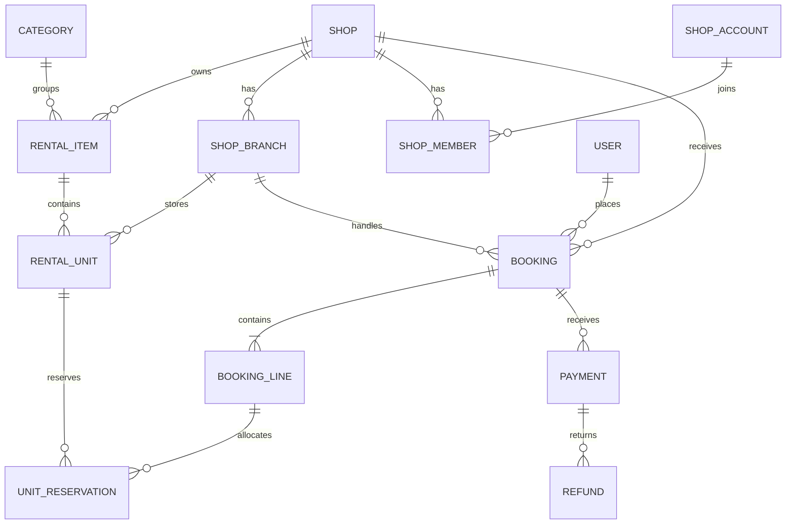

# RentHub — Roadmap Laravel 12 + Vue 3

> Dự án: nền tảng cho thuê đồ dùng nhiều shop.
> Học theo tính năng hoàn chỉnh, từ CRUD đến đặt thuê, thanh toán và vận hành thực tế.
> Đây là lộ trình dự kiến; bảng tiến độ bên dưới mới phản ánh phần đã thực hiện.

## 1. Mục tiêu và cách học

Bạn đã đi làm và có thể đọc code để hiểu nhanh. Không cần học lại từng cú pháp PHP hoặc làm nhiều bài tập rời rạc trước khi xây sản phẩm.

- Mỗi chặng tạo ra một tính năng dùng được xuyên suốt database → backend → giao diện.
- Giải thích PHP/OOP, HTTP, SQL tại chỗ khi tính năng cần đến.
- Trợ lý chuẩn bị migration/schema để bạn review; bạn tập trung code logic. Có thể nhờ tạo dữ liệu mẫu hoặc phần lặp lại.
- Viết controller trực tiếp ở chặng đầu; tách Action/Service khi logic và transaction xuất hiện.
- Kiểm tra tay luồng mới trước, bổ sung test cho hành vi và rủi ro quan trọng trong cùng chặng.
- Giữ PHPUnit hiện có. Pest là lựa chọn cú pháp, không phải điều kiện để đi tiếp.
- Không tạo interface, repository hoặc microservice khi chưa có nhu cầu cụ thể.
- Mỗi tính năng có tiêu chí hoàn thành; hiểu và làm được thì chuyển tiếp, không cần chia thành nhiều buổi nhỏ.

Không dự án nào sử dụng mọi API của Laravel. Đích đến là làm chủ các phần cốt lõi, tự lựa chọn công cụ và vận hành được ứng dụng có giao dịch, phân quyền và tác vụ nền.

## 2. Sản phẩm đang xây

**RentHub** cho phép khách thuê đồ của các shop: máy ảnh, máy chơi game, lều trại, dụng cụ và thiết bị sự kiện.

Luồng chính:

1. Chủ shop đăng đồ, ảnh, giá thuê theo ngày và mức cọc.
2. Khách tìm đồ, chọn khoảng ngày và nhận báo giá.
3. Hệ thống giữ một món đồ cụ thể trong thời gian chờ thanh toán.
4. Khách thanh toán, shop xác nhận và bàn giao.
5. Khách trả đồ; shop kiểm tra tình trạng, tính phí phát sinh và hoàn cọc.
6. Hai bên xem lịch sử; khách đánh giá đơn đã hoàn tất.

### Vai trò

| Vai trò              | Phạm vi                                               |
| -------------------- | ----------------------------------------------------- |
| Khách chưa đăng nhập | Tìm kiếm, xem đồ, xem shop và lịch còn trống          |
| Khách hàng           | Đặt thuê, thanh toán, xem đơn của mình, đánh giá      |
| Chủ shop             | Quản lý đồ, nhân viên, đơn và doanh thu của shop mình |
| Nhân viên            | Xử lý công việc được cấp quyền trong shop             |
| Quản trị nền tảng    | Duyệt shop, kiểm duyệt nội dung, hỗ trợ tranh chấp    |

Tách tài khoản khách hàng và tài khoản quản lý shop. `users` chỉ chứa khách hàng; `shops` lưu thông tin cửa hàng và liên hệ chủ shop, không có khóa ngoại owner_id đến users. Đến chặng xác thực, dùng `shop_accounts` riêng cho người đăng nhập quản lý và `shop_members` để cấp quyền theo shop. Thông tin liên hệ chủ shop không thay thế thông tin xác thực.

### Phạm vi tăng dần

- **MVP:** một shop với chi nhánh nhận/trả, danh mục, đồ cho thuê, ảnh, lịch trống, đặt thuê và bàn giao thủ công.
- **Bản giao dịch:** giữ chỗ có hạn, thanh toán sandbox, hủy đơn, hoàn tiền và thông báo.
- **Bản nền tảng:** nhiều shop, nhân viên, kiểm duyệt và báo cáo.
- **Bản vận hành:** realtime, tối ưu truy vấn, CI/CD, giám sát và phục hồi dữ liệu.

Chưa làm ví rút tiền, đấu giá, AI gợi ý hoặc microservice trong MVP.

## 3. Source và môi trường hiện tại

| Hạng mục                   | Hiện trạng                                                                        |
| -------------------------- | --------------------------------------------------------------------------------- |
| Backend                    | Laravel 12, PHP trong Docker, Composer                                            |
| Database                   | Có MySQL 8.4 trong Docker (`laravel_practice`); `.env` local hiện vẫn chọn SQLite |
| Docker service             | `app` và `db`                                                                     |
| Backend URL                | `http://localhost:8000`                                                           |
| Ping                       | `GET /api/ping`, khai báo trong `routes/web.php` với prefix `api`                 |
| Sanctum                    | Đã cài package, có config và migration; chưa xây đăng nhập                        |
| Frontend                   | Chưa tạo Vue app riêng                                                            |
| Migration nghiệp vụ        | Có `create_rental_items_table`, chưa tự chạy migrate                              |
| Model/Controller nghiệp vụ | Chưa tạo; đây là phần bạn sẽ code tiếp                                            |
| Test                       | PHPUnit; test mẫu và smoke test ping                                              |

```text
laravel-practice/
├── .docker/Dockerfile
├── docker-compose.yml
├── app/
├── bootstrap/app.php
├── database/migrations/
├── routes/web.php
├── resources/views/welcome.blade.php
├── tests/
├── docs/roadmap.md
├── composer.json
└── frontend/                  # Tạo ở chặng 2
```

Laravel hiện nằm ngay gốc repo. Service trong Compose là `app`; tên container do Docker tạo thường là `laravel-practice-app-1`. `docker compose exec` dùng tên service, còn `docker exec` dùng tên/ID container.

### Dựng source lần đầu

Chạy từ thư mục gốc repo bằng PowerShell:

```powershell
if (!(Test-Path .env)) { Copy-Item .env.example .env }
docker compose build
docker compose up -d --wait db
docker compose run --rm --no-deps app composer install
# Chỉ sinh key khi APP_KEY chưa có; không đổi key của môi trường đang dùng.
docker compose run --rm --no-deps app php artisan key:generate
docker compose run --rm --no-deps app php artisan migrate
docker compose up -d app
```

`.env.example` đã cấu hình MySQL khớp `docker-compose.yml`. Laravel dùng `DB_HOST=db`, `DB_PORT=3306`; DBeaver/TablePlus trên máy dùng host `127.0.0.1`, cổng `3307`, tài khoản theo Compose. Không commit `.env`.

**Trước khi làm CRUD:** `.env` local hiện còn `DB_CONNECTION=sqlite`. Muốn dùng MySQL theo roadmap, cập nhật toàn bộ nhóm `DB_CONNECTION`, `DB_HOST`, `DB_PORT`, `DB_DATABASE`, `DB_USERNAME`, `DB_PASSWORD` theo `.env.example`, rồi chạy `php artisan config:clear` và `php artisan migrate` trong container. Chỉ bật container MySQL không tự chuyển database của Laravel; dữ liệu SQLite cũ cũng không tự được chuyển sang MySQL. Giữ nguyên APP_KEY và các cấu hình local khác.

Không chạy `composer create-project` trong repo có sẵn. Trang chào và ping không cần npm/Vite. Giữ nguyên khai báo yêu cầu PHP hiện tại; việc nâng/chỉnh dependency không thuộc lần chuyển dự án này.

### Lệnh thường dùng

```bash
docker compose up -d
docker compose ps
docker compose exec app bash
docker compose exec app php artisan route:list
docker compose exec app php artisan migrate:status
docker compose exec app php artisan migrate
docker compose exec app php artisan test
docker compose exec app vendor/bin/pint --test
docker compose logs -f app
docker compose down
```

Đã vào shell container thì dùng trực tiếp `php artisan ...` và `composer ...`. Trong WSL, đường dẫn repo là `/mnt/d/Code/Be/laravel-practice`. Không dùng `down -v` hoặc `migrate:fresh` với database có dữ liệu cần giữ.

### Quy ước route và CSRF

Giữ `/api/ping` trong `web.php` như hiện tại. Prefix `api` chỉ đổi URL, không đổi middleware: route này vẫn thuộc nhóm `web` có session và CSRF.

**Trước khi thêm POST/PUT/PATCH/DELETE ở chặng 1, chọn và kiểm tra một cơ chế:**

- Tiếp tục dùng `web.php`: request ghi dữ liệu phải mang session cookie và CSRF token hợp lệ; dùng form Blade có `@csrf` hoặc client gửi token tương ứng.
- Khi tách JSON API: tạo `routes/api.php` và đăng ký `api: __DIR__.'/../routes/api.php'` trong `bootstrap/app.php`; chuyển route nghiệp vụ sang đó. Prefix `/api` do cấu hình API thêm, không bọc thêm prefix lần nữa.

Không tự động chuyển route trong lần đổi dự án này. Không tắt CSRF toàn ứng dụng để né lỗi 419. Chỉ đăng ký file route có tồn tại và tránh khai báo một endpoint ở cả hai file.

Đến chặng Sanctum SPA, thiết lập đầy đủ stateful API, cookie/session, CORS và `/sanctum/csrf-cookie`. Cài package Sanctum riêng lẻ chưa tạo ra luồng đăng nhập hoạt động.

## 4. Quy tắc nghiệp vụ thống nhất

### Đồ đăng bán và món đồ vật lý

`shops` là thương hiệu/cửa hàng; `shop_branches` là từng địa điểm giữ đồ và giao nhận. Địa chỉ, số điện thoại chi nhánh và tọa độ nằm ở chi nhánh. Shop có một địa điểm thì vẫn tạo một chi nhánh đầu tiên trong luồng tạo shop, không tự tạo địa chỉ giả trong migration. Tạo shop và chi nhánh đầu tiên trong cùng transaction khi làm API đăng ký shop.

`rental_items` là mẫu đồ/listing chung của shop, ví dụ “Sony A6400”. `rental_units` là từng chiếc có mã riêng, ví dụ `CAM-001`, `CAM-002`, thuộc listing và một chi nhánh cụ thể. Không gắn listing cố định vào một chi nhánh vì nhiều chi nhánh có thể cùng cho thuê mẫu đồ đó.

Chặng 1 chỉ xây listing; chặng 3 mới thêm các chiếc cụ thể. Tồn khả dụng được xác định theo lịch của từng chiếc, không chỉ nhìn một cột số lượng tồn.

### Thời gian và báo giá

- MVP thuê theo ngày, dùng khoảng **[start_date, end_date)**: có ngày bắt đầu, không gồm ngày kết thúc.
- Từ 10/11 đến 12/11 tính 2 ngày; `end_date` phải lớn hơn `start_date`.
- Hai khoảng trùng nhau khi `existing.start_date < requested.end_date` và `existing.end_date > requested.start_date`.
- Một chiếc trả ngày 12/11 có thể được đặt tiếp từ ngày 12/11. Khi thêm thời gian kiểm tra/vệ sinh, phải cập nhật quy tắc này và test.
- Ngày thuê theo múi giờ shop; MVP dùng `Asia/Ho_Chi_Minh`. Timestamp sự kiện được lưu theo UTC và hiển thị có chuyển múi giờ.
- Giá và tiền cọc dùng **số nguyên VND**, không dùng float. Các phép tính có kiểm tra số âm và giới hạn hợp lý.
- Lưu snapshot tên đồ, giá/ngày, số ngày, tiền cọc và giảm giá trong đơn; đổi giá listing không làm đổi đơn cũ.

### Đơn, giữ chỗ và thanh toán

```text
pending_payment → confirmed → picked_up → returned → completed
pending_payment → expired hoặc cancelled
confirmed → cancelled (theo chính sách hủy)
```

- MVP mỗi đơn thuộc một shop và một chi nhánh nhận/trả; giỏ nhiều shop hoặc nhiều chi nhánh phải tách đơn. Mỗi chiếc được phân bổ phải thuộc đúng shop và chi nhánh của đơn. Nhận và trả cùng chi nhánh; trả khác nơi cần thêm nghiệp vụ điều chuyển ở giai đoạn sau.
- Đơn `pending_payment` chỉ giữ lịch đến `hold_expires_at`; `confirmed` và `picked_up` tiếp tục chiếm lịch.
- MVP có thể xác nhận thanh toán thủ công. Đến chặng 6 mới tích hợp sandbox.
- Trạng thái thanh toán/hoàn tiền nằm riêng với trạng thái thuê. Trả đồ không đồng nghĩa đã hoàn cọc.
- Máy đang bảo trì hoặc ngừng hoạt động không được giữ chỗ mới.
- Không gọi API thanh toán trong khi đang giữ transaction/row lock của kho.
- Hủy đơn và hết hạn phải giải phóng lịch đúng một lần.

## 5. Mô hình dữ liệu đích

Đây là bản đồ thiết kế, **không tạo hết migration ngay đầu dự án**.

| Nhóm           | Bảng dự kiến                                        | Mục đích                                                 |
| -------------- | --------------------------------------------------- | -------------------------------------------------------- |
| Danh mục       | `categories`, `rental_items`, `item_images`         | Listing, phân loại, ảnh và thứ tự ảnh                    |
| Kho vật lý     | `rental_units`, `maintenance_periods`               | Từng chiếc, tình trạng, lịch bảo trì                     |
| Tài khoản/shop | `users`, `shops`, `shop_branches`, `shop_accounts`, `shop_members`                    | Khách hàng tách tài khoản quản lý shop và quyền theo shop                 |
| Đặt thuê       | `bookings`, `booking_lines`, `unit_reservations`    | Đơn, snapshot báo giá, phân bổ từng chiếc và khoảng thuê |
| Thanh toán     | `payments`, `payment_events`, `refunds`             | Giao dịch, webhook đã nhận, hoàn tiền                    |
| Giao nhận      | `handover_records`, `damage_reports`                | Checklist, ảnh bằng chứng, phí và người xác nhận         |
| Cộng đồng      | `favorites`, `reviews`, `conversations`, `messages` | Yêu thích, đánh giá, chat                                |
| Vận hành       | `notifications`, `audit_logs`                       | Thông báo và lịch sử thao tác                            |

Quan hệ chính:



Index theo đường truy vấn thực tế: listing theo shop/trạng thái/danh mục, đơn theo shop/trạng thái/ngày, reservation theo unit/khoảng ngày. Unique cho mã chiếc trong shop, mã đơn và định danh giao dịch nhà cung cấp. Index thông thường không tự ngăn hai khoảng ngày giao nhau; phần đó cần transaction và locking.

## 6. Chặng 1 — CRUD shop, chi nhánh và đồ cho thuê

**Đầu ra:** quản lý shop trước, rồi quản lý listing trong từng shop bằng HTTP, có phân trang và validation.

Migration chạy theo thứ tự `shops` → `shop_branches` → `rental_items`. Bảng `shops` gồm `id`, `shop_name`, `owner_name`, `owner_phone` (varchar 20), `owner_email` nullable, `description` nullable, `is_active` mặc định true và timestamps. Không liên kết chủ shop đến khách hàng trong users. Một shop có nhiều đồ cho thuê; owner_email là liên hệ, không bắt buộc unique và chưa phải tài khoản đăng nhập.

Bảng `shop_branches` gồm `id`, `shop_id`, `branch_name`, `address` (varchar 500), `phone` nullable, `latitude`/`longitude` (decimal 10,7) nullable, `is_active` và timestamps. Tọa độ phải cùng có hoặc cùng trống; validation giới hạn latitude [-90,90], longitude [-180,180]. Shop còn chi nhánh không được xóa cứng.

`rental_items.shop_id` bắt buộc, tham chiếu `shops.id`. Không xóa shop khi còn listing; khóa ngoại dùng restrict, tránh xóa dây chuyền dữ liệu nghiệp vụ.

Schema `rental_items`:

| Cột              | Kiểu                        | Ý nghĩa               |
| ---------------- | --------------------------- | --------------------- |
| `id`             | bigint PK                   | ID                    |
| `shop_id`        | foreign ID, bắt buộc         | Shop sở hữu listing   |
| `item_name`      | varchar(255)                | Tên đồ                |
| `description`    | text nullable               | Mô tả                 |
| `rental_price_per_day`     | unsigned bigint             | Giá thuê/ngày, VND    |
| `deposit_amount` | unsigned bigint, mặc định 0 | Tiền cọc, VND         |
| `is_active`      | boolean, mặc định true      | Có cho thuê hay không |
| timestamps       | timestamp                   | Ngày tạo/cập nhật     |

### Việc làm

1. Review migration do trợ lý chuẩn bị, chạy migrate; tạo model `Shop`, `RentalItem`, quan hệ Shop/ShopBranch/RentalItem, fillable và casts.
2. Viết `ShopController` CRUD trước, rồi CRUD `ShopBranch` theo shop và `RentalItemController` với index/store/show/update/destroy theo shop. Model Shop và ShopBranch đã có quan hệ branches()/shop(); tạo chi nhánh qua $shop->branches()->create(...).
3. Chốt cơ chế route/CSRF ở mục 3 trước khi thử endpoint ghi dữ liệu.
4. Tạo `StoreRentalItemRequest`, `UpdateRentalItemRequest`; dùng `validated()`.
5. Tạo `RentalItemResource` để ổn định response; danh sách có phân trang, giới hạn `per_page`.
6. Tìm theo tên, lọc `is_active`; chỉ cho sort theo danh sách cột được phép.
7. Factory/seeder tạo dữ liệu giả; không để controller tự sinh dữ liệu mẫu.

| Endpoint                                | Hành vi              |
| --------------------------------------- | -------------------- |
| `GET /api/shops` | Danh sách shop phân trang |
| `POST /api/shops` | Tạo shop, trả 201 |
| `GET /api/shops/{shop}` | Chi tiết shop |
| `PATCH /api/shops/{shop}` | Cập nhật shop |
| `DELETE /api/shops/{shop}` | Xóa shop rỗng; shop còn chi nhánh/listing trả lỗi nghiệp vụ |
| `GET /api/shops/{shop}/branches` | Danh sách chi nhánh |
| `POST /api/shops/{shop}/branches` | Thêm chi nhánh |
| `GET/PATCH/DELETE /api/shops/{shop}/branches/{branch}` | Xem/sửa/xóa chi nhánh thuộc shop |
| `GET /api/shops/{shop}/rental-items` | Danh sách đồ trong shop |
| `POST /api/shops/{shop}/rental-items` | Thêm đồ vào shop, trả 201 |
| `GET /api/shops/{shop}/rental-items/{rentalItem}` | Chi tiết đồ trong shop hoặc 404 |
| `PATCH /api/shops/{shop}/rental-items/{rentalItem}` | Sửa đồ trong shop |
| `DELETE /api/shops/{shop}/rental-items/{rentalItem}` | Xóa đồ trong shop, trả 204 |

Lấy shop từ route và tạo listing qua quan hệ; không nhận `shop_id` tùy ý từ payload. Dùng scoped binding hoặc query qua shop để chặn URL ghép shop A với đồ của shop B. Chưa có auth thì CRUD shop và thông tin liên hệ chỉ thực hành local. Khi triển khai đăng nhập quản lý, kiểm tra tài khoản shop và quyền thành viên; không coi shop_id hoặc owner_email do client gửi là bằng chứng sở hữu.

Dùng route model binding. Update cho phép bỏ qua trường không sửa; nếu có truyền thì phải hợp lệ. `rental_price_per_day` bắt buộc và lớn hơn 0; tiền cọc không âm; `is_active` là boolean. Xóa cứng listing chỉ dùng ở chặng đầu; trước khi có đơn phải đổi sang lưu trữ/ẩn để giữ lịch sử.

**Hoàn thành khi:** thêm/xem/sửa/xóa chạy được; input sai trả 422 khi request nhận JSON; ID không tồn tại trả 404; dữ liệu lưu MySQL thật; có feature test cho CRUD và validation. Các endpoint ghi dữ liệu chưa có phân quyền chỉ chạy local cho đến chặng 4.

## 7. Chặng 2 — Vue và danh mục có ảnh

**Đầu ra:** khách duyệt listing; có màn hình quản lý đồ dùng được.

- Tạo `frontend/` bằng Vue 3 + TypeScript, Vue Router; Vite chạy trên máy, không dùng Vite gốc Laravel cho SPA này.
- Màn hình danh sách dạng card ảnh, chi tiết, form thêm/sửa; trạng thái loading/rỗng/lỗi/422 và phân trang.
- Tách client HTTP và kiểu dữ liệu; component không rải URL API khắp nơi.
- Thêm `categories`, `category_id`, `item_images`, ảnh bìa, thứ tự ảnh.
- Upload qua Laravel Storage; kiểm tra MIME, dung lượng và quyền ghi/xóa; không tin tên file client.
- Local disk trước, object storage sau; quản lý xóa ảnh cũ và file bị bỏ dở.
- Dùng eager loading, kiểm tra N+1, giới hạn dữ liệu và trường JSON trả ra.
- Kết nối frontend/backend có CORS đúng origin. Nếu dùng web routes, xử lý session/CSRF đầy đủ.

**Hoàn thành khi:** thao tác CRUD từ UI được; ảnh tải lên/hiển thị/xóa đúng; filter và phân trang đồng bộ; test API upload bằng fake storage và kiểm tra loại file sai.

## 8. Chặng 3 — Kho vật lý và lịch còn trống

**Đầu ra:** chọn ngày và biết còn chiếc nào cho thuê.

- Thêm `rental_units`: mã chiếc, rental_item_id, shop_branch_id, tình trạng hoạt động/bảo trì. Kiểm tra listing và chi nhánh cùng shop; hai khóa ngoại độc lập chưa tự đảm bảo điều đó. Đến chặng này chọn composite constraint hoặc ràng buộc tương đương để giữ tính nhất quán.
- Thêm lịch bảo trì; không sửa một cột available thủ công để biểu diễn mọi thời điểm.
- Viết query tìm các chiếc không giao khoảng thuê và không bị bảo trì.
- Endpoint `GET /api/rental-items/{rentalItem}/availability?branch_id=...&start_date=...&end_date=...`.
- Viết báo giá dùng số nguyên và khoảng ngày đã thống nhất; chưa giữ lịch tại bước báo giá.
- Xem SQL, query plan, index; dùng eager loading đúng mức.

**Hoàn thành khi:** kiểm tra được các khoảng chạm biên, trùng một phần, bao trùm, không còn chiếc, bảo trì; báo giá 2 ngày đúng như tính tay. Đây là lúc học sâu SQL và quan hệ Eloquent, thay vì chỉ gọi ORM theo mẫu.

## 9. Chặng 4 — Tài khoản, một shop và phân quyền

**Đầu ra:** khách có tài khoản; chủ shop quản lý đồ và nhân viên đúng quyền.

- Đăng ký, đăng nhập, đăng xuất, người dùng hiện tại; hash mật khẩu, rate limit đăng nhập.
- Chọn Sanctum SPA cookie cho frontend first-party; hoàn thiện CSRF/session/CORS. Token dùng cho client phù hợp, không mặc định lưu token dài hạn trong localStorage.
- Xác minh email, đặt lại mật khẩu; Mail/Notification và mail giả lập khi test.
- `shops`, thông tin liên hệ chủ shop và `rental_items.shop_id` đã có từ chặng 1. Bổ sung `shop_accounts` cho thông tin đăng nhập riêng và `shop_members` (shop_account_id, shop_id, vai trò chủ/nhân viên); không tạo lại bảng shop, không dùng users làm tài khoản quản lý.
- Cấu hình provider/guard phù hợp cho khách hàng và tài khoản shop; kiểm tra đúng loại danh tính ở từng nhóm route. Policy cho xem/sửa/xóa, thêm nhân viên; lấy danh tính từ request đã xác thực.
- Vue có trạng thái đăng nhập, Pinia khi cần chia sẻ state, router guard; backend vẫn là nơi quyết định quyền.
- Nhóm quản trị dùng endpoint riêng; listing công khai chỉ trả dữ liệu được phép.

**Hoàn thành khi:** khách không sửa được listing; nhân viên không tự nâng quyền; user không đọc/sửa tài nguyên shop khác bằng cách đổi ID; test 401/403 và luồng xác thực.

## 10. Chặng 5 — Đặt thuê và chống trùng lịch

**Đầu ra:** tạo đơn có snapshot báo giá và phân bổ từng chiếc an toàn.

- Thêm `bookings`, `booking_lines`, `unit_reservations`, `hold_expires_at`.
- Tách `CreateBooking`, `CancelBooking`, `ConfirmBooking` thành Action khi logic vượt khỏi HTTP.
- Dùng enum cho trạng thái và quy tắc chuyển trạng thái tập trung.
- Trong transaction, khóa các dòng `rental_units` theo thứ tự ổn định bằng `lockForUpdate`, kiểm tra lại lịch rồi mới ghi reservation.
- Mọi luồng đặt/hủy/bảo trì cùng tuân thủ giao thức khóa; chỉ khóa kết quả query reservation rỗng là chưa đủ.
- Giữ chỗ có hạn; scheduler giải phóng đơn hết hạn theo batch, thao tác có thể chạy lại an toàn.
- Chặn double submit bằng khóa idempotency có unique constraint và quy định payload tương ứng.
- Có thể xác nhận cọc thủ công qua thao tác có quyền trước khi tích hợp payment gateway.

**Hoàn thành khi:** hai request đồng thời tranh một chiếc chỉ một request thành công; hết hạn/hủy giải phóng lịch; giá đổi sau đặt không ảnh hưởng đơn; thất bại giữa luồng rollback đủ. Kiểm tra concurrency trên MySQL thật với kết nối độc lập, không suy ra từ SQLite.

## 11. Chặng 6 — Thanh toán sandbox và hoàn tiền

**Đầu ra:** cọc và tiền thuê có lịch sử giao dịch, webhook xử lý trùng an toàn.

- Chọn một gateway có sandbox khi bắt đầu chặng này; xác minh tài liệu và chữ ký theo nhà cung cấp.
- `PaymentGateway` interface chỉ xuất hiện khi cần adapter thật/fake hoặc nhiều gateway.
- Dùng HTTP Client, timeout, retry có điều kiện; không retry giao dịch tài chính mù quáng.
- `payments`, `payment_events`, `refunds`; unique provider event/transaction ID.
- Webhook xác thực chữ ký, số tiền, loại tiền và đối chiếu đơn; redirect trên trình duyệt không là bằng chứng đã thanh toán.
- Payment, refund có trạng thái riêng; ghi audit và xử lý callback sai thứ tự.
- Tình huống thanh toán về sau khi giữ chỗ hết hạn phải có chính sách hoàn tiền/đối soát, không tự chiếm lại chiếc đã được đặt.
- Endpoint webhook bên ngoài có ngoại lệ CSRF đúng phạm vi và xác thực chữ ký thay thế.

**Hoàn thành khi:** webhook gửi nhiều lần chỉ ghi nhận một lần; tiền không khớp không xác nhận đơn; thất bại/timeout có cách đối soát; test bằng HTTP fake và payload mẫu sandbox.

## 12. Chặng 7 — Bàn giao, trả đồ và tranh chấp

**Đầu ra:** hoàn tất vòng đời thuê, biết vì sao tiền cọc được hoàn hoặc bị khấu trừ.

- Checklist giao/nhận, ảnh tình trạng, người thực hiện, thời điểm và ghi chú.
- Phí trả trễ theo chính sách được lưu snapshot; báo hư hỏng có bằng chứng.
- Chủ shop xác nhận phí, khách có luồng phản hồi; không tự trừ tiền tùy ý từ input client.
- Tách trả đồ, chốt phí, yêu cầu hoàn cọc và hoàn cọc thành các hành động rõ ràng.
- Bảo vệ file nhạy cảm; dùng authorized download/temporary URL khi cần.
- Audit thao tác nghiệp vụ, không ghi token/thông tin thanh toán nhạy cảm vào log.

**Hoàn thành khi:** chuyển trạng thái sai bị chặn; nhân viên sai shop không xem bằng chứng; trả/hoàn tiền lặp không tính hai lần; test tiền và quyền truy cập.

## 13. Chặng 8 — Event, queue và tác vụ định kỳ

**Đầu ra:** request nhanh; nhắc lịch và công việc nền có thể retry.

- Event `BookingConfirmed`, `ItemPickedUp`, `ItemReturned`; listener gửi thông báo.
- Dispatch hệ quả sau commit; khi cần đảm bảo không mất sự kiện, đánh giá outbox thay vì cho rằng queue luôn nguyên tử với DB.
- Job xử lý thumbnail, email, export CSV; chia batch và theo dõi tiến độ.
- Database queue trước; Redis/Horizon khi đã chọn Redis queue.
- Backoff, timeout, retry, failed jobs; job idempotent, payload nhỏ và tránh model cũ.
- Scheduler nhắc lịch, hết hạn giữ chỗ, đối soát; chống tác vụ chạy trùng phù hợp môi trường.
- Notification qua database/mail; người dùng chỉ đọc/đánh dấu thông báo của mình.

**Hoàn thành khi:** worker dừng không làm sai đơn; bật lại worker xử lý tiếp; retry không gửi/tính phí lặp ngoài chính sách; có cách xem và xử lý failed job.

## 14. Chặng 9 — Nhiều shop và chức năng cộng đồng

**Đầu ra:** mở cho nhiều shop, dữ liệu và quyền được cô lập.

- Mở onboarding shop, phê duyệt, khóa shop, mời nhân viên; mọi query và Policy xét shop đúng phạm vi.
- Unique code theo shop, route binding scoped khi phù hợp; test đoán ID và truy cập chéo.
- Yêu thích, review từ đơn hoàn tất; giới hạn một review theo quan hệ đơn đã xác định.
- Duyệt/ẩn review, soft delete có chủ đích; không để đánh giá ẩn lộ qua endpoint khác.
- Chỉ dùng polymorphic relation nếu thực sự có nhiều loại đối tượng chung hành vi, ví dụ audit hoặc tệp đính kèm.
- Chat theo đơn; private channel có authorization, Reverb/Echo và sự kiện sau commit.
- Đánh giá realtime để cập nhật UI; DB/API vẫn là nguồn xác nhận cuối cùng về tồn lịch.

**Hoàn thành khi:** một shop account tham gia nhiều shop vẫn đúng quyền từng shop; realtime không rò dữ liệu; review giả bị chặn. Chưa chia database riêng cho mỗi shop khi một DB với shop_id còn đáp ứng tốt.

## 15. Chặng 10 — Tìm kiếm, báo cáo và hiệu năng

**Đầu ra:** dữ liệu lớn hơn vẫn tìm được nhanh và báo cáo có số liệu kiểm chứng.

- Filter theo danh mục, shop, giá, khoảng ngày; debounce, query string, giới hạn tham số.
- Bắt đầu bằng MySQL; chỉ thêm Scout/search engine sau khi xác định nhu cầu full-text và cách đồng bộ.
- Báo cáo doanh thu phân biệt tiền thuê, tiền cọc đang giữ, tiền hoàn và phí; thống nhất ngày ghi nhận.
- Query Builder/raw SQL có binding, aggregate, index; đo bằng EXPLAIN và dữ liệu mẫu đủ lớn.
- Cache catalog/dashboard với TTL và invalidation cụ thể; không dùng cache cũ để quyết định giữ chỗ.
- `chunkById`, lazy collection, streaming cho export; không load toàn bộ đơn vào RAM.
- Rate limit theo endpoint/user; quan sát query count, memory, thời gian đáp ứng.
- Pagination cursor cho danh sách phù hợp; chọn dựa trên UX và cách sort.

**Hoàn thành khi:** có số đo trước/sau, không N+1 ở màn hình chính; báo cáo đối chiếu được với giao dịch; export lớn không timeout request.

## 16. Chặng 11 — Kiến trúc, kiểm thử và bảo mật

Thực hiện xuyên suốt rồi tổng rà ở đây, không chờ đến cuối mới bảo vệ dữ liệu.

- Controller lo HTTP; FormRequest lo input; Policy lo quyền; Action lo use case; Resource lo JSON.
- Model giữ quan hệ, casts và scope phù hợp; không gom mọi nghiệp vụ vào observer.
- Service Container, constructor injection; Service Provider để binding/configure; DTO khi có dữ liệu qua ranh giới rõ ràng.
- Exception nghiệp vụ, JSON lỗi thống nhất; không trả stack trace ở production.
- Unit test cho tính tiền/khoảng ngày; feature test cho API/quyền/transaction; integration test MySQL cho locking, sandbox cho gateway.
- Factory/Seeder, HTTP/Storage/Mail/Notification/Queue fake; không mock hết ORM để test chỉ phản ánh implementation.
- Kiểm tra giới hạn fake: `Queue::fake` không chứng minh worker chạy; SQLite không chứng minh khóa MySQL.
- Pint, Larastan/PHPStan theo mức tăng dần; frontend có type-check và test luồng form/đặt thuê.
- Kiểm soát mass assignment, XSS, SQL injection, upload, IDOR, brute force và webhook giả.
- Localization cho nội dung/thông báo khi cần; config và env tách rõ, không gọi env tùy tiện trong nghiệp vụ.
- Viết Artisan command đối soát hoặc import có dry-run, báo cáo lỗi và khả năng tiếp tục.

**Hoàn thành khi:** sửa công thức/Policy có test bắt lỗi; CI tự chạy kiểm tra; tài liệu giải thích được lựa chọn kiến trúc và giới hạn hiện tại.

## 17. Chặng 12 — Triển khai và vận hành

**Đầu ra:** bản staging chạy được và có quy trình cập nhật/phục hồi.

- Image production đóng gói source/vendor; nginx + PHP-FPM thay `artisan serve`; dùng build context và đường dẫn đúng cấu trúc gốc repo.
- Vue build thành file tĩnh; cấu hình API URL, SPA fallback, HTTPS/cookie/CORS theo domain thực tế.
- Tách web, worker, scheduler; quản lý process và restart worker sau deploy.
- CI chạy Composer install, Pint, static analysis, test; frontend lint/type-check/test/build.
- CI test độc lập bằng SQLite khi phù hợp và MySQL cho test đặc thù; không nối DB dev/production.
- Quản lý secrets; APP_DEBUG=false; quyền storage/cache; không đưa .env vào image/git.
- Migration tương thích bản cũ khi rolling deploy; sao lưu trước thay đổi khó đảo ngược.
- Config/route/view cache, health/readiness, log tập trung, cảnh báo failed job và lỗi thanh toán.
- Sao lưu DB và file, kiểm tra khôi phục; backup chưa thử restore chưa chứng minh phục hồi được.
- Redis/Horizon theo nhu cầu; Octane chỉ sau profiling và đánh giá trạng thái sống lâu của worker.

**Hoàn thành khi:** người khác dựng staging theo README được; deploy không mất đơn/file; phục hồi được bản sao lưu; biết cách rollback ứng dụng và xử lý migration đã chạy.

## 18. Bản đồ kiến thức để tự kiểm tra

| Nhóm Laravel                                          | Nơi thực hành         |
| ----------------------------------------------------- | --------------------- |
| Routing, middleware, lifecycle, HTTP, exception       | Chặng 1, 4, 11        |
| Migration, Eloquent, binding, relations, casts, scope | Chặng 1–5             |
| Validation, Resource, pagination                      | Chặng 1–2             |
| Session, CSRF, Sanctum, auth, Gate/Policy, rate limit | Chặng 1, 4, 9–11      |
| Storage, upload, private file, filesystem fake        | Chặng 2, 7            |
| DB transaction, lock, concurrency, query/index        | Chặng 3, 5, 10        |
| Container, Provider, interface, DTO, Action           | Chặng 5–6, 11         |
| HTTP Client, webhook, signed payload, idempotency     | Chặng 6               |
| Event, Listener, Queue, Job, Mail, Notification       | Chặng 8               |
| Scheduler, Artisan command, batch import/export       | Chặng 8, 10–11        |
| Broadcasting, private channel, Reverb                 | Chặng 9               |
| Cache, Redis, profiling, search                       | Chặng 10              |
| Factory, Seeder, unit/feature/integration test        | Xuyên suốt từ chặng 1 |
| Localization, config, logging, CI/CD, deployment      | Chặng 11–12           |

Blade vẫn được học qua trang chào, form/session và mail template; sản phẩm chính dùng Vue SPA. Package nâng cao chỉ thêm khi có bài toán, không cài tất cả để đủ danh sách.

## 19. Tiến độ và việc tiếp theo

- [x] Laravel + Docker + MySQL chạy được.
- [x] Có ping trong web routes.
- [x] Chọn nghiệp vụ RentHub và cập nhật tài liệu.
- [x] Có migration `shops` và `rental_items` với khóa ngoại.
- [ ] Chạy migration mới.
- [ ] Tạo Shop CRUD → chi nhánh theo shop → RentalItem CRUD theo shop.
- [ ] Chốt route/CSRF cho endpoint ghi dữ liệu.
- [ ] FormRequest, Resource, Factory/Seeder và feature test CRUD.
- [ ] Tạo Vue app và màn hình catalog.
- [ ] Các chặng đặt thuê, thanh toán và mở nhiều shop.

**Việc ngay tiếp theo:** làm trọn chặng 1. Migration đã chuẩn bị sẵn; bạn tập trung Model → Controller → Validation → Resource → Route và kiểm tra HTTP. Chưa cần học một loạt class PHP thuần trước CRUD.

```bash
# Trong container
php artisan migrate
php artisan make:model Shop
php artisan make:controller ShopController --api
php artisan make:model RentalItem
php artisan make:controller RentalItemController --api
php artisan make:request StoreRentalItemRequest
php artisan make:request UpdateRentalItemRequest
php artisan make:resource RentalItemResource
```

### Checklist trước khi coi một tính năng là xong

- Chạy được happy path, dữ liệu rỗng, input sai, tài nguyên không tồn tại.
- Quyền và phạm vi shop được kiểm tra phía backend.
- Giá/ngày/trạng thái có quy tắc và test cho biên quan trọng.
- Ghi nhiều bảng có transaction; tác vụ ngoài hệ thống được xử lý sau commit phù hợp.
- Không N+1 rõ ràng, không trả dữ liệu nhạy cảm hoặc list không giới hạn.
- Test và Pint qua; ghi ngắn điều đã hiểu, điều còn chưa rõ; commit theo tính năng.

### Khi bị kẹt

Đọc response HTTP → route:list → log Laravel → truy vấn/DB → test tái hiện. Đặt breakpoint hoặc dùng dump trong local; gỡ trước khi commit. Hỏi theo tình huống cụ thể: input, kết quả mong đợi, kết quả thực tế và lỗi.

### Ghi chú schema khách hàng

Các trường phone, avatar_path và suspended_at nằm trực tiếp trong migration users gốc; không còn migration add_profile_fields riêng. Migration users gốc đã được áp dụng trên SQLite local trước thay đổi này, nên migrate thông thường không tự thêm ba cột vào bảng cũ. Khi dựng database mới, schema đầy đủ được tạo ngay; nếu giữ database cũ thì cần migration nâng cấp riêng. Không tự reset database đang có dữ liệu.
