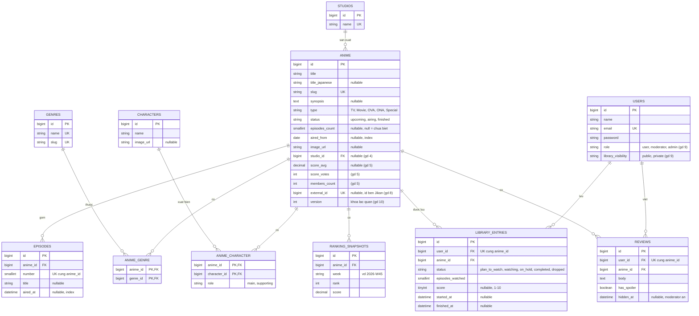

# Lộ trình tự học Laravel 12 + Vue 3: từ Beginner đến Advanced

> Học đến đâu, code đến đó. Mỗi bước có bài tập làm được ngay, tiêu chí hoàn thành và câu hỏi tự kiểm tra kèm đáp án.
> Tài liệu này được viết để **học một mình ở nhà, không cần AI**.

---

## Mục lục

0. [Cách dùng tài liệu này](#0-cách-dùng-tài-liệu-này)
1. [AniTrack là gì: mô tả dự án và giao diện](#1-anitrack-là-gì-mô-tả-dự-án-và-giao-diện)
2. [Chạy Laravel bằng Docker](#2-chạy-laravel-bằng-docker)
3. [Bộ công cụ tự học không cần AI](#3-bộ-công-cụ-tự-học-không-cần-ai)
4. [Giai đoạn 1 – Khởi động Laravel & tư duy lập trình](#giai-đoạn-1--khởi-động-laravel--tư-duy-lập-trình-beginner)
5. [Giai đoạn 2 – Laravel cơ bản: CRUD API đầu tiên](#giai-đoạn-2--laravel-cơ-bản-crud-api-đầu-tiên-beginner)
6. [Giai đoạn 3 – Vue 3 + TypeScript cơ bản](#giai-đoạn-3--vue-3--typescript-cơ-bản-beginner)
7. [Giai đoạn 4 – Database & quan hệ dữ liệu](#giai-đoạn-4--database--quan-hệ-dữ-liệu-intermediate)
8. [Giai đoạn 5 – OOP & SOLID trong nghiệp vụ thật](#giai-đoạn-5--oop--solid-trong-nghiệp-vụ-thật-intermediate)
9. [Giai đoạn 6 – Clean Code, Testing & Refactor](#giai-đoạn-6--clean-code-testing--refactor-intermediate)
10. [Giai đoạn 7 – Kiến trúc Vue](#giai-đoạn-7--kiến-trúc-vue-intermediate--advanced)
11. [Giai đoạn 8 – Design Patterns dùng đúng chỗ](#giai-đoạn-8--design-patterns-dùng-đúng-chỗ-advanced)
12. [Giai đoạn 9 – Kiến trúc Laravel nâng cao](#giai-đoạn-9--kiến-trúc-laravel-nâng-cao-advanced)
13. [Giai đoạn 10 – Tư duy thiết kế hệ thống](#giai-đoạn-10--tư-duy-thiết-kế-hệ-thống-advanced)
14. [Bài học từ codebase thực tế (ShopManager-Renew)](#bài-học-từ-codebase-thực-tế-shopmanager-renew)
15. [Checklist tự review code](#checklist-tự-review-code)
16. [Nhật ký học tập & lịch học](#nhật-ký-học-tập--lịch-học)

---

## 0. Cách dùng tài liệu này

### Mỗi bài học có cùng một cấu trúc

| Phần | Bạn làm gì |
| --- | --- |
| **Kiến thức** | Đọc phần giải thích ngắn + link tài liệu chính thức. |
| **Cách tư duy** | Câu hỏi bạn phải tự trả lời *trước khi* code. |
| **Nguyên tắc code** | Luật ngắn, áp dụng ngay. |
| **Ví dụ** | Code mẫu đọc hiểu được, **gõ lại bằng tay**, không copy-paste. |
| **Bài tập** | Việc cụ thể trong dự án AniTrack, có tiêu chí hoàn thành. |
| **Tự kiểm tra** | Câu hỏi + đáp án ẩn. Trả lời ra giấy trước rồi mới mở đáp án. |

### Quy tắc vàng

1. **Gõ tay, không copy.** Gõ lại làm não phải xử lý từng dòng. Copy thì không.
2. **Làm xong bài tập mới sang bài tiếp.** "Xong" nghĩa là đạt hết tiêu chí hoàn thành, không phải "chạy được là được".
3. **Mỗi giai đoạn chạy độc lập.** Giai đoạn N chỉ dùng kiến thức từ giai đoạn 1..N. Không cần biết giai đoạn sau.
4. **Bí 20 phút → làm theo [Thang gỡ bí](#32-thang-gỡ-bí-khi-không-có-ai).** Không bỏ cuộc, không đoán mò.
5. **Commit sau mỗi bài tập** với message nói rõ đã làm gì. Lịch sử git chính là bằng chứng bạn tiến bộ.

> **Về các lệnh trong tài liệu:** tài liệu viết lệnh ngắn gọn (`php artisan ...`, `composer ...`, `npm ...`). Laravel chạy bằng Docker (mục 2), nên lệnh **PHP/Composer/Artisan** chạy **trong container**: thêm `docker compose exec backend` phía trước. Ví dụ `php artisan test` → `docker compose exec backend php artisan test`. Mục 2.5 có cách đặt lệnh tắt cho đỡ gõ. Còn lệnh **npm/npx** của frontend chạy **thẳng trên máy** trong thư mục `frontend/`, không cần tiền tố.

### Thuật ngữ bạn sẽ gặp

Đọc lướt một lần, sau đó quay lại tra khi gặp từ lạ.

| Thuật ngữ | Nghĩa ngắn |
| --- | --- |
| **API** | Cách để chương trình này gọi chương trình khác qua HTTP. Ở đây: Vue gọi Laravel. |
| **JSON** | Định dạng văn bản để trao đổi dữ liệu, ví dụ `{"title": "Frieren"}`. |
| **CRUD** | Create / Read / Update / Delete: thêm, xem, sửa, xóa. |
| **Route** | Khai báo "URL + method nào thì chạy code nào". |
| **Controller** | Class nhận request, gọi logic, trả response. |
| **Model / Eloquent** | Model là class đại diện một bảng. Eloquent là ORM của Laravel: thao tác bảng bằng code PHP thay vì viết SQL. |
| **Migration** | File code mô tả thay đổi cấu trúc database, chạy bằng `php artisan migrate`. |
| **Factory / Seeder** | Factory sinh dữ liệu giả. Seeder nạp dữ liệu mẫu vào database. |
| **FormRequest** | Class riêng chứa luật validate cho một request. |
| **Resource** | Class quyết định JSON trả về trông thế nào. |
| **Middleware** | Lớp chặn request trước khi tới controller (đăng nhập, giới hạn tốc độ…). |
| **SPA** | Single Page Application: trang web chỉ tải một lần, chuyển màn hình bằng JavaScript (Vue). |
| **Component** | Mảnh giao diện dùng lại được trong Vue (file `.vue`). |
| **Props / Emits** | Props: dữ liệu cha truyền xuống con. Emits: sự kiện con báo lên cha. |
| **State** | Dữ liệu đang giữ trong bộ nhớ của ứng dụng (danh sách, ô đang nhập…). |
| **Image / Container** | Docker: image là bản đóng gói, container là bản đang chạy của image. |
| **ERD** | Sơ đồ các bảng và quan hệ giữa chúng. |
| **N+1** | Lỗi hiệu năng: 1 query lấy danh sách rồi thêm N query nữa cho từng dòng. |
| **Idempotent** | Làm 2 lần cho kết quả giống làm 1 lần. |

### Chuẩn bị máy (làm một lần)

- **VS Code** và các extension: *PHP Intelephense*, *Laravel* (hoặc *Laravel Extra Intellisense*), *Vue - Official*, *ESLint*, *Prettier*, *REST Client*, *Docker*, *Markdown Preview Mermaid Support*.
- **Trình duyệt** Chrome hoặc Edge, cài thêm extension **Vue.js devtools**.
- **Công cụ xem database:** DBeaver (miễn phí) hoặc TablePlus.
- Cài Docker, Git và Node.js theo mục 2.1.

### Git tối thiểu

```bash
cd anitrack
git init
git add .
git commit -m "chore: init repo"
```

- **Mỗi bài tập một commit**, message theo dạng `loại: nói ngắn gọn đã làm gì`:

| Loại | Dùng khi | Ví dụ |
| --- | --- | --- |
| `feat` | thêm tính năng | `feat: add anime CRUD API` |
| `fix` | sửa lỗi | `fix: slug unique khi cập nhật` |
| `refactor` | đổi cấu trúc code, hành vi giữ nguyên | `refactor: tách UpdateWatchProgress ra Action` |
| `test` | thêm hoặc sửa test | `test: cover Season boundaries` |
| `docs` | tài liệu, ghi chú | `docs: add ERD notes` |
| `chore` | việc lặt vặt (cấu hình, dependency) | `chore: install pest` |

  Đây cũng là kiểu message team ShopManager-Renew đang dùng (xem `git log` của repo công ty).
- **Mỗi giai đoạn một nhánh** (`stage-1-core`, `stage-2-anime-api`…), xong bài tập thì merge vào `main`.
- Tạo repo **private** trên GitHub rồi `git push` để có bản sao lưu. Không bao giờ commit file `.env` (Laravel và create-vue đã tự ignore).

### Thời lượng tham khảo

| Giai đoạn | Cấp độ | Thời gian (45–60 phút/ngày, 5 ngày/tuần) |
| --- | --- | --- |
| 1–3 | Beginner | 5–7 tuần |
| 4–6 | Intermediate | 6–8 tuần |
| 7–8 | Intermediate → Advanced | 4–6 tuần |
| 9–10 | Advanced | 6–8 tuần |

Chậm hơn không sao. Hiểu sâu quan trọng hơn chạy theo lịch.

### Tuần đầu tiên, từng ngày

Không biết bắt đầu từ đâu thì làm đúng danh sách này:

| Ngày | Việc | Xong khi |
| --- | --- | --- |
| 1 | Cài Docker, Git, Node, VS Code. Làm mục 2 (Docker + tạo project Laravel). | `http://localhost:8000` hiện trang Laravel. |
| 2 | Giai đoạn 1.0: đi một vòng thư mục, viết route `/api/ping`, chạy `route:list`. | Mở `/api/ping` thấy JSON. Ghi log buổi đầu vào `LEARNING_LOG.md`. |
| 3 | Mục 1.3: cài Pest. Viết `Score` và 3 test. | `php artisan test` xanh. |
| 4 | Viết `RatingCalculator` và test. **Tính tay công thức ra giấy trước khi code.** | Số tính tay trùng số test. |
| 5 | Viết `WatchProgress`, `Season` và test theo bảng đặc tả ở bài 1.A. | Mọi dòng trong bảng đặc tả đều qua. |
| 6–7 | Ôn: đóng file lại, **viết lại `Score` từ đầu không nhìn**. Làm bài 1.B (kata). | Tự viết lại được, không bí. |

Tuần 2: bài 1.A mục 5 (đưa ra API), rồi sang giai đoạn 2.

---

## 1. AniTrack là gì: mô tả dự án và giao diện

### 1.1 Một câu mô tả

**AniTrack** là website theo dõi anime, giống MyAnimeList phiên bản thu nhỏ. Người dùng tìm anime, xem thông tin chi tiết, thêm vào danh sách của mình, ghi lại đã xem tới tập mấy, chấm điểm, viết review, và xem bảng xếp hạng cùng lịch chiếu trong tuần.

Bạn xây **hai phần tách biệt**, nói chuyện với nhau qua HTTP:

| Phần | Công nghệ | Việc của nó |
| --- | --- | --- |
| **backend** | Laravel 12 | Lưu dữ liệu, kiểm tra quy tắc, trả JSON qua API. **Không có giao diện.** |
| **frontend** | Vue 3 + TypeScript | Chạy trên trình duyệt, gọi API, vẽ ra các màn hình ở mục 1.4. |

Đây là **2 source riêng**, không build gộp vào nhau. Frontend dùng Vite làm công cụ chạy/build của chính nó (`npm run dev` trong `frontend/`). Trong `backend/` bạn sẽ thấy `vite.config.js` và `resources/js` do Laravel tạo sẵn; dự án này **không dùng**, vì Laravel chỉ làm API, không phục vụ giao diện. Không chạy `npm run dev` trong `backend/`.

### 1.2 Ai dùng và làm được gì

| Vai trò | Làm được |
| --- | --- |
| **Khách** (chưa đăng nhập) | Xem danh sách, tìm kiếm, lọc, xem chi tiết anime, bảng xếp hạng, lịch chiếu, đọc review. |
| **Thành viên** | Mọi thứ của khách + thư viện cá nhân, cập nhật tiến độ, chấm điểm, viết review, nhận thông báo tập mới. |
| **Moderator** | Mọi thứ của thành viên + ẩn/hiện review vi phạm. |
| **Admin** | Mọi thứ của moderator + thêm/sửa/xóa anime, import dữ liệu từ Jikan. |

### 1.3 Luồng người dùng chính

Làm giao diện theo đúng các luồng này, không cần nghĩ thêm tính năng:

1. Khách vào trang **Khám phá**, lọc "Fantasy + Mùa Thu 2023", bấm vào một anime.
2. Ở trang **Chi tiết**, bấm "Thêm vào thư viện". Chưa đăng nhập thì chuyển sang đăng nhập, xong quay lại đúng trang.
3. Xem xong một tập, vào **Thư viện của tôi** bấm "+1 tập". Xem đủ số tập thì anime tự chuyển sang "Đã xem xong".
4. Chấm điểm 1–10. Điểm trung bình trên trang anime cập nhật theo.
5. Vào **Bảng xếp hạng** xem anime điểm cao / phổ biến / đang hot.
6. Anime mình đang xem có tập mới: **chuông thông báo** hiện số lượng chưa đọc.

### 1.4 Danh sách màn hình

| Màn hình | URL (frontend) | Làm ở giai đoạn |
| --- | --- | --- |
| Khám phá (danh sách anime) | `/anime` | 3 (lưới + tìm kiếm + phân trang), 4 (bộ lọc), 7 (bộ lọc lưu trên URL) |
| Chi tiết anime | `/anime/:id` | 3 (cơ bản), 4 (thể loại, tập, nhân vật), 9 (review) |
| Form thêm/sửa anime (admin) | `/anime/new`, `/anime/:id/edit` | 3 |
| Lịch chiếu theo tuần | `/schedule` | 4 |
| Thư viện của tôi | `/me/library` | 5 |
| Đăng ký / Đăng nhập | `/register`, `/login` | 7 |
| Bảng xếp hạng | `/rankings` | 8 |
| Chuông thông báo (trên thanh điều hướng) | không có URL riêng | 8 |
| Thống kê cá nhân | `/me/stats` | 10 |

Trang chủ `/` chỉ cần chuyển hướng sang `/anime`.

### 1.5 Mẫu giao diện (wireframe)

Chỉ là bố cục để bạn biết đặt cái gì ở đâu. Không cần giống từng pixel.

**Thanh điều hướng**, hiện ở mọi trang:

```
+-- THANH ĐIỀU HƯỚNG -----------------------------------------------
| AniTrack    Khám phá | Xếp hạng | Lịch chiếu       (chuông) [Đăng nhập]
```

**Khám phá `/anime`** (giai đoạn 3, 4, 7):

```
+-- BỘ LỌC ---------------------------------------------------------
| Tìm: [______________]  Thể loại [v]  Mùa [v]  Năm [v]  Trạng thái [v]
|
+-- LƯỚI ANIME (tự co số cột theo độ rộng màn hình) -------------------
| +-------+  +-------+  +-------+  +-------+  +-------+
| | ảnh   |  | ảnh   |  | ảnh   |  | ảnh   |  | ảnh   |
| | tỉ lệ |  | 2:3   |  |       |  |       |  |       |
| |  9.3  |  |       |  |       |  |       |  |       |
| +-------+  +-------+  +-------+  +-------+  +-------+
| Frieren    Bocchi...
| TV · 28 tập
|
+-- PHÂN TRANG -----------------------------------------------------
|              [< Trước]    3 / 12    [Sau >]
```

Thẻ anime gồm: ảnh tỉ lệ 2:3, điểm trung bình ở góc ảnh (ẩn nếu chưa ai chấm), tiêu đề (cắt tối đa 2 dòng), dòng phụ "TV · 28 tập" (tập chưa biết thì hiện `?`).

**Chi tiết anime `/anime/:id`** (giai đoạn 3, 4, 9):

```
+-- THÔNG TIN CHÍNH ------------------------------------------------
| +--------+   Sousou no Frieren   (葬送のフリーレン)
| |  ảnh   |   TV · 28 tập · Đã chiếu xong · Mùa Thu 2023
| |  bìa   |   Studio: Madhouse
| +--------+   Thể loại: [Fantasy] [Adventure] [Drama]
|              Điểm 9.3 (12.345 lượt chấm)      Hạng #1
|              [Thêm vào thư viện v]    Chấm điểm: ★★★★★★★★★☆
+-- TÓM TẮT ---------------------------------------------------------
| Đoạn synopsis...
+-- TẬP PHIM (giai đoạn 4) -------------------------------------------
| 1. Tên tập ............ 29/09/2023
| 2. Tên tập ............ 06/10/2023
+-- NHÂN VẬT (giai đoạn 4) ------------------------------------------
| Chính: [ảnh] Frieren  [ảnh] Fern        Phụ: [ảnh] ...
+-- REVIEW (giai đoạn 9) ---------------------------------------------
| Tên người dùng · 8/10      [Hiện spoiler]
| Nội dung review...
```

**Thư viện của tôi `/me/library`** (giai đoạn 5):

```
+-- TAB THEO TRẠNG THÁI ---------------------------------------------
| [Đang xem 5] [Định xem 12] [Đã xem xong 30] [Tạm dừng 2] [Bỏ dở 1]
|
+-- DANH SÁCH ---------------------------------------------------------
| [ảnh nhỏ]  Frieren               Tiến độ: 12/28  [=====-----]  [+1 tập]
|            Điểm: [8 v]           Trạng thái: [Đang xem v]      [Xóa]
| [ảnh nhỏ]  Bocchi the Rock!      Tiến độ: 3/12   [==--------]  [+1 tập]
```

**Bảng xếp hạng `/rankings`** (giai đoạn 8):

```
| Tab: [Điểm cao] [Phổ biến] [Đang hot]
|
| #1   [ảnh nhỏ]  Frieren           Điểm 9.3     1,2 triệu thành viên
| #2   [ảnh nhỏ]  ...
```

**Lịch chiếu `/schedule`** (giai đoạn 4):

```
| [<]  Tuần 45 (02/11 - 08/11)  [>]
|
| Thứ Hai     | Anime A · tập 5 · 18:00     Anime B · tập 2 · 23:30
| Thứ Ba      | (không có tập nào)
| Thứ Tư      | ...
```

**Form thêm/sửa anime `/anime/new`** (giai đoạn 3): một cột, mỗi ô một dòng, lỗi hiện **ngay dưới ô** bị sai.

| Ô | Kiểu | Ghi chú |
| --- | --- | --- |
| Tên (Romaji) | text | Bắt buộc |
| Tên tiếng Nhật | text | Tùy chọn |
| Slug | text | Bỏ trống thì tự sinh từ tên |
| Loại | select | TV / Movie / OVA / ONA / Special |
| Trạng thái | select | Sắp chiếu / Đang chiếu / Đã xong |
| Số tập | number | Bỏ trống nếu chưa biết |
| Ngày bắt đầu chiếu | date | Tùy chọn |
| Link ảnh bìa | url | Có xem trước ảnh bên cạnh |
| Tóm tắt | textarea | Tối đa 5000 ký tự |

### 1.6 Phong cách giao diện

Mục tiêu là **dễ dùng và gọn**, không phải đẹp. Làm đúng các quy tắc sau là đủ:

- **Không dùng thư viện UI.** CSS thuần (hoặc Tailwind nếu bạn đã quen). Tự viết vài component nhỏ trong `components/ui` (nút, ô nhập, badge) để học.
- **Nền tối** làm mặc định. Khai báo màu một lần bằng biến CSS, mọi nơi dùng lại:

```css
:root {
  --bg: #0f1220;
  --surface: #1a1f35;
  --text: #e8eaf6;
  --muted: #9aa3c7;
  --accent: #7c5cff;
  --danger: #ff5c7c;
  --radius: 8px;
}
body { background: var(--bg); color: var(--text); font-family: system-ui, sans-serif; }
```

- **Bố cục:** nội dung rộng tối đa 1200px, căn giữa, lề 16px. Lưới anime: `grid-template-columns: repeat(auto-fill, minmax(180px, 1fr))`.
- **Màn hình nhỏ:** kiểm tra ở độ rộng 375px (DevTools → chế độ điện thoại). Chấp nhận cuộn dọc, không để cuộn ngang.
- **Ảnh khi chưa có dữ liệu thật:** `AnimeFactory` dùng `https://picsum.photos/seed/<số>/300/450` (ảnh ngẫu nhiên nhưng cố định theo số). Từ giai đoạn 8, import từ Jikan sẽ có ảnh bìa thật.
- **Mỗi màn hình có đủ 3 trạng thái:** đang tải, lỗi (kèm nút thử lại), và rỗng ("Chưa có anime nào").
- **Chữ trên giao diện bằng tiếng Việt.** Tên anime hiển thị bằng Romaji, tên tiếng Nhật chỉ là phụ.

### 1.7 Dữ liệu chính (ERD)

Đây là bản đồ **toàn bộ** bảng của dự án khi hoàn thành. Bạn **không tạo hết ngay**: mỗi bảng chỉ được tạo ở giai đoạn ghi trong bảng bên dưới. Cột nào thêm muộn cũng được ghi rõ.



> Sơ đồ trên dùng Mermaid. GitHub tự vẽ; trong VS Code cài extension *Markdown Preview Mermaid Support* rồi mở Preview. Không xem được thì dán nội dung vào https://mermaid.live, hoặc vẽ lại bằng https://dbdiagram.io.

**Bảng nào tạo ở giai đoạn nào:**

| Giai đoạn | Bảng tạo thêm | Ghi chú |
| --- | --- | --- |
| 2 | `anime` | Chưa có `studio_id`, điểm, `external_id`, `version`. |
| 4 | `studios`, `genres`, `anime_genre`, `episodes`, `characters`, `anime_character` | Thêm cột `studio_id` vào `anime`. |
| 5 | `library_entries` | Thêm `score_avg`, `score_votes`, `members_count` vào `anime`. `user_id` tạm trỏ tới bảng `users` có sẵn của Laravel. |
| 7 | (dùng `users`, thêm bảng token Sanctum) | Đăng nhập thật. |
| 8 | `notifications` (bảng có sẵn của Laravel), `activity_logs` | Thêm `external_id` vào `anime`. |
| 9 | `reviews` | Thêm `role`, `library_visibility` vào `users`. |
| 10 | `ranking_snapshots` | Thêm `version` vào `anime`. |

**Quan hệ cần nhớ:**

| Quan hệ | Loại | Bảng trung gian |
| --- | --- | --- |
| Studio – Anime | 1 – n | không (khóa ngoại `studio_id` trên `anime`) |
| Anime – Genre | n – n | `anime_genre` |
| Anime – Episode | 1 – n | không |
| Anime – Character | n – n | `anime_character` (có thêm cột `role`) |
| User – Anime (thư viện) | n – n | `library_entries` (có thêm trạng thái, tiến độ, điểm) |
| User – Anime (review) | n – n | `reviews` (mỗi user một review cho một anime) |

### 1.8 Vì sao chọn dự án này

- **Bạn thích anime nên có động lực làm lâu dài.** Bạn cũng tự là người dùng của sản phẩm, tự biết tính năng nào hay, chỗ nào khó dùng.
- **Có dữ liệu thật miễn phí:** [Jikan API](https://docs.api.jikan.moe/) (dữ liệu MyAnimeList, không cần API key) để import anime thật, không phải tự gõ dữ liệu giả.
- **Bắt đầu cực đơn giản** (CRUD anime) và **mở rộng gần như vô hạn**: quan hệ nhiều-nhiều, trạng thái xem, chấm điểm có công thức, xếp hạng, quyền riêng tư, kiểm duyệt review, đồng bộ dữ liệu ngoài, thông báo, realtime.
- **Mỗi tính năng kéo theo đúng một kiến thức mới**, nên học đến đâu dùng đến đó.

### Bản đồ tính năng theo giai đoạn

| Giai đoạn | Tính năng AniTrack | Kiến thức chính |
| --- | --- | --- |
| 1 | Tạo project Laravel + lõi tính điểm & tiến độ xem | Cấu trúc Laravel, artisan, tư duy, PHP 8 Laravel dùng, Pest |
| 2 | API danh mục anime (CRUD) | Route, Controller, Model, Validation, Resource |
| 3 | Màn hình danh sách + form anime | Vue SFC, props/emits, TS, router, gọi API |
| 4 | Thể loại, studio, tập phim, nhân vật | Migration, 1-n, n-n, N+1, index, transaction |
| 5 | Thư viện cá nhân + chấm điểm | OOP, SOLID, Enum trạng thái, Action class, lock |
| 6 | Viết test, refactor toàn bộ | Clean code, Pest, Vitest, refactor an toàn |
| 7 | Đăng nhập, layout, bộ lọc trên URL | Pinia, composable, kiến trúc thư mục Vue |
| 8 | Bảng xếp hạng, thông báo tập mới, import Jikan | Strategy, Observer, Pipeline, DTO, Factory, Adapter |
| 9 | Review, kiểm duyệt, riêng tư, đồng bộ hằng ngày | Policy, Scope, Event, Job, Scheduler, Cache |
| 10 | Lịch sử xếp hạng theo mùa, triển khai | System design, Docker, CI, đo đạc hiệu năng |

### Cấu trúc repo

```
anitrack/
├── docker-compose.yml      # 2 container: backend (Laravel) + db (MySQL), xem mục 2
├── docker/
│   └── backend.Dockerfile
├── backend/                # Laravel 12 (API thuần, JSON), chạy trong Docker
├── frontend/               # Vue 3 + Vite + TypeScript + Pinia + Vue Router, chạy thẳng trên máy
├── docs/                   # Ghi chú thiết kế, sơ đồ ERD, quyết định kỹ thuật
└── LEARNING_LOG.md
```

**Tại sao tách backend/frontend thay vì dùng Inertia hay starter kit?** Vì bạn cần *thấy rõ* ranh giới: frontend gửi request gì, backend trả gì, lỗi đi đường nào. Khi đã hiểu rõ, dùng Inertia sau chỉ mất một buổi.

---

## 2. Chạy Laravel bằng Docker

**Mục tiêu:** sau mục này bạn mở được `http://localhost:8000` (Laravel) và có MySQL chạy sẵn, chỉ bằng vài lệnh, trên máy nào cũng giống nhau. Làm xong mục này **trước khi** vào giai đoạn 1.

**Docker chỉ dùng cho phần Laravel** (PHP + MySQL). Frontend Vue không nằm trong Docker: bạn cài Node.js và chạy thẳng trên máy ở giai đoạn 3.

### 2.1 Cài đặt

- Cài **Docker Desktop**. Trên Windows, bật tùy chọn **WSL 2 backend** khi cài.
- Mở Docker Desktop và đợi nó báo "running" rồi mới gõ lệnh.
- Kiểm tra: `docker --version` và `docker compose version` đều in ra phiên bản.
- Cài thêm **Git**. Tạo repo trống `anitrack` rồi làm mọi thứ trong thư mục đó.
- Cài **Node.js 22 LTS** (từ nodejs.org). Chưa cần ngay, đến giai đoạn 3 mới dùng để chạy frontend.

> **Windows:** nếu thấy chạy chậm, để repo trong ổ Linux của WSL 2 (ví dụ `~/anitrack` trong Ubuntu) thay vì `C:\...`. Mở bằng VS Code với extension *WSL*.

### 2.2 Hiểu nhanh: 2 container làm gì

```
 TRÊN MÁY BẠN                          TRONG DOCKER
+--------------------------+          +-------------------------------------+
| Trình duyệt              |          |                                     |
|   |                      |          |  backend (PHP chạy Laravel :8000)   |
|   v                      |  /api    |        |                            |
| Vue + Vite (Node :5173) -+--------->|        v                            |
|   (giai đoạn 3)          |          |  db (MySQL)                         |
+--------------------------+          +-------------------------------------+
```

Hai điều dễ nhầm, hiểu ngay từ đầu để khỏi mất cả buổi:

- **Frontend và trình duyệt chạy trên máy bạn, không nằm trong Docker.** Nên frontend gọi API bằng `http://localhost:8000/api` (cổng 8000 mà Docker mở ra ngoài).
- **Backend nằm trong Docker, cùng mạng với `db`.** Nên Laravel kết nối MySQL bằng `DB_HOST=db` (tên service), không phải `127.0.0.1`.

### 2.3 Tạo 2 file

Trong thư mục `anitrack/`:

```bash
mkdir docker
```

**`docker/backend.Dockerfile`**: PHP 8.3 + Composer + driver MySQL.

```dockerfile
FROM php:8.3-cli

RUN apt-get update \
    && apt-get install -y --no-install-recommends git unzip libzip-dev \
    && docker-php-ext-install pdo_mysql zip bcmath pcntl \
    && rm -rf /var/lib/apt/lists/*

COPY --from=composer:2 /usr/bin/composer /usr/bin/composer

WORKDIR /var/www/html
EXPOSE 8000

CMD ["php", "artisan", "serve", "--host=0.0.0.0", "--port=8000"]
```

**`docker-compose.yml`** (đặt ở thư mục gốc `anitrack/`):

```yaml
services:
  backend:
    build:
      context: ./docker
      dockerfile: backend.Dockerfile
    volumes:
      - ./backend:/var/www/html
    ports:
      - "8000:8000"
    depends_on:
      db:
        condition: service_healthy

  db:
    image: mysql:8.4
    environment:
      MYSQL_ROOT_PASSWORD: root
      MYSQL_DATABASE: anitrack
      MYSQL_USER: anitrack
      MYSQL_PASSWORD: secret
    ports:
      - "3307:3306"    # cổng 3307 trên máy bạn, tránh đụng MySQL cài sẵn (nếu có)
    volumes:
      - db_data:/var/lib/mysql
    healthcheck:
      test: ["CMD", "mysqladmin", "ping", "-h", "localhost", "-uroot", "-proot"]
      interval: 5s
      timeout: 5s
      retries: 20

volumes:
  db_data:
```

Giải thích các dòng khó:

| Dòng | Ý nghĩa |
| --- | --- |
| `volumes: ./backend:/var/www/html` | Thư mục `backend` trên máy được "gắn" vào container. Bạn sửa code bằng VS Code, container thấy ngay, không cần build lại. |
| `ports: "8000:8000"` | Cổng `máy bạn : container`. |
| `depends_on ... service_healthy` | Backend chỉ bật sau khi MySQL sẵn sàng nhận kết nối. |
| `db_data` | Nơi MySQL lưu dữ liệu. Tắt container, dữ liệu vẫn còn. Muốn xóa sạch dữ liệu: `docker compose down -v`. |

### 2.4 Lần đầu: tạo project (làm đúng thứ tự)

Thư mục `backend` phải **trống hoặc chưa tồn tại**. Đây là các lệnh bạn chạy **một lần duy nhất**. (Frontend để đến giai đoạn 3.)

```bash
# 1. dựng image và bật MySQL (--wait: đợi đến khi MySQL sẵn sàng, lần đầu mất khoảng 30 giây)
docker compose build
docker compose up -d --wait db

# 2. tạo project Laravel vào ./backend
docker compose run --rm --no-deps backend composer create-project laravel/laravel .
```

Mở `backend/.env`, đổi phần database (Laravel mặc định dùng SQLite) thành:

```
DB_CONNECTION=mysql
DB_HOST=db
DB_PORT=3306
DB_DATABASE=anitrack
DB_USERNAME=anitrack
DB_PASSWORD=secret
```

```bash
# 3. cài Sanctum + tạo routes/api.php (trả lời "yes" nếu nó hỏi chạy migration)
docker compose run --rm --no-deps backend php artisan install:api

# 4. bật backend
docker compose up -d backend
```

Mở `http://localhost:8000`: thấy trang chào của Laravel là xong.

### 2.5 Dùng hằng ngày

| Việc | Lệnh |
| --- | --- |
| Bật tất cả | `docker compose up -d` |
| Tắt tất cả (giữ dữ liệu) | `docker compose down` |
| Xem container đang chạy | `docker compose ps` |
| Xem log (Ctrl+C để thoát) | `docker compose logs -f backend` |
| Chạy artisan | `docker compose exec backend php artisan migrate` |
| Chạy test backend | `docker compose exec backend php artisan test` |
| Cài thư viện PHP | `docker compose exec backend composer require <tên>` |
| Vào MySQL bằng dòng lệnh | `docker compose exec db mysql -uanitrack -psecret anitrack` |
| Vào shell trong container | `docker compose exec backend bash` |
| Xóa sạch cả dữ liệu MySQL | `docker compose down -v` |

**Mở MySQL bằng công cụ có giao diện** (DBeaver, TablePlus, hoặc extension MySQL của VS Code): host `127.0.0.1`, cổng **3307**, user `anitrack`, mật khẩu `secret`, database `anitrack`.

**Đặt lệnh tắt** cho đỡ gõ dài:

```bash
# bash / WSL / Git Bash: thêm vào ~/.bashrc
alias art='docker compose exec backend php artisan'
alias dc='docker compose'
```

```powershell
# PowerShell: thêm vào file mở bằng lệnh `notepad $PROFILE`
function art { docker compose exec backend php artisan @args }
function dc  { docker compose @args }
```

Sau đó `art migrate`, `art route:list --path=api`, `dc logs -f backend`.

> **Test không đụng dữ liệu của bạn:** kiểm tra `backend/phpunit.xml` có dòng `DB_CONNECTION` = `sqlite` và `DB_DATABASE` = `:memory:`. Có thì `php artisan test` chạy trên database tạm trong bộ nhớ, không xóa dữ liệu MySQL dev của bạn. Không có thì thêm vào trước khi viết test đầu tiên.

### 2.6 Lỗi thường gặp

| Triệu chứng | Nguyên nhân và cách xử lý |
| --- | --- |
| `error during connect` / `cannot connect to the Docker daemon` | Docker Desktop chưa chạy. Mở nó lên, đợi báo "running". |
| `port is already allocated` | Cổng 8000 hoặc 3307 đang bị chương trình khác dùng. Đổi số **bên trái** dấu `:` trong `ports`, ví dụ `"8001:8000"`. |
| `composer create-project` báo thư mục không rỗng | Xóa hết nội dung trong `backend/` (kể cả file ẩn như `.env`) rồi chạy lại. |
| Laravel báo `SQLSTATE[HY000] [2002] Connection refused` hoặc `getaddrinfo for db failed` | `DB_HOST` phải là `db`, không phải `127.0.0.1`. Kiểm tra `docker compose ps` thấy `db` ở trạng thái `healthy`. Sửa `.env` xong chạy `docker compose restart backend`. |
| Sửa `.env` mà Laravel vẫn dùng giá trị cũ | `docker compose exec backend php artisan config:clear` |
| Frontend gọi API bị lỗi `Network Error` | Kiểm tra `docker compose ps` thấy `backend` đang chạy và `http://localhost:8000/api/ping` mở được trên trình duyệt. `VITE_API_URL` phải là `http://localhost:8000/api`. Sửa `.env` của frontend xong phải tắt `npm run dev` rồi chạy lại, vì Vite chỉ đọc `.env` lúc khởi động. |
| Lỗi `Permission denied` khi ghi `storage/logs` (Linux/WSL) | Chỉ trong lúc học: `chmod -R 777 backend/storage backend/bootstrap/cache`. |
| Trên Linux/WSL, file do container tạo ra bị sở hữu bởi `root`, VS Code không lưu được | `sudo chown -R $USER:$USER backend` |
| `docker compose up` báo `no such file` hoặc backend thoát ngay | Chưa tạo project Laravel vào `backend/` (bước 2 ở mục 2.4) nên không có file `artisan`. Xem log: `docker compose logs backend`. |
| Trang frontend gọi API trả 404 ở `/api/...` | Chưa chạy `php artisan install:api` nên chưa có `routes/api.php`. |

### 2.7 Hoàn thành khi

- [ ] `docker compose down` rồi `docker compose up -d` chạy lại sạch, không lỗi.
- [ ] `http://localhost:8000` hiện trang Laravel.
- [ ] `docker compose exec backend php artisan migrate` chạy được, và bạn thấy các bảng trong công cụ MySQL.
- [ ] Giải thích được bằng lời: vì sao sau này frontend (chạy trên máy) gọi API qua `localhost:8000` còn Laravel (chạy trong Docker) dùng `DB_HOST=db`.
- [ ] Đã commit `docker-compose.yml` và thư mục `docker/` vào git.

> Lên **production** (đóng gói code vào image, nginx + php-fpm, redis, queue worker) là việc của giai đoạn 10. Bản Docker này chỉ để phát triển ở máy bạn.

---

## 3. Bộ công cụ tự học không cần AI

### 3.1 Tài liệu chính thức (bookmark hết)

| Chủ đề | Link |
| --- | --- |
| Laravel 12 | https://laravel.com/docs/12.x |
| PHP | https://www.php.net/manual/en/ |
| Vue 3 | https://vuejs.org/guide/introduction.html |
| Vue Router | https://router.vuejs.org/ |
| Pinia | https://pinia.vuejs.org/ |
| TypeScript | https://www.typescriptlang.org/docs/handbook/intro.html |
| Pest (test PHP) | https://pestphp.com/docs |
| Vitest (test JS) | https://vitest.dev/guide/ |
| MySQL | https://dev.mysql.com/doc/refman/8.0/en/ |
| Jikan API | https://docs.api.jikan.moe/ |

**Học offline:** vào https://devdocs.io, bật *Offline data* cho PHP, Laravel, Vue, TypeScript, JavaScript, MySQL. Mất mạng vẫn tra được.

**Đọc source framework:** mọi thứ Laravel làm đều nằm trong `backend/vendor/laravel/framework/src`. Ctrl+Click vào một hàm trong IDE để nhảy tới code thật. Đây là "AI" đáng tin nhất, vì nó *chính là* thứ đang chạy.

### 3.2 Thang gỡ bí khi không có AI

Làm **theo thứ tự**, mỗi bậc tối đa 10–15 phút:

1. **Đọc hết thông báo lỗi.** Dòng đầu tiên nói *cái gì* sai. Stack trace nói *ở đâu*. Tìm dòng đầu tiên trong stack trace thuộc code của bạn (không phải `vendor/`).
2. **Phát biểu vấn đề thành 1 câu:** "Tôi mong đợi X, nhưng thực tế là Y." Viết ra giấy. Nhiều khi viết xong là thấy lỗi.
3. **Thu hẹp phạm vi:** request có tới controller không? Dữ liệu vào đúng không? Query đúng không? Response đúng không? Kiểm tra *từng chặng*, đừng đoán.
4. **In ra giá trị thật:** `dd()`, `dump()`, `logger()`, `console.log()`, Vue DevTools, tab Network.
5. **Thử trong môi trường nhỏ:** `php artisan tinker` cho PHP, file test riêng, hoặc component tối giản.
6. **Đọc tài liệu chính thức** đúng mục liên quan (không đọc blog trước).
7. **Đọc source framework** trong `vendor/` hoặc `node_modules/`.
8. **Ghi câu hỏi vào LEARNING_LOG**, chuyển sang việc khác, quay lại hôm sau. Não giải quyết rất nhiều vấn đề trong lúc nghỉ.

### 3.3 Lệnh và công cụ phải thuộc

Các lệnh `php`, `composer`, `artisan` chạy trong container backend, ví dụ `docker compose exec backend php artisan route:list` (hoặc dùng lệnh tắt `art` ở mục 2.5).

| Mục đích | Công cụ |
| --- | --- |
| Xem tất cả route | `php artisan route:list --path=api` |
| Thử code PHP/Eloquent | `php artisan tinker` |
| Xem SQL thật | `Anime::where(...)->toRawSql()` hoặc `DB::listen(fn ($q) => logger($q->sql, $q->bindings));` |
| Xem log | `storage/logs/laravel.log` |
| Debug request | Laravel Telescope (`composer require laravel/telescope --dev`) |
| Xem state Vue | Vue DevTools (extension trình duyệt) |
| Xem request/response | DevTools → tab **Network** → chọn request → *Payload* / *Response* |
| Kiểm tra type TS | `npx vue-tsc --noEmit` |
| Chạy test | `php artisan test`, `npx vitest` |

---

## Giai đoạn 1 – Khởi động Laravel & tư duy lập trình (Beginner)

**Mục tiêu:** tạo project Laravel, hiểu cấu trúc thư mục và lệnh artisan; viết phần lõi tính điểm/tiến độ trong `app/Domain` có test, rồi trả kết quả ra API đầu tiên.

### 1.0 Tạo project Laravel và đi một vòng

Project Laravel đã được tạo và chạy bằng Docker ở **mục 2**. Nếu chưa làm, quay lại làm xong mục 2 trước. Kiểm tra `docker compose ps` thấy `backend` đang chạy và `http://localhost:8000` hiện trang Laravel.

**Đi một vòng các thư mục** (mở từng cái ra xem, chưa cần hiểu hết):

| Thư mục / file | Dùng để |
| --- | --- |
| `routes/api.php` | Khai báo URL của API |
| `app/Http/Controllers` | Nhận request, trả response |
| `app/Models` | Model Eloquent (mỗi bảng một model) |
| `database/migrations` | Mô tả cấu trúc bảng bằng code |
| `bootstrap/app.php` | Cấu hình route, middleware, xử lý lỗi |
| `config/` | Cấu hình; giá trị thật nằm trong `.env` |
| `tests/` | Test. Mặc định là PHPUnit, mục 1.3 sẽ cài thêm Pest |
| `storage/logs/laravel.log` | Log lỗi: chỗ đầu tiên phải xem khi có lỗi |

**Route đầu tiên:**

```php
// routes/api.php
Route::get('/ping', fn () => ['message' => 'pong', 'time' => now()->toIso8601String()]);
```

Mở `http://localhost:8000/api/ping`. Laravel tự biến mảng PHP thành JSON. Chạy `php artisan route:list --path=api` để thấy route vừa tạo.

**Vì sao phần lõi đặt trong `app/Domain` mà chưa có database?** Quy tắc tính điểm, tiến độ xem, mùa phát sóng là *nghiệp vụ*, không phụ thuộc database hay HTTP. Viết chúng thành class độc lập thì test nhanh, hiểu rõ, và giai đoạn 4–5 sẽ gắn vào Model/Controller mà không phải viết lại.

### 1.1 Tư duy: chia bài toán trước khi code

**Kiến thức.** Code chỉ là bước cuối. Trước đó phải trả lời 4 câu:

1. **Input** là gì? (kiểu dữ liệu, giới hạn)
2. **Output** là gì?
3. **Quy tắc** biến input thành output là gì?
4. **Trường hợp đặc biệt** nào? (rỗng, âm, quá lớn, trùng, không tồn tại)

**Ví dụ áp dụng.** Bài toán: *tính điểm trung bình của một anime và điểm xếp hạng công bằng.*

| Câu hỏi | Trả lời |
| --- | --- |
| Input | Danh sách điểm người dùng chấm (số nguyên 1–10). |
| Output | Số lượt chấm, điểm trung bình (2 chữ số thập phân), điểm xếp hạng có trọng số. |
| Quy tắc | Trung bình = tổng / số lượt. Điểm xếp hạng dùng công thức trọng số (bên dưới) để anime chỉ có 2 lượt chấm 10 điểm không vượt anime có 10.000 lượt chấm 9 điểm. |
| Đặc biệt | Chưa ai chấm → trung bình là `null` (không phải 0!). Điểm 0 hoặc 11 → lỗi. |

**Công thức điểm trọng số** (kiểu IMDb dùng):

```
WR = (v / (v + m)) × R + (m / (v + m)) × C

v = số lượt chấm của anime       R = điểm trung bình của anime
m = số lượt tối thiểu (ví dụ 50) C = điểm trung bình của toàn bộ anime
```

Ít lượt chấm → kết quả bị kéo về gần C. Nhiều lượt → kết quả gần R. Hãy thử tính tay vài ví dụ ra giấy trước khi code.

**Nguyên tắc code.**
- **"Chưa có dữ liệu" khác "bằng 0".** Dùng `null` để biểu diễn "chưa có".
- **Không so sánh số thực bằng `==`**: `0.1 + 0.2 == 0.3` là `false`. Làm tròn ở **một chỗ duy nhất**, so sánh trong test bằng sai số cho phép.
- Hàm nhận tham số có kiểu, trả về có kiểu. Một hàm làm một việc.

### 1.2 PHP 8 mà Laravel 12 dùng liên tục

Đây không phải học lại PHP từ đầu, mà là những cú pháp bạn sẽ gặp ở *mọi* file Laravel 12. Không nắm thì đọc code Laravel sẽ không phân biệt được đâu là framework, đâu là ngôn ngữ.

**Kiến thức** (đọc mục tương ứng trong php.net):
- `declare(strict_types=1);`: bắt PHP không tự ép kiểu.
- Kiểu dữ liệu: `int`, `float`, `string`, `bool`, `array`, `?int` (nullable), union `int|string`.
- **Constructor promotion**, `readonly` property.
- `enum` (PHP 8.1).
- `match` thay cho `switch`.
- Named arguments, nullsafe `?->`, spread `...`.
- Closure và arrow function `fn ($x) => $x * 2`.
- Hàm mảng: `array_map`, `array_filter`, `array_reduce`, `array_sum`.

**Ví dụ.**

```php
<?php
// app/Domain/Rating/Score.php

declare(strict_types=1);

namespace App\Domain\Rating;

final class Score
{
    public function __construct(public readonly int $value)
    {
        if ($value < 1 || $value > 10) {
            throw new \InvalidArgumentException('Điểm phải từ 1 đến 10.');
        }
    }
}
```

```php
final class RatingSummary
{
    public function __construct(
        public readonly int $votes,
        public readonly ?float $average, // null = chưa ai chấm
    ) {}
}

final class RatingCalculator
{
    /** @param list<Score> $scores */
    public function summarize(array $scores): RatingSummary
    {
        $votes = count($scores);
        if ($votes === 0) {
            return new RatingSummary(0, null);
        }

        $sum = array_sum(array_map(fn (Score $s) => $s->value, $scores));

        return new RatingSummary($votes, round($sum / $votes, 2));
    }

    public function weighted(RatingSummary $anime, float $globalAverage, int $minVotes = 50): ?float
    {
        if ($anime->average === null) {
            return null;
        }

        $v = $anime->votes;
        $m = $minVotes;

        return round(($v / ($v + $m)) * $anime->average + ($m / ($v + $m)) * $globalAverage, 2);
    }
}
```

**Cách tư duy khi đọc ví dụ.** Tự hỏi: *tại sao kiểm tra điểm ở constructor của `Score` mà không ở `summarize`?* Vì một `Score` sai thì không nên tồn tại. Validate càng sớm càng tốt; mọi chỗ nhận `Score` đều yên tâm nó hợp lệ.

### 1.3 Test đầu tiên với Pest

Test là cách **tự kiểm chứng không cần ai**. Nó trả lời "code có đúng không?" thay bạn.

Laravel mới tạo chỉ có **PHPUnit**, chưa có Pest. Cài Pest một lần (lệnh đầy đủ, chạy trong container):

```bash
docker compose exec backend composer remove phpunit/phpunit --dev
docker compose exec backend composer require pestphp/pest pestphp/pest-plugin-laravel --dev --with-all-dependencies
docker compose exec backend php artisan pest:install
```

Composer báo xung đột phiên bản thì xem https://pestphp.com/docs/installation. Cài xong sẽ có file `tests/Pest.php`. Sau đó tạo test và chạy:

```bash
php artisan make:test RatingCalculatorTest --unit --pest   # tạo tests/Unit/RatingCalculatorTest.php
php artisan test                                            # chạy toàn bộ test
```

```php
// tests/Unit/RatingCalculatorTest.php
use App\Domain\Rating\{RatingCalculator, RatingSummary, Score};

it('tính điểm trung bình', function () {
    $summary = (new RatingCalculator())->summarize([new Score(8), new Score(9), new Score(10)]);

    expect($summary->votes)->toBe(3)
        ->and($summary->average)->toBe(9.0);
});

it('trả null khi chưa ai chấm', function () {
    expect((new RatingCalculator())->summarize([])->average)->toBeNull();
});

it('kéo điểm về trung bình chung khi ít lượt chấm', function () {
    $weighted = (new RatingCalculator())->weighted(new RatingSummary(3, 9.0), globalAverage: 7.0);

    // (3/53)×9 + (50/53)×7 ≈ 7.11 → tính tay ra giấy để kiểm tra
    expect($weighted)->toEqualWithDelta(7.11, 0.001);
});

it('không cho điểm 11', function () {
    new Score(11);
})->throws(InvalidArgumentException::class);
```

### Bài tập giai đoạn 1

> **Bài 1.A – Lõi nghiệp vụ trong `app/Domain`**
> 1. Tự viết `Score`, `RatingSummary`, `RatingCalculator` trong `app/Domain/Rating`.
> 2. Viết `WatchProgress` trong `app/Domain/Watching` (readonly): `watched` (số tập đã xem), `total` (`?int`, null = anime đang chiếu chưa biết tổng số tập). Có `percent(): ?int`, `isCompleted(): bool`. Không cho `watched` âm hoặc vượt `total`.
> 3. Viết `enum Season: string { case Winter = 'winter'; ... }` trong `app/Domain/Calendar` với hàm tĩnh `Season::fromDate(DateTimeInterface $d): self` (tháng 1–3 Winter, 4–6 Spring, 7–9 Summer, 10–12 Fall) và hàm của từng case `dateRange(int $year): array` (gọi kiểu `Season::Fall->dateRange(2024)`) trả `['2024-10-01', '2024-12-31']`, là 2 chuỗi dạng `Y-m-d`.
> 4. Viết tối thiểu **12 test**, gồm: không ai chấm, 1 lượt, nhiều lượt, trọng số với v rất lớn (gần R), v = 0; tiến độ khi `total` null; xem đủ tập; vượt tập (lỗi); ngày 31/3 và 1/4 (biên của mùa).
> 5. Đưa ra API: `GET /api/tools/season?date=2026-11-03` trả `{"season": "fall", "year": 2026}`; `GET /api/tools/rating?scores=8,9,10` trả số lượt + điểm trung bình. Viết closure route trước, rồi chuyển sang một controller (`php artisan make:controller ToolController`).
>
> **Hoàn thành khi:** `php artisan test` xanh hết; 2 API trả đúng JSON; không test nào so sánh float bằng `toBe` trừ khi kết quả chắc chắn chính xác; giải thích được bằng lời mỗi dòng.

**Bảng đặc tả để tự kiểm tra.** Mỗi dòng là một test bạn phải viết. Không có AI để hỏi "đúng chưa" thì bảng này chính là đáp án.

| Gọi | Kết quả mong đợi |
| --- | --- |
| `new WatchProgress(12, 28)` → `percent()` | `43` (làm tròn từ 42,857) |
| `new WatchProgress(12, 28)` → `isCompleted()` | `false` |
| `new WatchProgress(28, 28)` → `percent()`, `isCompleted()` | `100`, `true` |
| `new WatchProgress(5, null)` → `percent()`, `isCompleted()` | `null`, `false` (chưa biết tổng nên không tính được) |
| `new WatchProgress(0, 12)` → `percent()` | `0` |
| `new WatchProgress(-1, 28)` | ném `InvalidArgumentException` |
| `new WatchProgress(29, 28)` | ném `InvalidArgumentException` |
| `Season::fromDate(new DateTimeImmutable('2026-01-15'))` | `Season::Winter` |
| `Season::fromDate(new DateTimeImmutable('2026-03-31'))` | `Season::Winter` |
| `Season::fromDate(new DateTimeImmutable('2026-04-01'))` | `Season::Spring` |
| `Season::fromDate(new DateTimeImmutable('2026-12-31'))` | `Season::Fall` |
| `Season::Winter->dateRange(2026)` | `['2026-01-01', '2026-03-31']` |
| `Season::Fall->dateRange(2024)` | `['2024-10-01', '2024-12-31']` |
| `summarize([])` → `votes`, `average` | `0`, `null` |
| `summarize([8, 9, 10])` → `votes`, `average` | `3`, `9.0` |
| `weighted(RatingSummary(3, 9.0), 7.0)` | khoảng `7.11` |
| `GET /api/tools/season?date=2026-11-03` | `{"season":"fall","year":2026}` |
| `GET /api/tools/rating?scores=8,9,10` | `{"votes":3,"average":9.0}` |
| `GET /api/tools/rating?scores=8,11` | HTTP 422 kèm thông báo lỗi |

Cấu trúc thư mục gợi ý cho giai đoạn này:

```
app/Domain/
├── Rating/     Score, RatingSummary, RatingCalculator
├── Watching/   WatchProgress
└── Calendar/   Season
```

> **Enum gắn với bảng database** (`AnimeType`, `AiringStatus`, `WatchStatus`, `Role`) đặt trong `app/Enums`. **Code nghiệp vụ thuần** (`Score`, `WatchProgress`, `Season`) đặt trong `app/Domain`.

> **Bài 1.B – Kata tư duy** (mỗi bài ≤ 30 phút, viết test trước):
> - `formatWatchTime(int $episodes, int $minutesPerEpisode): string`: 12 tập × 24 phút → `"4 giờ 48 phút"`.
> - `slugify(string $title): string`: `"Shingeki no Kyojin: The Final Season"` → `"shingeki-no-kyojin-the-final-season"`.
> - `parseEpisodeRange(string $raw): array`: `"1-3, 5, 7-8"` → `[1, 2, 3, 5, 7, 8]`; chuỗi sai format → lỗi.

### Tự kiểm tra

<details><summary>1. Vì sao không so sánh số thực bằng `==` (hay `toBe` trong test)?</summary>

Số thực được lưu nhị phân gần đúng: `0.1 + 0.2` ra `0.30000000000000004`. Hai cách tính "cùng giá trị" có thể lệch ở chữ số rất nhỏ. So sánh bằng sai số cho phép (`toEqualWithDelta`) hoặc làm tròn trước ở một chỗ cố định.
</details>

<details><summary>2. Vì sao điểm trung bình khi chưa ai chấm là `null` chứ không phải `0`?</summary>

`0` là một giá trị thật ("rất dở"), còn "chưa ai chấm" là *không có dữ liệu*. Trả 0 sẽ làm anime mới bị xếp cuối bảng và hiển thị sai "0 điểm".
</details>

<details><summary>3. `strict_types=1` thay đổi gì khi gọi `new Score('8')`?</summary>

Không có strict types: PHP tự ép `'8'` thành `8` và chạy tiếp. Có strict types: ném `TypeError` ngay. Lỗi lộ ra sớm, đúng chỗ.
</details>

---

## Giai đoạn 2 – Laravel cơ bản: CRUD API đầu tiên (Beginner)

**Mục tiêu:** tự tạo API `anime` đầy đủ: danh sách (phân trang, tìm kiếm), xem, tạo, sửa, xóa, có validation và test.

### 2.0 HTTP trong 5 phút

API là thứ bạn làm ở giai đoạn này, nên phải nắm HTTP trước.

Một **request** gồm: method + URL + headers + body (JSON). Một **response** gồm: status + headers + body (JSON). Mở DevTools của trình duyệt → tab **Network** để nhìn thấy đúng những thứ này.

| Method | Ý nghĩa | Ví dụ trong AniTrack |
| --- | --- | --- |
| `GET` | Đọc dữ liệu | `GET /api/anime` |
| `POST` | Tạo mới | `POST /api/anime` |
| `PUT` / `PATCH` | Sửa (PUT: thay cả bản ghi, PATCH: sửa một phần) | `PUT /api/anime/5` |
| `DELETE` | Xóa | `DELETE /api/anime/5` |

| Status | Nghĩa |
| --- | --- |
| `200` | OK |
| `201` | Đã tạo xong |
| `204` | Thành công, không có nội dung trả về (thường sau khi xóa) |
| `401` | Chưa đăng nhập |
| `403` | Đã đăng nhập nhưng không có quyền |
| `404` | Không tìm thấy |
| `409` | Xung đột với quy tắc nghiệp vụ |
| `422` | Dữ liệu gửi lên không hợp lệ (lỗi validate) |
| `500` | Lỗi phía server (xem `storage/logs/laravel.log`) |

Header quan trọng: `Accept: application/json` (báo "tôi muốn nhận JSON"), `Content-Type: application/json` (báo "body tôi gửi là JSON"), `Authorization: Bearer <token>` (giai đoạn 7).

### 2.1 Vòng đời một request (phải vẽ ra được)

```
HTTP request
  → public/index.php
  → bootstrap/app.php (đăng ký route, middleware, exception handling)
  → Middleware (ví dụ: auth, throttle)
  → Route (routes/api.php) khớp URL + method
  → FormRequest (authorize + validate)  ← sai thì trả 422 luôn, controller không chạy
  → Controller method
  → Model / Eloquent → SQL → Database
  → API Resource (định dạng JSON)
  → HTTP response
```

**Bài tập nhỏ:** in sơ đồ này ra, dán cạnh màn hình. Mỗi lần debug, hỏi: *"Request đang chết ở chặng nào?"*

### 2.2 Khởi tạo

Project đã tạo ở giai đoạn 1, chỉ cần sinh các file cho Anime:

```bash
php artisan make:model Anime -mfc --api --requests
# -m migration, -f factory, -c controller, --api bỏ create/edit, --requests tạo FormRequest
```

Các file bạn sẽ làm việc ở giai đoạn này và vị trí của chúng:

| File | Đặt ở | Cách có file |
| --- | --- | --- |
| `AnimeType`, `AiringStatus` (enum) | `app/Enums/` | Tự tạo file |
| Migration `create_anime_table` | `database/migrations/` | Lệnh `make:model -m` ở trên sinh sẵn, bạn sửa nội dung |
| `Anime` (model) | `app/Models/Anime.php` | Sinh sẵn |
| `StoreAnimeRequest`, `UpdateAnimeRequest` | `app/Http/Requests/` | Sinh sẵn nhờ `--requests` |
| `AnimeController` | `app/Http/Controllers/` | Sinh sẵn |
| `AnimeFactory` | `database/factories/` | Sinh sẵn |
| `AnimeResource` | `app/Http/Resources/` | `php artisan make:resource AnimeResource` |

Database đã trỏ sẵn sang MySQL trong Docker từ mục 2.4, bạn không cần cấu hình thêm.

> **Bẫy đặt tên:** tiếng Anh số nhiều của "anime" vẫn là "anime". Laravel tự đoán tên bảng từ tên model. Mở `php artisan tinker` gõ `Str::plural('anime')` để xem nó đoán gì. Để chắc chắn, khai báo rõ `protected $table = 'anime';` và đặt cùng tên trong migration.

### 2.3 Từng thành phần

**Enum: dùng lại kiến thức giai đoạn 1.**

```php
enum AnimeType: string
{
    case Tv = 'TV';
    case Movie = 'Movie';
    case Ova = 'OVA';
    case Ona = 'ONA';
    case Special = 'Special';
}

enum AiringStatus: string
{
    case Upcoming = 'upcoming';
    case Airing = 'airing';
    case Finished = 'finished';
}
```

**Migration: thiết kế bảng.**

```php
Schema::create('anime', function (Blueprint $table) {
    $table->id();
    $table->string('title');
    $table->string('title_japanese')->nullable();
    $table->string('slug')->unique();
    $table->text('synopsis')->nullable();
    $table->string('type', 20);
    $table->string('status', 20)->index();
    $table->unsignedSmallInteger('episodes_count')->nullable(); // null = chưa biết (đang chiếu)
    $table->date('aired_from')->nullable()->index();
    $table->string('image_url')->nullable();
    $table->timestamps();
});
```

**Model.**

```php
class Anime extends Model
{
    use HasFactory;

    protected $table = 'anime';

    protected $fillable = [
        'title', 'title_japanese', 'slug', 'synopsis', 'type',
        'status', 'episodes_count', 'aired_from', 'image_url',
    ];

    protected function casts(): array
    {
        return [
            'type'       => AnimeType::class,
            'status'     => AiringStatus::class,
            'aired_from' => 'date',
        ];
    }
}
```

**FormRequest: validation tách khỏi controller.**

```php
class StoreAnimeRequest extends FormRequest
{
    public function authorize(): bool
    {
        return true; // giai đoạn 9 sẽ thay bằng Policy
    }

    public function rules(): array
    {
        return [
            'title'          => ['required', 'string', 'max:255'],
            'title_japanese' => ['nullable', 'string', 'max:255'],
            'slug'           => ['required', 'string', 'max:255', 'alpha_dash', 'unique:anime,slug'],
            'synopsis'       => ['nullable', 'string', 'max:5000'],
            'type'           => ['required', Rule::enum(AnimeType::class)],
            'status'         => ['required', Rule::enum(AiringStatus::class)],
            'episodes_count' => ['nullable', 'integer', 'min:1'],
            'aired_from'     => ['nullable', 'date'],
            'image_url'      => ['nullable', 'url'],
        ];
    }
}
```

**API Resource: kiểm soát JSON trả ra.**

```php
class AnimeResource extends JsonResource
{
    public function toArray(Request $request): array
    {
        return [
            'id'             => $this->id,
            'title'          => $this->title,
            'title_japanese' => $this->title_japanese,
            'slug'           => $this->slug,
            'synopsis'       => $this->synopsis,
            'type'           => $this->type,
            'status'         => $this->status,
            'episodes_count' => $this->episodes_count,
            'aired_from'     => $this->aired_from?->toDateString(),
            'image_url'      => $this->image_url,
            'created_at'     => $this->created_at?->toIso8601String(),
        ];
    }
}
```

**Controller: mỏng, chỉ điều phối.**

```php
class AnimeController extends Controller
{
    public function index(Request $request)
    {
        $anime = Anime::query()
            ->when($request->string('q')->trim()->value(), function ($query, string $q) {
                $query->where(fn ($w) => $w->where('title', 'like', "%{$q}%")
                    ->orWhere('title_japanese', 'like', "%{$q}%"));
            })
            ->latest()
            ->paginate($request->integer('per_page', 20));

        return AnimeResource::collection($anime);
    }

    public function store(StoreAnimeRequest $request)
    {
        $anime = Anime::create($request->validated());

        return AnimeResource::make($anime)->response()->setStatusCode(201);
    }

    public function show(Anime $anime)
    {
        return AnimeResource::make($anime);
    }

    public function update(UpdateAnimeRequest $request, Anime $anime)
    {
        $anime->update($request->validated());

        return AnimeResource::make($anime);
    }

    public function destroy(Anime $anime)
    {
        $anime->delete();

        return response()->noContent();
    }
}
```

```php
// routes/api.php
Route::apiResource('anime', AnimeController::class);
// Chạy `php artisan route:list --path=api` để xem tên tham số route Laravel sinh ra
// và chắc chắn nó khớp với tên biến `$anime` trong controller.
```

**Factory và Seeder: sinh dữ liệu giả để có gì mà xem.**

```php
// database/factories/AnimeFactory.php
public function definition(): array
{
    $title = fake()->unique()->words(3, true);

    return [
        'title'          => ucwords($title),
        'title_japanese' => null,
        'slug'           => Str::slug($title),
        'synopsis'       => fake()->paragraph(),
        'type'           => fake()->randomElement(AnimeType::cases()),
        'status'         => AiringStatus::Finished,
        'episodes_count' => fake()->numberBetween(1, 26),
        'aired_from'     => fake()->dateTimeBetween('-5 years')->format('Y-m-d'),
        'image_url'      => 'https://picsum.photos/seed/'.fake()->unique()->numberBetween(1, 9999).'/300/450',
    ];
}
```

```php
// database/seeders/DatabaseSeeder.php → run()
Anime::factory()->count(50)->create();
```

**Chạy migration và xem kết quả:**

```bash
php artisan migrate               # tạo bảng theo file migration
php artisan db:seed               # nạp 50 anime giả
php artisan migrate:fresh --seed  # xóa sạch rồi làm lại từ đầu (dùng rất nhiều khi học)
```

Sau đó mở công cụ MySQL (mục 2.5) xem bảng `anime`, và mở `http://localhost:8000/api/anime` trên trình duyệt thấy danh sách JSON.

**Nguyên tắc code.**
- Luôn dùng `$request->validated()`, **không bao giờ** `$request->all()` để ghi DB.
- Controller không chứa logic nghiệp vụ. Nếu một method dài quá ~20 dòng, logic đang nằm sai chỗ.
- Một controller = một resource. Không dùng tham số kiểu `page_name` để "rẽ nhánh" trong 1 method.
- Trả đúng HTTP status: 200 đọc/sửa, 201 tạo, 204 xóa, 404 không thấy, 422 sai validate.

**Mẹo thực tế.**
- `Anime $anime` trong tham số gọi là **Route Model Binding**: Laravel tự tìm theo `id`, không thấy thì trả 404. Không cần tự `findOrFail`.
- Gọi thử API bằng file `.http` (extension REST Client của VS Code) hoặc Postman. Lưu file `.http` vào repo để làm "tài liệu sống".

```http
### Thêm anime
POST http://localhost:8000/api/anime
Accept: application/json
Content-Type: application/json

{
  "title": "Sousou no Frieren",
  "slug": "sousou-no-frieren",
  "type": "TV",
  "status": "finished",
  "episodes_count": 28
}
```

> **Luôn gửi header `Accept: application/json`.** Thiếu nó, lỗi validate sẽ redirect thay vì trả JSON 422. Đây là lỗi kinh điển người mới hay mất cả buổi.

### 2.4 Feature test

Feature test gọi API thật và ghi database, nên cần **làm sạch database sau mỗi test**. Mở `tests/Pest.php` và cấu hình:

```php
pest()->extend(Tests\TestCase::class)
    ->use(Illuminate\Foundation\Testing\RefreshDatabase::class)
    ->in('Feature');
```

(Pest bản cũ viết `uses(Tests\TestCase::class, RefreshDatabase::class)->in('Feature');`.) Tạo test bằng `php artisan make:test AnimeApiTest --pest`.

```php
// tests/Feature/AnimeApiTest.php
use App\Models\Anime;
use function Pest\Laravel\{getJson, postJson};

it('thêm anime', function () {
    postJson('/api/anime', [
        'title' => 'Sousou no Frieren', 'slug' => 'sousou-no-frieren',
        'type' => 'TV', 'status' => 'finished', 'episodes_count' => 28,
    ])
        ->assertCreated()
        ->assertJsonPath('data.title', 'Sousou no Frieren');

    expect(Anime::count())->toBe(1);
});

it('không nhận type không hợp lệ', function () {
    postJson('/api/anime', ['title' => 'X', 'slug' => 'x', 'type' => 'Manga', 'status' => 'airing'])
        ->assertUnprocessable()
        ->assertJsonValidationErrors(['type']);
});

it('tìm theo tên', function () {
    Anime::factory()->create(['title' => 'Sousou no Frieren']);
    Anime::factory()->create(['title' => 'Bocchi the Rock!']);

    getJson('/api/anime?q=Frieren')
        ->assertOk()
        ->assertJsonCount(1, 'data');
});
```

### Bài tập giai đoạn 2

> **Bài 2.A – Anime API hoàn chỉnh**
> 1. Làm đủ 5 endpoint như trên, *gõ tay*.
> 2. `UpdateAnimeRequest`: slug unique nhưng **bỏ qua chính anime đang sửa**. Gợi ý: trong `UpdateAnimeRequest`, `Rule::unique('anime', 'slug')->ignore($this->route('anime'))` (`$this->route('anime')` chính là anime đang sửa nhờ Route Model Binding). Khi sửa thường chỉ gửi vài field, nên đổi `required` thành `sometimes`. Xem docs mục *Validation → Rule::unique*.
> 3. Nếu không gửi `slug`, tự sinh từ `title` bằng hàm `slugify` của bài 1.B. Gợi ý: `prepareForValidation()` trong FormRequest.
> 4. Quy tắc chéo giữa các field: anime `finished` **bắt buộc** có `episodes_count`; anime `upcoming` thì `aired_from` (nếu có) phải ở tương lai. Gợi ý: `Rule::requiredIf`, hoặc hàm `after()` trong FormRequest.
> 5. `AnimeFactory` sinh dữ liệu giả; `DatabaseSeeder` tạo 50 anime. Để giao diện giai đoạn 3 có ảnh, cho `image_url` dạng `"https://picsum.photos/seed/{$số-không-trùng}/300/450"` (ví dụ `fake()->unique()->numberBetween(1, 9999)`).
> 6. Viết tối thiểu 8 feature test, bao gồm 404 và 422.
>
> **Hoàn thành khi:** test xanh; file `.http` gọi được cả 5 endpoint; vẽ lại được vòng đời request cho `POST /api/anime` mà không nhìn tài liệu.

### Tự kiểm tra

<details><summary>1. Gửi thêm field `id: 999` khi tạo anime thì sao?</summary>

`validated()` chỉ chứa field có trong `rules()` nên `id` bị bỏ qua. Thêm vào đó `$fillable` cũng không có `id`. Hai lớp bảo vệ chống mass assignment.
</details>

<details><summary>2. Validate sai thì code trong `store()` có chạy không?</summary>

Không. FormRequest được resolve *trước* khi gọi method; validate fail sẽ ném `ValidationException`, Laravel chuyển thành response 422.
</details>

<details><summary>3. Vì sao cần API Resource thay vì `return $anime;`?</summary>

Để kiểm soát chính xác JSON: ẩn cột nội bộ, đổi format ngày, giữ API ổn định dù đổi tên cột DB. Frontend phụ thuộc vào Resource chứ không phụ thuộc vào cấu trúc bảng.
</details>

---

## Giai đoạn 3 – Vue 3 + TypeScript cơ bản (Beginner)

**Mục tiêu:** tự xây màn hình danh sách anime (dạng lưới thẻ có ảnh) + form thêm/sửa, gọi API ở giai đoạn 2.

### 3.0 JavaScript, TypeScript, HTML/CSS cần biết trước

Vue không dạy bạn JavaScript. Chưa chắc phần nào thì học phần đó **trước khi** sang 3.1 (khoảng 1 tuần), vì thiếu nó sẽ không đọc nổi code Vue:

| Nhóm | Cần biết | Học ở đâu |
| --- | --- | --- |
| **JavaScript** | `const`/`let`; arrow function; destructuring và spread (`{ a, ...rest }`); `map`/`filter`/`find`/`reduce`; template string; `?.` và `??`; `import`/`export`; Promise, `async`/`await`, `try`/`catch` | https://javascript.info (phần *Fundamentals*, *Promises, async/await*) |
| **TypeScript** | Gán kiểu cho biến/hàm; `interface` và `type`; union (`string \| null`); thuộc tính tùy chọn (`name?: string`); generic (`Array<T>`); `Pick`, `Omit`; thu hẹp kiểu (`if (x !== null)`) | https://www.typescriptlang.org/docs/handbook/intro.html (*The Basics*, *Everyday Types*) |
| **HTML/CSS** | Thẻ form (`form`, `input`, `select`, `button`, `label`); flexbox; grid; biến CSS (`var(--x)`) | https://developer.mozilla.org (mục *Learn web development*) |

**Bài kiểm tra trước khi vào Vue** (làm trong một file `test.html` hoặc Node, không cần framework):

1. Viết hàm `groupBy(items, keyFn)` không dùng thư viện: nhóm danh sách anime theo `type`.
2. Dùng `fetch` gọi `https://api.jikan.moe/v4/top/anime` bằng `async/await`, in 5 tên anime đầu tiên. Bắt lỗi bằng `try/catch`.
3. Khai báo `interface` cho một anime từ kết quả trên (chỉ cần `title`, `score`, `episodes: number | null`) và viết hàm trả về danh sách anime có `score` ≥ 8.

Làm được cả 3 bài là đủ nền để học tiếp.

### 3.1 Khởi tạo

Frontend **chạy thẳng trên máy bạn bằng Node.js** (đã cài ở mục 2.1), không dùng Docker. Gõ các lệnh này ở thư mục gốc `anitrack/` (cùng cấp với `backend/`), trong terminal thường, không phải trong container:

```bash
npm create vue@latest frontend
# chọn: TypeScript ✔, Vue Router ✔, Pinia ✔, Vitest ✔, ESLint ✔, Prettier ✔
cd frontend
npm install
npm install axios
npm run dev                  # mở http://localhost:5173
```

Tạo file `frontend/.env`: `VITE_API_URL=http://localhost:8000/api` (cổng 8000 là cổng Laravel trong Docker mở ra, xem mục 2.2). Sửa `.env` xong phải tắt `npm run dev` rồi chạy lại.

Về CORS: Laravel 12 mặc định cho phép các request tới `api/*` từ mọi nguồn, nên giai đoạn học bạn không cần cấu hình gì thêm. Khi muốn giới hạn lại, chạy `php artisan config:publish cors` rồi sửa `allowed_origins` thành `http://localhost:5173`.

**Dọn project mẫu và dựng khung.** `npm create vue` sinh sẵn vài file mẫu. Làm theo thứ tự:

1. Xóa `src/views/`, `src/components/HelloWorld.vue`, `src/components/TheWelcome.vue`, `src/components/icons/`, `src/components/__tests__/HelloWorld.spec.ts` và các file ảnh trong `src/assets/`. (Tên file có thể khác chút tùy phiên bản, cứ xóa hết phần mẫu.)
2. Thay nội dung `src/assets/main.css` bằng bộ biến màu ở mục 1.6 và vài dòng reset cơ bản (`* { box-sizing: border-box }`, `body { margin: 0 }`).
3. Tạo thư mục `src/pages/`, `src/api/`, `src/types/`, `src/components/anime/` (cấu trúc đầy đủ ở giai đoạn 7).
4. Viết router `src/router/index.ts`:

```ts
import { createRouter, createWebHistory } from 'vue-router'

const router = createRouter({
  history: createWebHistory(import.meta.env.BASE_URL),
  routes: [
    { path: '/', redirect: '/anime' },
    { path: '/anime', name: 'anime-list', component: () => import('@/pages/AnimeListPage.vue') },
    // '/anime/new' PHẢI đứng trước '/anime/:id', nếu không "new" sẽ bị hiểu là một :id
    { path: '/anime/new', name: 'anime-new', component: () => import('@/pages/AnimeFormPage.vue') },
    { path: '/anime/:id', name: 'anime-detail', component: () => import('@/pages/AnimeDetailPage.vue'), props: true },
    { path: '/anime/:id/edit', name: 'anime-edit', component: () => import('@/pages/AnimeFormPage.vue'), props: true },
  ],
})

export default router
```

5. Viết `src/App.vue` chỉ gồm thanh điều hướng và chỗ hiện trang:

```vue
<script setup lang="ts">
import { RouterLink, RouterView } from 'vue-router'
</script>

<template>
  <header class="nav">
    <RouterLink to="/anime">AniTrack</RouterLink>
    <RouterLink to="/anime">Khám phá</RouterLink>
  </header>
  <main class="container">
    <RouterView />
  </main>
</template>
```

6. Tạo 3 file page rỗng (`AnimeListPage.vue`, `AnimeDetailPage.vue`, `AnimeFormPage.vue`, mỗi file một thẻ `<template><p>…</p></template>`) để router không báo lỗi, rồi làm dần ở ví dụ bên dưới.

Các lệnh kiểm tra có sẵn trong `package.json` của project mới: `npm run type-check`, `npm run lint`, `npm run test:unit`, `npm run build`.

### 3.2 Kiến thức cốt lõi

| Khái niệm | Hiểu một câu |
| --- | --- |
| `<script setup lang="ts">` | Cách viết component Vue 3 gọn nhất. |
| `ref()` | Giá trị phản ứng (reactive); đọc/ghi qua `.value` trong script. |
| `computed()` | Giá trị suy ra từ state khác, tự cập nhật, có cache. |
| `watch()` | Chạy side effect khi state đổi (ví dụ: gọi lại API khi đổi trang). |
| `defineProps` | Dữ liệu cha truyền xuống, **chỉ đọc**. |
| `defineEmits` | Con báo sự kiện lên cha. |
| `v-model` | Ràng buộc 2 chiều; trong component con dùng `defineModel()`. |
| `onMounted` | Chạy khi component đã gắn vào DOM. |

**Nguyên tắc vàng của luồng dữ liệu:** *props đi xuống, events đi lên.* Component con **không bao giờ** sửa trực tiếp props.

### 3.3 Ví dụ hoàn chỉnh

**Kiểu dữ liệu: viết đầu tiên.**

```ts
// src/types/anime.ts
export type AnimeType = 'TV' | 'Movie' | 'OVA' | 'ONA' | 'Special'
export type AiringStatus = 'upcoming' | 'airing' | 'finished'

export interface Anime {
  id: number
  title: string
  title_japanese: string | null
  slug: string
  synopsis: string | null
  type: AnimeType
  status: AiringStatus
  episodes_count: number | null
  aired_from: string | null
  image_url: string | null
  created_at: string
}

export type AnimeInput = Omit<Anime, 'id' | 'slug' | 'created_at'> & { slug?: string }

export interface Paginated<T> {
  data: T[]
  meta: { current_page: number; last_page: number; per_page: number; total: number }
}
```

**Lớp gọi API: component không gọi axios trực tiếp.**

```ts
// src/api/http.ts
import axios from 'axios'

export const http = axios.create({
  baseURL: import.meta.env.VITE_API_URL,
  headers: { Accept: 'application/json' },
})
```

```ts
// src/api/anime.ts
import { http } from './http'
import type { Anime, AnimeInput, Paginated } from '@/types/anime'

export const animeApi = {
  list: (params: { q?: string; page?: number }) =>
    http.get<Paginated<Anime>>('/anime', { params }).then((r) => r.data),

  get: (id: number) =>
    http.get<{ data: Anime }>(`/anime/${id}`).then((r) => r.data.data),

  create: (input: AnimeInput) =>
    http.post<{ data: Anime }>('/anime', input).then((r) => r.data.data),

  update: (id: number, input: AnimeInput) =>
    http.put<{ data: Anime }>(`/anime/${id}`, input).then((r) => r.data.data),

  remove: (id: number) => http.delete(`/anime/${id}`),
}
```

**Component trình bày (presentational): chỉ nhận props, phát events.**

```vue
<!-- src/components/anime/AnimeGrid.vue -->
<script setup lang="ts">
import type { Anime } from '@/types/anime'

defineProps<{ items: Anime[] }>()
const emit = defineEmits<{
  edit: [anime: Anime]
  remove: [anime: Anime]
}>()
</script>

<template>
  <p v-if="items.length === 0">Chưa có anime nào.</p>
  <ul v-else class="grid">
    <li v-for="a in items" :key="a.id" class="card">
      
      <h3>{{ a.title }}</h3>
      <small>{{ a.type }} · {{ a.episodes_count ?? '?' }} tập</small>
      <button @click="emit('edit', a)">Sửa</button>
      <button @click="emit('remove', a)">Xóa</button>
    </li>
  </ul>
</template>

<style scoped>
.grid { display: grid; grid-template-columns: repeat(auto-fill, minmax(180px, 1fr)); gap: 16px; list-style: none; padding: 0; }
.card img { width: 100%; aspect-ratio: 2 / 3; object-fit: cover; border-radius: 8px; }
</style>
```

**Component trang (page): giữ state, gọi API.**

```vue
<!-- src/pages/AnimeListPage.vue -->
<script setup lang="ts">
import { ref, watch, onMounted } from 'vue'
import { useRouter } from 'vue-router'
import { animeApi } from '@/api/anime'
import AnimeGrid from '@/components/anime/AnimeGrid.vue'
import type { Anime } from '@/types/anime'

const router = useRouter()
const items = ref<Anime[]>([])
const keyword = ref('')
const page = ref(1)
const lastPage = ref(1)
const loading = ref(false)
const error = ref<string | null>(null)

async function load() {
  loading.value = true
  error.value = null
  try {
    const res = await animeApi.list({ q: keyword.value, page: page.value })
    items.value = res.data
    lastPage.value = res.meta.last_page
  } catch {
    error.value = 'Không tải được danh sách anime.'
  } finally {
    loading.value = false
  }
}

async function remove(a: Anime) {
  if (!confirm(`Xóa "${a.title}"?`)) return
  await animeApi.remove(a.id)
  await load()
}

function search() {
  if (page.value === 1) load()
  else page.value = 1 // watch(page) bên dưới sẽ tự gọi load()
}

function edit(a: Anime) {
  router.push(`/anime/${a.id}/edit`)
}

watch(page, load)
onMounted(load)
</script>

<template>
  <form @submit.prevent="search">
    <input v-model="keyword" placeholder="Tìm tên anime (Romaji hoặc tiếng Nhật)" />
    <button>Tìm</button>
  </form>

  <p v-if="error">{{ error }}</p>
  <p v-else-if="loading">Đang tải…</p>
  <AnimeGrid v-else :items="items" @remove="remove" @edit="edit" />

  <button :disabled="page <= 1" @click="page--">Trước</button>
  <span>{{ page }} / {{ lastPage }}</span>
  <button :disabled="page >= lastPage" @click="page++">Sau</button>
</template>
```

**Cách tư duy.** Trước khi viết một màn hình, vẽ ra giấy:
1. **State** nào cần giữ? (danh sách, từ khóa, trang, loading, lỗi)
2. **Hành động** nào làm đổi state? (tìm, đổi trang, xóa)
3. **3 trạng thái UI**: đang tải, lỗi, có dữ liệu (kèm trường hợp rỗng).
4. Phần nào tách thành component con *chỉ hiển thị*?

### Bài tập giai đoạn 3

> **Bài 3.A – Màn hình anime**
> 1. Tự gõ lại toàn bộ ví dụ trên, chạy được với backend thật.
> 2. Tạo `AnimeForm.vue` dùng chung cho **thêm và sửa**: props `initial?: Anime`, emit `submit: [input: AnimeInput]`, `cancel: []`. Ô `type`, `status` là `<select>`; có xem trước ảnh khi nhập `image_url`.
> 3. Hiển thị lỗi 422 của Laravel **dưới từng ô input**. Gợi ý: lỗi nằm ở `error.response.data.errors` dạng `{ slug: ['...'] }`. Dùng `axios.isAxiosError(e)` để thu hẹp kiểu.
> 4. Route: `/anime`, `/anime/new`, `/anime/:id`, `/anime/:id/edit`. Trang chi tiết hiển thị đầy đủ thông tin + synopsis.
> 5. Nút Submit bị khóa khi đang gửi (chống bấm 2 lần).
>
> **Hoàn thành khi:** `npm run type-check` không lỗi; không có `any`; thêm/sửa/xóa/tìm/phân trang đều chạy; nhập slug trùng thấy lỗi ngay dưới ô.

**Khung gợi ý cho `AnimeForm.vue`** (làm tiếp các ô còn lại):

```vue
<!-- src/components/anime/AnimeForm.vue -->
<script setup lang="ts">
import { reactive } from 'vue'
import type { Anime, AnimeInput } from '@/types/anime'

const props = defineProps<{
  initial?: Anime
  submitting?: boolean
  errors?: Record<string, string[]> // lỗi 422 do trang cha truyền xuống
}>()
const emit = defineEmits<{ submit: [input: AnimeInput]; cancel: [] }>()

const form = reactive<AnimeInput>({
  title: props.initial?.title ?? '',
  title_japanese: props.initial?.title_japanese ?? null,
  synopsis: props.initial?.synopsis ?? null,
  type: props.initial?.type ?? 'TV',
  status: props.initial?.status ?? 'upcoming',
  episodes_count: props.initial?.episodes_count ?? null,
  aired_from: props.initial?.aired_from ?? null,
  image_url: props.initial?.image_url ?? null,
})
</script>

<template>
  <form @submit.prevent="emit('submit', { ...form })">
    <label>
      Tên (Romaji)
      <input v-model="form.title" />
      <small v-if="errors?.title" class="error">{{ errors.title[0] }}</small>
    </label>

    <!-- Các ô còn lại làm tương tự theo bảng ở mục 1.5 -->

    <button :disabled="submitting">Lưu</button>
    <button type="button" @click="emit('cancel')">Hủy</button>
  </form>
</template>
```

Trang cha (`AnimeFormPage.vue`) làm 3 việc: nếu có `id` trên URL thì gọi `animeApi.get(id)` để lấy dữ liệu sửa; khi nhận `submit` thì gọi `animeApi.create` hoặc `animeApi.update`; nếu lỗi 422 thì lấy `error.response.data.errors` truyền xuống `errors`; thành công thì `router.push('/anime')`.

### Tự kiểm tra

<details><summary>1. Vì sao `AnimeGrid` không tự gọi API xóa?</summary>

Để nó chỉ lo hiển thị nên dùng lại được ở nơi khác (trang tìm kiếm, trang xếp hạng…), dễ test. Quyết định "xóa xong thì làm gì" thuộc về trang cha.
</details>

<details><summary>2. Gõ từ khóa rất nhanh, 2 request trả về sai thứ tự thì sao?</summary>

Kết quả của request cũ có thể ghi đè kết quả mới (race condition). Cách xử lý (giai đoạn 7): đánh số request và bỏ qua kết quả cũ, hoặc hủy request cũ bằng `AbortController`.
</details>

<details><summary>3. `ref` và `reactive` khác gì, nên dùng cái nào?</summary>

`ref` bọc mọi kiểu (kể cả số, chuỗi), truy cập qua `.value`; gán lại cả object được. `reactive` chỉ cho object, mất reactivity nếu destructure hoặc gán lại. Mặc định dùng `ref` cho đơn giản và nhất quán.
</details>

---

## Giai đoạn 4 – Database & quan hệ dữ liệu (Intermediate)

**Mục tiêu:** thiết kế nhiều bảng có quan hệ 1-n và n-n, truy vấn hiệu quả, hiểu SQL thật Eloquent sinh ra.

### 4.1 Thiết kế trước khi migrate

ERD đầy đủ của cả dự án nằm ở mục 1.7. Ở giai đoạn này, **đóng sơ đồ lại và tự vẽ phần của giai đoạn 4 ra giấy** (hoặc https://dbdiagram.io), rồi mới so với mục 1.7 để tìm chỗ khác. Làm **trước** khi tạo migration:

```
studios 1──n anime n──n genres          (bảng trung gian anime_genre)
               │
               ├──1──n episodes
               └──n──n characters       (bảng trung gian anime_character, có cột role)
```

| Bảng | Cột chính |
| --- | --- |
| `studios` | id, name (unique) |
| `anime` | thêm `studio_id` (FK, nullable) |
| `genres` | id, name (unique), slug (unique) |
| `anime_genre` | anime_id, genre_id, **khóa chính kép** (anime_id, genre_id) |
| `episodes` | id, anime_id (FK), number, title, aired_at; **unique**(anime_id, number) |
| `characters` | id, name, image_url |
| `anime_character` | anime_id, character_id, role (`main` / `supporting`) |

**Câu hỏi tư duy khi thiết kế bảng:**
- Quan hệ là 1-1, 1-n hay n-n? (Một anime có nhiều thể loại *và* một thể loại có nhiều anime → n-n.)
- Xóa cha thì con thế nào? Xóa anime → xóa tập phim (`cascadeOnDelete`). Xóa studio → anime giữ lại, `studio_id` thành null (`nullOnDelete`).
- Cột nào hay dùng để **lọc / sắp xếp / join** → cần index.
- Cặp giá trị nào phải duy nhất → unique index (đừng chỉ dựa vào validation).

### 4.2 Quan hệ Eloquent

```php
class Anime extends Model
{
    public function studio(): BelongsTo
    {
        return $this->belongsTo(Studio::class);
    }

    public function genres(): BelongsToMany
    {
        return $this->belongsToMany(Genre::class);
    }

    public function episodes(): HasMany
    {
        return $this->hasMany(Episode::class)->orderBy('number');
    }

    public function characters(): BelongsToMany
    {
        return $this->belongsToMany(Character::class)->withPivot('role');
    }
}
```

```php
// Gán thể loại (n-n)
$anime->genres()->sync([1, 4, 7]);   // giữ đúng 3 thể loại này, bỏ các cái khác
$anime->genres()->attach(9);         // thêm 1
$anime->genres()->detach(4);         // bỏ 1
```

### 4.2b Viết migration và model cho các bảng mới

Tạo bằng `php artisan make:model Studio -m`, `Genre -m`, `Episode -m`, `Character -m`; bảng trung gian không cần model nên dùng `php artisan make:migration create_anime_genre_table`. Nội dung migration mẫu:

```php
// create_studios_table
Schema::create('studios', function (Blueprint $table) {
    $table->id();
    $table->string('name')->unique();
    $table->timestamps();
});

// add_studio_id_to_anime_table  (php artisan make:migration add_studio_id_to_anime_table)
Schema::table('anime', function (Blueprint $table) {
    $table->foreignId('studio_id')->nullable()->after('image_url')
        ->constrained()->nullOnDelete();     // xóa studio thì anime giữ lại, studio_id thành null
});

// create_anime_genre_table
Schema::create('anime_genre', function (Blueprint $table) {
    $table->foreignId('anime_id')->constrained('anime')->cascadeOnDelete();
    $table->foreignId('genre_id')->constrained()->cascadeOnDelete();
    $table->primary(['anime_id', 'genre_id']);
});

// create_episodes_table
Schema::create('episodes', function (Blueprint $table) {
    $table->id();
    $table->foreignId('anime_id')->constrained('anime')->cascadeOnDelete();
    $table->unsignedSmallInteger('number');
    $table->string('title')->nullable();
    $table->dateTime('aired_at')->nullable()->index();
    $table->timestamps();
    $table->unique(['anime_id', 'number']);
});
```

> Chú ý `constrained('anime')`: phải ghi rõ tên bảng vì Laravel đoán tên bảng từ tên cột `anime_id` có thể ra `animes` (xem bẫy đặt tên ở giai đoạn 2).

Model: thêm `$fillable` cho từng model (ví dụ `Episode`: `anime_id`, `number`, `title`, `aired_at`, cast `aired_at` => `datetime`), và quan hệ **ngược lại** để gọi được từ hai phía:

```php
class Genre extends Model
{
    public function anime(): BelongsToMany { return $this->belongsToMany(Anime::class); }
}

class Episode extends Model
{
    public function anime(): BelongsTo { return $this->belongsTo(Anime::class); }
}

class Studio extends Model
{
    public function anime(): HasMany { return $this->hasMany(Anime::class); }
}
```

**Nạp dữ liệu mẫu cho thể loại:**

```php
// database/seeders/GenreSeeder.php → run()  (gọi từ DatabaseSeeder bằng $this->call(GenreSeeder::class))
foreach (['Action', 'Adventure', 'Comedy', 'Drama', 'Fantasy', 'Horror', 'Mystery',
          'Romance', 'Sci-Fi', 'Slice of Life', 'Sports', 'Supernatural'] as $name) {
    Genre::firstOrCreate(['slug' => Str::slug($name)], ['name' => $name]);
}
```

Trong `DatabaseSeeder`, sau khi tạo 50 anime, gán ngẫu nhiên 1–3 thể loại cho mỗi anime bằng `$anime->genres()->attach(Genre::inRandomOrder()->limit(3)->pluck('id'))` để có dữ liệu thử bộ lọc.

**API lồng (bài 4.A mục 3):**

```php
// routes/api.php
Route::apiResource('anime.episodes', EpisodeController::class)->only(['index', 'store']);
// URL: GET/POST /api/anime/{anime}/episodes
```

```php
// StoreEpisodeRequest::rules(): số tập không được trùng trong CÙNG một anime
'number' => ['required', 'integer', 'min:1',
    Rule::unique('episodes')->where('anime_id', $this->route('anime')->id)],
```

**Endpoint lịch chiếu theo tuần (bài 4.A mục 5):** đổi chuỗi `2026-W45` thành khoảng ngày bằng Carbon.

```php
$request->validate(['week' => ['required', 'regex:/^\d{4}-W(0[1-9]|[1-4]\d|5[0-3])$/']]);

[$year, $weekNumber] = explode('-W', $request->string('week')->value());
$start = CarbonImmutable::now()->setISODate((int) $year, (int) $weekNumber)->startOfWeek();
$end   = $start->endOfWeek();

$episodes = Episode::with('anime')->whereBetween('aired_at', [$start, $end])->orderBy('aired_at')->get();
```

### 4.3 N+1: lỗi hiệu năng phổ biến nhất

```php
// ❌ 1 query lấy 50 tập + 50 query lấy anime + 50 query lấy studio = 101 query
$episodes = Episode::latest('aired_at')->take(50)->get();
foreach ($episodes as $ep) {
    echo $ep->anime->title . ' – ' . $ep->anime->studio?->name;
}

// ✅ 3 query
$episodes = Episode::with('anime.studio')->latest('aired_at')->take(50)->get();
```

**Mẹo:** bật chặn lazy loading khi dev, N+1 sẽ ném lỗi ngay:

```php
// app/Providers/AppServiceProvider.php → boot()
Model::preventLazyLoading(! app()->isProduction());
```

### 4.4 Query Scope: đặt tên cho điều kiện lọc

```php
class Anime extends Model
{
    public function scopeAiring(Builder $query): void
    {
        $query->where('status', AiringStatus::Airing);
    }

    public function scopeInSeason(Builder $query, int $year, Season $season): void
    {
        [$from, $to] = $season->dateRange($year); // enum Season từ bài 1.A
        $query->whereBetween('aired_from', [$from, $to]);
    }

    public function scopeWithGenre(Builder $query, string $genreSlug): void
    {
        $query->whereHas('genres', fn ($q) => $q->where('slug', $genreSlug));
    }
}

// Dùng:
Anime::inSeason(2024, Season::Fall)->withGenre('fantasy')->with('studio', 'genres')->paginate();
```

> **Lưu ý:** `whereYear('aired_from', 2024)` hay `whereMonth(...)` bọc cột trong hàm `YEAR()`/`MONTH()` nên MySQL **không dùng được index** trên `aired_from`. Dùng `whereBetween` với khoảng ngày như trên. Đây là kiểu chi tiết phân biệt junior với mid.

### 4.5 Transaction

Khi một thao tác ghi **nhiều bảng** thì hoặc tất cả thành công, hoặc không gì cả:

```php
DB::transaction(function () use ($data) {
    $anime = Anime::create($data['anime']);
    $anime->genres()->sync($data['genre_ids']);
    $anime->episodes()->createMany($data['episodes']);
});
```

### 4.6 SQL thật: phải đọc được

```php
Anime::inSeason(2024, Season::Fall)->withGenre('fantasy')->toRawSql();
```

Học thuộc và tự viết tay được: `SELECT … JOIN … WHERE … GROUP BY … HAVING … ORDER BY … LIMIT`. Thử viết tay: *"Đếm số anime theo từng thể loại, chỉ lấy thể loại có ≥ 5 anime"*. Dùng `EXPLAIN` để xem query có dùng index không.

**Tập gõ SQL thật.** Vào MySQL bằng `docker compose exec db mysql -uanitrack -psecret anitrack` rồi gõ từng câu, đối chiếu kết quả với dữ liệu bạn thấy qua API:

```sql
-- anime nào thuộc thể loại fantasy?
SELECT a.title, g.name
FROM anime a
JOIN anime_genre ag ON ag.anime_id = a.id
JOIN genres g ON g.id = ag.genre_id
WHERE g.slug = 'fantasy';

-- mỗi thể loại có bao nhiêu anime? chỉ lấy thể loại có từ 5 anime trở lên
SELECT g.name, COUNT(*) AS total
FROM genres g
JOIN anime_genre ag ON ag.genre_id = g.id
GROUP BY g.id, g.name
HAVING COUNT(*) >= 5
ORDER BY total DESC;

-- query này có dùng index trên aired_from không? (xem cột `key` trong kết quả)
EXPLAIN SELECT * FROM anime WHERE aired_from BETWEEN '2024-10-01' AND '2024-12-31';
```

### Bài tập giai đoạn 4

> **Bài 4.A – Thể loại, studio, tập phim, nhân vật**
> 1. Migration + Model + quan hệ cho tất cả bảng ở 4.1. Có foreign key, unique và index hợp lý.
> 2. Thêm/sửa anime nhận kèm `genre_ids[]` và `studio_id`, lưu trong **một transaction**. Validate `genre_ids.*` tồn tại.
> 3. API lồng: `GET/POST /api/anime/{anime}/episodes`. Không cho trùng số tập trong cùng anime (validation **và** unique index).
> 4. API danh sách anime lọc theo: thể loại, studio, mùa + năm, trạng thái; trả kèm studio + genres. **Số query cố định, không tăng theo số anime** (kiểm tra bằng Telescope hoặc `DB::listen`).
> 5. Endpoint `GET /api/schedule?week=2026-W45`: các tập phát sóng trong tuần, kèm anime.
> 6. Frontend: trang chi tiết anime (thể loại dạng chip, danh sách tập, nhân vật chính/phụ tách 2 nhóm); form lọc trên trang danh sách; trang Lịch chiếu `/schedule`. Bố cục các trang này xem wireframe ở mục 1.5.
>
> **Hoàn thành khi:** bật `preventLazyLoading` không lỗi; viết tay được câu SQL tương đương cho API lọc theo thể loại; `EXPLAIN` cho thấy lọc theo mùa dùng index.

### Tự kiểm tra

<details><summary>1. `$anime->genres` và `$anime->genres()` khác gì?</summary>

Không ngoặc: chạy query, trả Collection (có cache trên model). Có ngoặc: trả Relation/Query Builder để nối thêm điều kiện hoặc gọi `sync/attach`, chưa chạy query.
</details>

<details><summary>2. `sync` và `attach` khác gì? Dùng cái nào cho form sửa anime?</summary>

`attach` chỉ thêm (gọi 2 lần sẽ trùng hoặc lỗi khóa chính). `sync` đưa danh sách về *đúng* những ID truyền vào: thêm cái thiếu, xóa cái thừa. Form sửa dùng `sync`.
</details>

<details><summary>3. Validation đã chặn trùng số tập, sao vẫn cần unique index trong DB?</summary>

Hai request đồng thời có thể cùng qua validation (lúc kiểm tra chưa có bản ghi), rồi cùng insert. Chỉ ràng buộc ở DB mới chặn được tuyệt đối.
</details>

---

## Giai đoạn 5 – OOP & SOLID trong nghiệp vụ thật (Intermediate)

**Mục tiêu:** xây **Thư viện cá nhân (Library)**, tính năng có nghiệp vụ thật: trạng thái xem, tiến độ tập, chấm điểm, cập nhật điểm trung bình. Học OOP và SOLID bằng cách *cần* đến chúng.

### 5.1 Nghiệp vụ

- Mỗi user thêm anime vào thư viện với trạng thái: `plan_to_watch`, `watching`, `on_hold`, `completed`, `dropped`. Mỗi anime chỉ có một mục trong thư viện của một user.
- Cập nhật số tập đã xem: đang "định xem" mà xem tập đầu → tự chuyển sang **Đang xem**; xem đủ số tập → tự chuyển **Đã xem xong** và ghi ngày xong. Không được vượt tổng số tập. Anime đang chiếu (chưa biết tổng) thì không bao giờ tự "xong".
- Chấm điểm 1–10 (dùng lại `Score` của giai đoạn 1). Anime lưu sẵn `score_avg`, `score_votes`, `members_count` để hiển thị nhanh; phải cập nhật **chính xác** kể cả khi nhiều người chấm cùng lúc.
- Chưa có đăng nhập (giai đoạn 7 mới làm). Tạm dùng route `/api/users/{user}/library`.

Bảng `library_entries`: user_id, anime_id, status, episodes_watched, score (nullable), started_at, finished_at; **unique**(user_id, anime_id). Thêm vào `anime`: `score_avg` (decimal 4,2 nullable), `score_votes`, `members_count`.

### 5.2 OOP: 4 trụ cột qua ví dụ thật

| Trụ cột | Trong AniTrack |
| --- | --- |
| **Encapsulation** (đóng gói) | Quy tắc chuyển trạng thái nằm *trong* enum `WatchStatus`, không rải rác khắp controller. |
| **Abstraction** (trừu tượng) | Controller gọi `UpdateWatchProgress->handle(...)`, không cần biết bên trong tự đổi trạng thái thế nào. |
| **Inheritance** (kế thừa) | Exception nghiệp vụ kế thừa `DomainException`. Dùng ít, chỉ khi thật sự "là một". |
| **Polymorphism** (đa hình) | Giai đoạn 8: nhiều cách xếp hạng cùng implement một interface. |

**Enum có hành vi: encapsulation.**

```php
enum WatchStatus: string
{
    case PlanToWatch = 'plan_to_watch';
    case Watching = 'watching';
    case OnHold = 'on_hold';
    case Completed = 'completed';
    case Dropped = 'dropped';

    /** @return list<self> */
    public function allowedNext(): array
    {
        return match ($this) {
            self::PlanToWatch => [self::Watching, self::Completed, self::Dropped],
            self::Watching    => [self::OnHold, self::Completed, self::Dropped],
            self::OnHold      => [self::Watching, self::Completed, self::Dropped],
            self::Dropped     => [self::Watching],
            self::Completed   => [self::Watching], // xem lại (rewatch)
        };
    }

    public function canTransitionTo(self $next): bool
    {
        return in_array($next, $this->allowedNext(), true);
    }
}
```

```php
class LibraryEntry extends Model
{
    protected function casts(): array
    {
        return [
            'status'      => WatchStatus::class,
            'started_at'  => 'datetime',
            'finished_at' => 'datetime',
        ];
    }
}
```

### 5.3 SOLID: dùng thực dụng

| Nguyên tắc | Câu hỏi tự kiểm tra | Áp dụng trong AniTrack |
| --- | --- | --- |
| **S**ingle Responsibility | Class này có *mấy lý do* để bị sửa? | Controller lo HTTP; Action lo nghiệp vụ; Resource lo JSON; `RatingCalculator` lo công thức. |
| **O**pen/Closed | Thêm loại mới có phải sửa code cũ không? | Thêm cách xếp hạng = thêm class, không sửa `if/else` (giai đoạn 8). |
| **L**iskov Substitution | Thay class con vào chỗ class cha có còn đúng không? | Mọi `AnimeRanking` đều chỉ sắp xếp/lọc, không xóa hay sửa dữ liệu. |
| **I**nterface Segregation | Interface có bắt implement hàm không cần không? | `AnimeDataSource::find()` nhỏ gọn, không gộp chung `find/search/sync/log`. |
| **D**ependency Inversion | Class có tự `new` dependency không? | Inject `RatingCalculator` qua constructor; Laravel container tự giải quyết. |

> **SOLID không phải luật phải áp tuyệt đối.** Nó là công cụ để giảm chi phí *sửa đổi*. Code chưa từng cần đổi thì chưa cần trừu tượng hóa. Trừu tượng sớm quá còn tệ hơn trùng lặp.

### 5.4 Action class: nơi chứa nghiệp vụ

```php
final class UpdateWatchProgress
{
    public function handle(LibraryEntry $entry, int $episodesWatched): LibraryEntry
    {
        // WatchProgress từ giai đoạn 1 ném InvalidArgumentException nếu âm hoặc vượt tổng số tập.
        // Chuyển nó thành lỗi validate để API trả 422 thay vì 500.
        try {
            $progress = new WatchProgress($episodesWatched, $entry->anime->episodes_count);
        } catch (\InvalidArgumentException $e) {
            throw ValidationException::withMessages(['episodes_watched' => $e->getMessage()]);
        }
        $next = $this->resolveStatus($entry->status, $progress);

        if ($next !== $entry->status && ! $entry->status->canTransitionTo($next)) {
            throw InvalidStatusTransition::from($entry->status, $next);
        }

        $entry->fill([
            'episodes_watched' => $progress->watched,
            'status'           => $next,
            'started_at'       => $entry->started_at ?? ($progress->watched > 0 ? now() : null),
            'finished_at'      => $next === WatchStatus::Completed ? now() : $entry->finished_at,
        ])->save();

        return $entry;
    }

    private function resolveStatus(WatchStatus $current, WatchProgress $progress): WatchStatus
    {
        return match (true) {
            $progress->isCompleted() => WatchStatus::Completed,
            $current === WatchStatus::PlanToWatch && $progress->watched > 0 => WatchStatus::Watching,
            default => $current,
        };
    }
}
```

```php
final class RateAnime
{
    public function handle(LibraryEntry $entry, ?int $rawScore): LibraryEntry
    {
        $score = $rawScore === null ? null : new Score($rawScore); // dùng lại validate của giai đoạn 1

        return DB::transaction(function () use ($entry, $score) {
            // Khóa dòng anime: hai người chấm cùng lúc sẽ phải xếp hàng
            $anime = Anime::whereKey($entry->anime_id)->lockForUpdate()->firstOrFail();

            $entry->update(['score' => $score?->value]);

            $stats = LibraryEntry::where('anime_id', $anime->id)
                ->whereNotNull('score')
                ->selectRaw('COUNT(*) as votes, AVG(score) as average')
                ->first();

            $anime->update([
                'score_votes' => $stats->votes,
                'score_avg'   => $stats->average === null ? null : round((float) $stats->average, 2),
            ]);

            return $entry;
        });
    }
}
```

```php
// Controller chỉ còn điều phối
public function progress(UpdateProgressRequest $request, LibraryEntry $entry, UpdateWatchProgress $action)
{
    return LibraryEntryResource::make($action->handle($entry, $request->integer('episodes_watched')));
}
```

**Exception nghiệp vụ trả lỗi đẹp:**

```php
class InvalidStatusTransition extends DomainException
{
    public static function from(WatchStatus $from, WatchStatus $to): self
    {
        return new self("Không thể chuyển từ {$from->value} sang {$to->value}.");
    }

    public function render(): JsonResponse
    {
        return response()->json(['message' => $this->getMessage()], 409);
    }
}
```

**Action còn lại và Resource trả về cho frontend:**

```php
final class AddToLibrary
{
    public function handle(User $user, Anime $anime): LibraryEntry
    {
        return DB::transaction(function () use ($user, $anime) {
            $entry = LibraryEntry::firstOrCreate(
                ['user_id' => $user->id, 'anime_id' => $anime->id],
                ['status' => WatchStatus::PlanToWatch, 'episodes_watched' => 0],
            );

            if ($entry->wasRecentlyCreated) {   // thêm lần 2 không tăng đếm lần nữa
                $anime->increment('members_count');
            }

            return $entry;
        });
    }
}
```

```php
class LibraryEntryResource extends JsonResource
{
    public function toArray(Request $request): array
    {
        return [
            'id'               => $this->id,
            'anime'            => AnimeResource::make($this->whenLoaded('anime')),
            'status'           => $this->status,
            'allowed_statuses' => $this->status->allowedNext(), // frontend chỉ việc hiển thị
            'episodes_watched' => $this->episodes_watched,
            'score'            => $this->score,
            'started_at'       => $this->started_at?->toIso8601String(),
            'finished_at'      => $this->finished_at?->toIso8601String(),
        ];
    }
}
```

Việc còn lại để bạn tự làm: model `LibraryEntry` cần `belongsTo` tới `Anime` và `User`, `User` cần `hasMany` tới `LibraryEntry`; viết `LibraryEntryFactory` (dùng `Anime::factory()` và `User::factory()` cho hai khóa ngoại); `ChangeWatchStatus` và `RemoveFromLibrary` theo mẫu của các Action trên. Route tạm `/api/users/{user}/library` dùng Route Model Binding với `User`.

**Cách tư duy.** Mỗi khi viết logic, hỏi: *"Nếu mai có màn hình khác (hoặc command, hoặc job import) cũng cần làm việc này, tôi có phải copy code không?"* Nếu có, logic đang nằm sai chỗ (thường là trong controller). Chuyển nó vào Action.

**Mẹo.** `lockForUpdate()` chỉ có tác dụng **bên trong transaction**. Ngoài transaction nó không khóa gì cả.

### Bài tập giai đoạn 5

> **Bài 5.A – Thư viện cá nhân**
> 1. Migration `library_entries` + các cột thống kê trên `anime`. Dùng lại `Score`, `WatchProgress` đã viết trong `app/Domain` ở giai đoạn 1.
> 2. Action: `AddToLibrary` (tăng `members_count`), `UpdateWatchProgress`, `ChangeWatchStatus`, `RateAnime`, `RemoveFromLibrary` (giảm `members_count`, tính lại điểm).
> 3. Route: `GET/POST /api/users/{user}/library`, `PATCH /api/library/{entry}/progress`, `PATCH /api/library/{entry}/status`, `PUT /api/library/{entry}/score`, `DELETE /api/library/{entry}`.
> 4. Lỗi nghiệp vụ trả **409** (chuyển trạng thái sai) hoặc **422** (vượt số tập), thông báo rõ ràng.
> 5. Test: tự chuyển Watching khi xem tập đầu; tự Completed khi đủ tập; anime đang chiếu không tự Completed; Dropped → OnHold bị chặn; chấm điểm cập nhật đúng `score_avg`; bỏ điểm (null) cập nhật lại; xóa mục cập nhật lại; thêm cùng một anime 2 lần chỉ tạo 1 mục và `members_count` chỉ tăng 1.
> 6. Frontend: trang "Thư viện của tôi" chia tab theo trạng thái; nút **+1 tập**; chọn điểm; nút hành động chỉ hiện khi hợp lệ (backend trả `allowed_statuses` trong Resource; frontend **không** tự lặp lại logic chuyển trạng thái).
>
> **Hoàn thành khi:** không controller method nào dài quá 10 dòng; giải thích được vì sao cần `lockForUpdate` ở `RateAnime`; chỉ ra được mỗi chữ cái SOLID đang thể hiện ở file nào.

### Tự kiểm tra

<details><summary>1. Bỏ `lockForUpdate` trong `RateAnime` thì hỏng ở đâu?</summary>

Hai người chấm cùng lúc: transaction A và B cùng tính `AVG` khi chưa thấy điểm của nhau (chưa commit), rồi lần lượt ghi đè `score_avg`. Kết quả cuối thiếu một trong hai điểm, lệch so với dữ liệu thật. Khóa dòng anime buộc B đợi A xong mới tính.
</details>

<details><summary>2. Vì sao lưu sẵn `score_avg` trên bảng anime thay vì mỗi lần hiển thị lại tính `AVG`?</summary>

Danh sách/xếp hạng đọc rất nhiều, chấm điểm thì ít. Tính sẵn giúp đọc nhanh và sắp xếp được bằng index. Cái giá là phải giữ đồng bộ (đây gọi là *denormalization*). Mọi chỗ thay đổi điểm đều phải đi qua Action để không quên cập nhật.
</details>

<details><summary>3. Vì sao frontend nên nhận `allowed_statuses` từ backend?</summary>

Quy tắc nghiệp vụ chỉ có một nguồn sự thật (backend). Nếu frontend tự tính, hai nơi sẽ lệch nhau khi quy tắc thay đổi.
</details>

---

## Giai đoạn 6 – Clean Code, Testing & Refactor (Intermediate)

**Mục tiêu:** viết code người khác (và chính bạn sau 6 tháng) đọc hiểu ngay; refactor không sợ vỡ.

### 6.1 Clean Code: 10 luật thực dụng

1. **Tên nói lên ý định.** `$n` → `$episodesWatched`. Hàm là động từ: `calculateAverage()`, biến boolean là câu hỏi: `isAiring`, `hasScore`.
2. **Hàm ngắn, làm một việc.** Một mức trừu tượng mỗi hàm.
3. **Return sớm** thay vì if lồng nhau.

   ```php
   // ❌
   if ($entry) { if ($entry->status !== WatchStatus::Dropped) { if ($episodes >= 0) { /* ... */ } } }

   // ✅
   if (! $entry) return;
   if ($entry->status === WatchStatus::Dropped) throw ...;
   if ($episodes < 0) throw ...;
   // logic chính ở đây, không thụt lề
   ```
4. **Không magic number/string.** `if ($status == 4)` → `WatchStatus::Completed`.
5. **Không dùng hằng số toàn cục.** Đặt hằng số trong class/enum mà nó thuộc về.
6. **Comment giải thích *tại sao*, không giải thích *cái gì*.** Code đã nói cái gì.
7. **Xóa code chết.** Code comment-out → xóa. Git đã lưu lịch sử.
8. **Nhất quán.** Một dự án một kiểu đặt tên: PHP method `camelCase`, cột DB `snake_case`, Vue component `PascalCase`.
9. **Không hàm helper toàn cục cho logic nghiệp vụ.** Helper chỉ cho tiện ích thuần (format, parse).
10. **File quá 300 dòng = tín hiệu cần tách.**

### 6.2 Kim tự tháp test

```
        ┌──────────┐   Ít: E2E (Playwright/Cypress), sau này
        ├──────────┤
        │ Feature  │   Nhiều: gọi API thật, DB test (Pest + RefreshDatabase)
        ├──────────┤
        │   Unit   │   Nhiều nhất: Enum, Calculator, composable, hàm thuần
        └──────────┘
```

**Test cái gì?** Ưu tiên theo rủi ro: điểm số, tiến độ, trạng thái, phân quyền, dữ liệu riêng tư. **Không** test getter/setter vô nghĩa.

**Cấu trúc một test: Arrange – Act – Assert.**

```php
it('không cho chuyển từ Dropped sang OnHold', function () {
    // Arrange
    $entry = LibraryEntry::factory()->create(['status' => WatchStatus::Dropped]);

    // Act
    $response = patchJson("/api/library/{$entry->id}/status", ['status' => 'on_hold']);

    // Assert
    $response->assertStatus(409);
    expect($entry->fresh()->status)->toBe(WatchStatus::Dropped);
});
```

**Test Vue với Vitest + Vue Test Utils:**

```ts
import { mount } from '@vue/test-utils'
import { describe, it, expect } from 'vitest'
import AnimeGrid from '@/components/anime/AnimeGrid.vue'
import type { Anime } from '@/types/anime'

const frieren: Anime = {
  id: 1, title: 'Sousou no Frieren', title_japanese: '葬送のフリーレン', slug: 'sousou-no-frieren',
  synopsis: null, type: 'TV', status: 'finished', episodes_count: 28,
  aired_from: '2023-09-29', image_url: null, created_at: '',
}

describe('AnimeGrid', () => {
  it('phát sự kiện remove kèm anime', async () => {
    const wrapper = mount(AnimeGrid, { props: { items: [frieren] } })

    await wrapper.findAll('button')[1].trigger('click')

    expect(wrapper.emitted('remove')?.[0]).toEqual([frieren])
  })

  it('hiện thông báo khi rỗng', () => {
    const wrapper = mount(AnimeGrid, { props: { items: [] } })
    expect(wrapper.text()).toContain('Chưa có anime nào')
  })
})
```

### 6.3 Quy trình refactor an toàn

1. Có test bao phủ hành vi hiện tại (chưa có → viết trước).
2. Đổi **một** thứ nhỏ.
3. Chạy test.
4. Commit.
5. Lặp lại.

Không bao giờ vừa refactor vừa thêm tính năng trong cùng một commit.

### 6.4 Công cụ tự động "review" thay AI

```bash
# Backend
composer require laravel/pint --dev        # format code theo chuẩn
composer require larastan/larastan --dev   # phân tích tĩnh, bắt lỗi type
./vendor/bin/pint
./vendor/bin/phpstan analyse --level=6 app

# Frontend
npm run lint
npx vue-tsc --noEmit
```

Larastan cần một file cấu hình để hiểu "phép màu" của Laravel. Tạo `backend/phpstan.neon`:

```
includes:
    - vendor/larastan/larastan/extension.neon

parameters:
    paths:
        - app
    level: 6
```

Rồi chạy `./vendor/bin/phpstan analyse` (không cần thêm tham số). Larastan báo lỗi = có người review miễn phí. Nâng `level` dần từ 5 lên 8.

Các lệnh frontend có sẵn trong `package.json`: `npm run lint`, `npm run type-check`, `npm run test:unit`.

### Bài tập giai đoạn 6

> **Bài 6.A – Đợt dọn dẹp lớn**
> 1. Cài Pint, Larastan (level 6), ESLint; sửa hết lỗi.
> 2. Đọc lại *toàn bộ* code giai đoạn 2–5, ghi danh sách vi phạm 10 luật ở 6.1, sửa từng cái, mỗi cái một commit.
> 3. Đạt: mọi Action có test; mọi component trình bày có ít nhất 1 test Vitest.
> 4. Chọn file dài nhất của bạn, tách nó ra.
>
> **Hoàn thành khi:** `php artisan test`, `npx vitest run`, `phpstan`, `vue-tsc` đều xanh; mở một file bất kỳ, đọc hiểu trong 1 phút.

### Tự kiểm tra

<details><summary>1. Test bị "giòn" (sửa code nhỏ là test vỡ dù hành vi không đổi) là do đâu?</summary>

Test đang kiểm tra *cách làm* (chi tiết nội bộ) thay vì *kết quả* (hành vi quan sát được). Hãy assert trên response, dữ liệu DB, event phát ra, đừng assert trên hàm private hay cấu trúc HTML quá chi tiết.
</details>

<details><summary>2. Khi nào được phép trùng lặp code?</summary>

Khi hai đoạn giống nhau *ngẫu nhiên* nhưng có lý do thay đổi khác nhau. Quy tắc "Rule of Three": trùng lần thứ 3 mới tách chung.
</details>

---

## Giai đoạn 7 – Kiến trúc Vue (Intermediate → Advanced)

**Mục tiêu:** tổ chức frontend lớn dần mà không rối: đăng nhập, layout, composable, store, bộ lọc trên URL.

### 7.1 Cấu trúc thư mục theo tính năng

```
src/
├── api/              # http.ts + một file mỗi resource
├── types/            # interface dùng chung
├── stores/           # Pinia: CHỈ state toàn cục (auth, settings)
├── composables/      # logic tái sử dụng: useAsync, usePagination, useFormErrors
├── components/
│   ├── ui/           # nút, input, modal, rating stars: không biết gì về nghiệp vụ
│   └── <feature>/    # anime/, library/, reviews/: component nghiệp vụ
├── pages/            # mỗi route một page, ghép component + composable
├── layouts/
└── router/
```

**Quy tắc phụ thuộc** (chỉ được import theo chiều mũi tên):
`pages → components/<feature> → components/ui`; `pages → composables → api → types`.
`components/ui` **không** import `api` hay `stores`.

### 7.2 Khi nào dùng Pinia, khi nào không?

| Dữ liệu | Để ở đâu |
| --- | --- |
| User đăng nhập, token, quyền | **Pinia** (nhiều trang dùng) |
| Danh sách anime ở trang tìm kiếm | **State cục bộ trong page/composable** |
| Form đang nhập | **State cục bộ** |
| Bộ lọc (thể loại, mùa, năm) muốn giữ khi F5 / Back | **Query string trên URL** (`route.query`) |

Sai lầm phổ biến: đưa mọi thứ vào store. Store phình to, ai cũng sửa được, khó lần theo.

```ts
// src/stores/auth.ts
export const useAuthStore = defineStore('auth', () => {
  const user = ref<User | null>(null)
  const token = ref<string | null>(localStorage.getItem('token'))
  const isLoggedIn = computed(() => token.value !== null)

  async function login(email: string, password: string) {
    const res = await authApi.login(email, password)
    token.value = res.token
    user.value = res.user
    localStorage.setItem('token', res.token)
  }

  function logout() {
    token.value = null
    user.value = null
    localStorage.removeItem('token')
  }

  return { user, token, isLoggedIn, login, logout }
})
```

### 7.3 Composable: tái sử dụng logic có state

```ts
// src/composables/useAsync.ts
import { ref, shallowRef } from 'vue'

export function useAsync<TArgs extends unknown[], TResult>(
  fn: (...args: TArgs) => Promise<TResult>,
) {
  const data = shallowRef<TResult | null>(null)
  const error = ref<unknown>(null)
  const loading = ref(false)
  let lastCallId = 0

  async function run(...args: TArgs): Promise<TResult | undefined> {
    const callId = ++lastCallId
    loading.value = true
    error.value = null
    try {
      const result = await fn(...args)
      if (callId === lastCallId) data.value = result // bỏ kết quả của request cũ
      return result
    } catch (e) {
      if (callId === lastCallId) error.value = e
    } finally {
      if (callId === lastCallId) loading.value = false
    }
  }

  return { data, error, loading, run }
}
```

```ts
// Dùng trong page
const { data, loading, error, run } = useAsync(animeApi.list)
watch([keyword, page], () => run({ q: keyword.value, page: page.value }), { immediate: true })
```

**Cách tư duy.** Khi thấy cùng bộ ba `loading / error / data` lặp ở 3 trang, đó là lúc tách composable. Không tách sớm hơn.

### 7.4 Xử lý lỗi tập trung

```ts
// src/api/http.ts
http.interceptors.request.use((config) => {
  const token = useAuthStore().token
  if (token) config.headers.Authorization = `Bearer ${token}`
  return config
})

http.interceptors.response.use(
  (res) => res,
  (error) => {
    if (axios.isAxiosError(error) && error.response?.status === 401) {
      useAuthStore().logout()
      router.push({ name: 'login' })
    }
    return Promise.reject(error)
  },
)
```

Phân loại lỗi rõ ràng: **401** → đăng nhập lại; **403** → thông báo không có quyền; **422** → hiện dưới ô input; **409** → thông báo nghiệp vụ; **5xx/mạng** → thông báo chung + nút thử lại.

### 7.5 Router guard

```ts
router.beforeEach((to) => {
  const auth = useAuthStore()
  if (to.meta.requiresAuth && !auth.isLoggedIn) {
    return { name: 'login', query: { redirect: to.fullPath } }
  }
})
```

### 7.6 Backend đăng nhập bằng Sanctum

`install:api` ở mục 2 đã cài Sanctum. Việc cần làm: mở `app/Models/User.php`, kiểm tra đã có `use HasApiTokens;` (từ `Laravel\Sanctum\HasApiTokens`) chưa, chưa có thì thêm. Sau đó:

```php
// app/Http/Controllers/AuthController.php
class AuthController extends Controller
{
    public function register(RegisterRequest $request)
    {
        $user = User::create($request->validated()); // password tự được hash nhờ cast 'hashed' có sẵn trong User

        return response()->json([
            'user'  => UserResource::make($user),
            'token' => $user->createToken('web')->plainTextToken,
        ], 201);
    }

    public function login(Request $request)
    {
        $credentials = $request->validate([
            'email'    => ['required', 'email'],
            'password' => ['required'],
        ]);

        $user = User::where('email', $credentials['email'])->first();

        if (! $user || ! Hash::check($credentials['password'], $user->password)) {
            throw ValidationException::withMessages(['email' => 'Email hoặc mật khẩu không đúng.']);
        }

        return response()->json([
            'user'  => UserResource::make($user),
            'token' => $user->createToken('web')->plainTextToken,
        ]);
    }

    public function logout(Request $request)
    {
        $request->user()->currentAccessToken()->delete();

        return response()->noContent();
    }

    public function me(Request $request)
    {
        return UserResource::make($request->user());
    }
}
```

```php
// routes/api.php
Route::post('/register', [AuthController::class, 'register']);
Route::post('/login', [AuthController::class, 'login'])->middleware('throttle:5,1'); // tối đa 5 lần/phút

Route::middleware('auth:sanctum')->group(function () {
    Route::post('/logout', [AuthController::class, 'logout']);
    Route::get('/me', [AuthController::class, 'me']);
    // các route /me/library... đặt trong nhóm này
});
```

`RegisterRequest` cần: `name` (bắt buộc), `email` (email, unique:users), `password` (tối thiểu 8 ký tự, `confirmed`). `UserResource` trả `id`, `name`, `email`. Dùng `php artisan make:request RegisterRequest` và `make:resource UserResource`.

> Không dùng `Auth::attempt()` cho API token: nó dựa vào session, mà route `api` không có session nên sẽ lỗi. Kiểm tra mật khẩu bằng `Hash::check` như trên.

Phía frontend:

```ts
// src/types/user.ts
export interface User { id: number; name: string; email: string }

// src/api/auth.ts
import { http } from './http'
import type { User } from '@/types/user'

export const authApi = {
  register: (input: { name: string; email: string; password: string; password_confirmation: string }) =>
    http.post<{ user: User; token: string }>('/register', input).then((r) => r.data),

  login: (email: string, password: string) =>
    http.post<{ user: User; token: string }>('/login', { email, password }).then((r) => r.data),

  logout: () => http.post('/logout'),

  me: () => http.get<{ data: User }>('/me').then((r) => r.data.data),
}
```

Lưu ý khi F5 trang: `token` vẫn còn trong `localStorage` nhưng `user` trong store thì mất. Lần đầu vào router guard, nếu có token mà chưa có `user` thì gọi `authApi.me()` để nạp lại; nếu `me()` trả 401 thì xóa token.

### Bài tập giai đoạn 7

> **Bài 7.A – Đăng nhập & kiến trúc**
> 1. Backend: Sanctum token: `POST /api/register`, `POST /api/login`, `POST /api/logout`, `GET /api/me`.
> 2. Đổi route thư viện từ `/api/users/{user}/library` sang `/api/me/library` (lấy user đang đăng nhập). Ghi vào LEARNING_LOG: vì sao route cũ là lỗ hổng bảo mật?
> 3. Frontend: `useAuthStore`, trang đăng ký/đăng nhập, router guard, interceptor 401. Nút "Thêm vào thư viện" trên trang anime: chưa đăng nhập thì chuyển sang login rồi quay lại đúng trang.
> 4. Sắp xếp lại thư mục theo 7.1. Viết `useAsync`, `usePagination` (đồng bộ `page` với `route.query.page`), `useFormErrors` (gom xử lý lỗi 422 từ bài 3.A).
> 5. Bộ lọc anime (thể loại, mùa, năm, trạng thái) lưu trên URL: F5 hoặc bấm Back vẫn giữ bộ lọc; copy link gửi người khác mở ra đúng kết quả.
> 6. Component `ui/RatingStars.vue` dùng `defineModel<number | null>()`. Test Vitest cho `useAsync`: chứng minh kết quả request cũ bị bỏ qua.
>
> **Hoàn thành khi:** không page nào tự gọi `axios`; `components/ui` không import `api`/`stores`; F5 ở bất kỳ trang nào vẫn đúng trạng thái.

### Tự kiểm tra

<details><summary>1. Vì sao `useAsync` dùng `shallowRef` cho `data`?</summary>

Dữ liệu API thường thay thế cả cục, không sửa sâu từng thuộc tính. `shallowRef` không biến đổi sâu cả object thành reactive nên nhẹ hơn với danh sách lớn.
</details>

<details><summary>2. Mixin (Vue 2) và composable khác nhau thế nào?</summary>

Mixin trộn thuộc tính vào `this` một cách ngầm: không biết `this.loading` đến từ đâu, dễ trùng tên. Composable là hàm trả về giá trị *rõ ràng*: `const { loading } = useAsync(...)`, nhìn là biết nguồn gốc, có type đầy đủ.
</details>

<details><summary>3. Vì sao `/api/users/{user}/library` là lỗ hổng sau khi có đăng nhập?</summary>

Ai cũng có thể đổi `{user}` thành ID người khác để xem hoặc sửa thư viện của họ (lỗi IDOR). Lấy user từ token đăng nhập thì không giả mạo được.
</details>

---

## Giai đoạn 8 – Design Patterns dùng đúng chỗ (Advanced)

**Mục tiêu:** nhận ra *vấn đề* trước, rồi mới chọn pattern. Không học pattern để "khoe".

| Pattern | Vấn đề nó giải quyết | Tính năng AniTrack |
| --- | --- | --- |
| **Strategy** | Nhiều cách làm cùng một việc, chọn lúc chạy | Bảng xếp hạng: điểm cao, phổ biến, đang hot |
| **Factory** | Tạo object phù hợp theo điều kiện | Chọn Strategy theo `?sort=top` |
| **Observer / Event** | Một việc xảy ra, nhiều nơi cần phản ứng, không muốn gắn chặt | Có tập mới → thông báo người đang xem, ghi log |
| **Pipeline** | Chuỗi bước xử lý tuần tự, có thể thêm/bớt | Bộ lọc tìm kiếm anime nhiều điều kiện |
| **DTO** | Mảng `$data['x']` không có type, không biết có những key gì | Dữ liệu anime import từ Jikan |
| **Adapter** | Bọc dịch vụ ngoài để đổi được nguồn, test được | `AnimeDataSource`: Jikan thật / bản giả cho test |

### 8.1 Strategy + Factory: bảng xếp hạng

```php
interface AnimeRanking
{
    public function apply(Builder $query): Builder;
}

final class MostPopular implements AnimeRanking
{
    public function apply(Builder $query): Builder
    {
        return $query->orderByDesc('members_count');
    }
}

final class TopRated implements AnimeRanking
{
    public function __construct(private int $minVotes = 50) {}

    public function apply(Builder $query): Builder
    {
        $globalAvg = (float) Anime::whereNotNull('score_avg')->avg('score_avg');
        $m = $this->minVotes;

        // Đúng công thức điểm trọng số ở giai đoạn 1, viết bằng SQL
        return $query->whereNotNull('score_avg')->orderByRaw(
            '(score_votes / (score_votes + ?)) * score_avg + (? / (score_votes + ?)) * ? DESC',
            [$m, $m, $m, $globalAvg],
        );
    }
}

final class AnimeRankingFactory
{
    public function make(string $sort): AnimeRanking
    {
        return match ($sort) {
            'top'     => new TopRated(),
            'popular' => new MostPopular(),
            default   => throw new InvalidArgumentException("Không hỗ trợ kiểu xếp hạng: {$sort}"),
        };
    }
}
```

Thêm kiểu xếp hạng mới = thêm class mới + một dòng trong Factory. Code cũ không đụng tới (Open/Closed).

> **Câu hỏi để tự nghĩ:** công thức trọng số giờ nằm ở *hai nơi* (`RatingCalculator` PHP và câu SQL). Nếu đổi công thức, rất dễ quên sửa một chỗ. Có cách nào chỉ giữ một nơi? (Gợi ý: tính sẵn cột `weighted_score` trong `RateAnime` bằng `RatingCalculator`, rồi chỉ `orderByDesc('weighted_score')`. Đánh đổi là gì?)

### 8.2 Event: tách hệ quả khỏi hành động chính

```php
// Khi tạo tập mới (Action CreateEpisode):
EpisodeAired::dispatch($episode);

// Listener độc lập, mỗi cái một việc
class NotifyWatchers implements ShouldQueue
{
    public function handle(EpisodeAired $event): void
    {
        LibraryEntry::query()
            ->where('anime_id', $event->episode->anime_id)
            ->where('status', WatchStatus::Watching)
            ->with('user')
            ->chunkById(500, function ($entries) use ($event) {
                foreach ($entries as $entry) {
                    $entry->user->notify(new NewEpisodeNotification($event->episode));
                }
            });
    }
}
```

`CreateEpisode` không biết (và không cần biết) có bao nhiêu thứ phản ứng với nó. `chunkById` để không nạp 100.000 dòng vào RAM một lúc.

**Tạo các file cần thiết và bảng thông báo:**

```bash
php artisan make:event EpisodeAired
php artisan make:listener NotifyWatchers --event=EpisodeAired
php artisan make:notification NewEpisodeNotification
php artisan make:notifications-table    # tạo migration cho bảng notifications (xem docs Notifications → Database)
php artisan migrate
```

```php
// app/Events/EpisodeAired.php
class EpisodeAired
{
    use Dispatchable;

    public function __construct(public Episode $episode) {}
}

// app/Notifications/NewEpisodeNotification.php
class NewEpisodeNotification extends Notification
{
    public function __construct(public Episode $episode) {}

    public function via(object $notifiable): array
    {
        return ['database'];
    }

    public function toArray(object $notifiable): array
    {
        $this->episode->loadMissing('anime');

        return [
            'anime_id'   => $this->episode->anime_id,
            'episode_id' => $this->episode->id,
            'message'    => "Tập {$this->episode->number} của {$this->episode->anime->title} đã phát sóng.",
        ];
    }
}
```

Laravel 12 tự nhận ra listener trong `app/Listeners` qua kiểu tham số của `handle(EpisodeAired $event)`, không cần đăng ký tay.

> **Listener có `ShouldQueue` chỉ chạy khi có worker.** Bật worker ở một terminal riêng bằng `docker compose exec backend php artisan queue:work` và để nó mở. Nếu quên, event vẫn bắn nhưng thông báo **không bao giờ được tạo**, đây là lỗi người mới hay gặp nhất. Khi chạy test, hàng đợi tự chạy đồng bộ (`QUEUE_CONNECTION=sync` trong `phpunit.xml`) nên không cần worker.

### 8.3 Pipeline: bộ lọc tìm kiếm

```php
$query = app(Pipeline::class)
    ->send(Anime::query())
    ->through([
        new FilterByKeyword($request->string('q')->value()),
        new FilterByGenre($request->string('genre')->value()),
        new FilterBySeason($request->integer('year') ?: null, $request->enum('season', Season::class)),
        new FilterByStatus($request->enum('status', AiringStatus::class)),
    ])
    ->thenReturn();
```

Mỗi filter là một class nhỏ có hàm `handle(Builder $query, Closure $next)`, test riêng được; giá trị rỗng thì bỏ qua. Ví dụ một filter:

```php
final class FilterByStatus
{
    public function __construct(private ?AiringStatus $status) {}

    public function handle(Builder $query, Closure $next)
    {
        if ($this->status !== null) {
            $query->where('status', $this->status);
        }

        return $next($query); // luôn chuyển tiếp cho filter kế tiếp
    }
}
```

### 8.4 DTO + Adapter: import dữ liệu thật từ Jikan

```php
final readonly class AnimeImportData
{
    /** @param list<string> $genres */
    public function __construct(
        public int $externalId,
        public string $title,
        public ?string $titleJapanese,
        public ?string $synopsis,
        public ?int $episodes,
        public string $status,
        public ?string $airedFrom,
        public ?string $imageUrl,
        public array $genres,
    ) {}
}

interface AnimeDataSource
{
    public function find(int $externalId): AnimeImportData;
}

final class JikanAnimeSource implements AnimeDataSource
{
    public function find(int $externalId): AnimeImportData
    {
        $json = Http::baseUrl('https://api.jikan.moe/v4')
            ->timeout(10)
            ->retry(3, 1000)
            ->get("/anime/{$externalId}")
            ->throw()
            ->json('data');

        return new AnimeImportData(
            externalId: $json['mal_id'],
            title: $json['title'],
            titleJapanese: $json['title_japanese'] ?? null,
            synopsis: $json['synopsis'] ?? null,
            episodes: $json['episodes'] ?? null,
            status: $json['status'],            // "Currently Airing"… → bài tập: ánh xạ sang AiringStatus
            airedFrom: $json['aired']['from'] ?? null,
            imageUrl: $json['images']['jpg']['image_url'] ?? null,
            genres: array_column($json['genres'] ?? [], 'name'),
        );
    }
}
```

Trong test: `Http::fake([...])` hoặc bind `FakeAnimeSource` thay cho `JikanAnimeSource`. Code import không cần biết dữ liệu đến từ đâu.

> **Đọc docs Jikan** để biết giới hạn số request. Khi viết tài liệu này, Jikan giới hạn khoảng 3 request mỗi giây và 60 request mỗi phút (kiểm tra lại trong docs vì có thể đổi). Gọi quá nhanh sẽ bị chặn (HTTP 429). Khi import nhiều anime, cho nghỉ giữa các lần gọi (`usleep(400_000)` hoặc `sleep(1)`) và xử lý lỗi 429 bằng cách chờ rồi thử lại. Đây là bài học thực tế khi làm việc với API bên ngoài.
>
> Trường `status` của Jikan là chữ tiếng Anh, cần ánh xạ sang `AiringStatus` của bạn: `Currently Airing` → `Airing`, `Finished Airing` → `Finished`, `Not yet aired` → `Upcoming`.

**Cảnh báo over-engineering.** Đừng dùng Repository pattern bọc Eloquent "cho chuẩn". Eloquent đã là một lớp truy cập dữ liệu. Chỉ thêm abstraction khi có lý do cụ thể, như `AnimeDataSource` ở trên: nguồn dữ liệu bên ngoài *thật sự* cần thay được khi test.

### Bài tập giai đoạn 8

> **Bài 8.A**
> 1. `GET /api/rankings?sort=top|popular`, dùng Strategy + Factory, validate `sort` bằng `Rule::in`.
> 2. Thêm kiểu `trending` (nhiều lượt thêm vào thư viện nhất trong 7 ngày) **mà không sửa class Strategy nào có sẵn**.
> 3. Event `EpisodeAired` + 2 listener: thông báo người đang xem (Laravel Notification, kênh `database`), ghi `activity_logs` (bảng gồm: `id`, `action` string, `subject_type` + `subject_id` tạo bằng `$table->morphs('subject')`, `data` json nullable, `created_at`). Test bằng `Event::fake()` và `Notification::fake()`.
> 4. `AnimeDataSource` + `JikanAnimeSource` + `FakeAnimeSource`. Command `php artisan anime:import {mal_id}` dùng Action `ImportAnime` (tạo hoặc cập nhật theo `external_id` bằng `Anime::updateOrCreate(['external_id' => ...], [...])`, đồng bộ thể loại bằng `firstOrCreate` + `sync`; slug tự sinh từ tên, nếu trùng thì nối thêm `external_id`). Test bằng `Http::fake()`, không gọi mạng thật.
> 5. Refactor bộ lọc tìm kiếm sang Pipeline.
> 6. Frontend: trang Bảng xếp hạng có tab; chuông thông báo đọc từ `GET /api/me/notifications`.
>
> **Hoàn thành khi:** import được 20 anime thật bằng command; chạy import 2 lần không tạo bản trùng; giải thích được vì sao *không* dùng Repository cho Eloquent.

### Tự kiểm tra

<details><summary>1. Dấu hiệu nào cho thấy nên dùng Strategy?</summary>

Một `switch`/`if-else` theo "loại" xuất hiện ở nhiều nơi, và mỗi lần thêm loại mới phải sửa tất cả các chỗ đó.
</details>

<details><summary>2. Nhược điểm của Event là gì?</summary>

Luồng chạy không còn đọc thẳng từ trên xuống: phải tìm xem ai lắng nghe event. Dùng cho *hệ quả phụ* (thông báo, log), không dùng cho logic chính bắt buộc phải thành công cùng transaction.
</details>

<details><summary>3. Vì sao test import không nên gọi Jikan thật?</summary>

Test sẽ chậm, phụ thuộc mạng, có thể bị giới hạn request, và dữ liệu thật thay đổi theo thời gian khiến test lúc pass lúc fail. Test phải cho cùng kết quả mỗi lần chạy.
</details>

---

## Giai đoạn 9 – Kiến trúc Laravel nâng cao (Advanced)

**Mục tiêu:** cộng đồng có review, vai trò kiểm duyệt, quyền riêng tư, đồng bộ dữ liệu tự động, chạy nhanh và an toàn.

### 9.1 Quyền riêng tư: dữ liệu ai được xem

- Thư viện có chế độ `public` / `private` (cột `library_visibility` trên `users`).
- Review có thể bị moderator ẩn (`hidden_at`).

**Không** được dựa vào việc "nhớ thêm điều kiện" ở mọi query: thể nào cũng có chỗ quên. Gom điều kiện vào **một scope duy nhất** và dùng nó ở mọi nơi đọc dữ liệu:

```php
class Review extends Model
{
    public function scopeVisibleTo(Builder $query, ?User $viewer): void
    {
        if ($viewer?->role->canModerate()) {
            return; // moderator thấy cả review bị ẩn
        }

        $query->where(fn ($q) => $q->whereNull('hidden_at')
            ->when($viewer, fn ($q) => $q->orWhere('user_id', $viewer->id))); // tác giả vẫn thấy review của mình
    }
}
```

**Bài test bắt buộc:** user B gọi `GET /api/users/{A}/library` khi thư viện A là private → nhận **404** (không phải 403, để không lộ việc "có tồn tại").

### 9.2 Phân quyền: Policy

```php
class ReviewPolicy
{
    public function update(User $user, Review $review): bool
    {
        return $review->user_id === $user->id;
    }

    public function hide(User $user, Review $review): bool
    {
        return $user->role->canModerate();
    }
}

// Controller
Gate::authorize('hide', $review);
```

Vai trò lưu bằng enum, đặt ở `app/Enums/Role.php`:

```php
enum Role: string
{
    case User = 'user';
    case Moderator = 'moderator';
    case Admin = 'admin';

    public function canModerate(): bool
    {
        return in_array($this, [self::Moderator, self::Admin], true);
    }
}
```

Làm 3 việc: thêm migration cho bảng `users` với cột `role` (mặc định `'user'`) và `library_visibility` (mặc định `'public'`); trong `User::casts()` thêm `'role' => Role::class`; viết `ReviewFactory`. Các đoạn `$user->role->canModerate()` ở trên dựa vào đây.

Viết bảng quyền (ma trận vai trò × hành động: sửa anime, xóa anime, ẩn review, khóa tài khoản…) trong `docs/` **trước** khi code.

### 9.3 Queue & Job

Việc chậm (gọi Jikan, gửi thông báo hàng loạt, xuất dữ liệu) chạy nền:

```bash
php artisan queue:work --tries=3
```

Nguyên tắc Job: **idempotent** (chạy lại 2 lần không gây hậu quả gấp đôi), truyền ID hoặc model (được serialize thành ID), có `$tries`, `$backoff`, xử lý `failed()`.

### 9.4 Scheduler

```php
// routes/console.php
Schedule::command('anime:sync-airing')->dailyAt('03:00');
```

Đồng bộ anime đang chiếu mỗi đêm: có tập mới thì tạo `Episode` → bắn `EpisodeAired` → thông báo tự chạy (dùng lại toàn bộ giai đoạn 8).

**Đặc tả cho command `anime:sync-airing`:**

1. Lấy mọi anime có `status = airing` và có `external_id`.
2. Với mỗi anime, đưa một Job `SyncAnimeEpisodes` vào hàng đợi (không gọi Jikan trực tiếp trong command).
3. Job gọi API tập phim của Jikan (xem docs endpoint `/anime/{id}/episodes` để biết cấu trúc JSON), với mỗi tập chưa có trong database (so theo `number`) thì tạo `Episode` bằng `firstOrCreate` để chạy lại không bị trùng. Tập **mới tạo** thì `EpisodeAired::dispatch($episode)`.
4. Các Job cách nhau tối thiểu 1 giây để không vượt giới hạn của Jikan (dùng `->delay(now()->addSeconds($i))` khi dispatch từng job).

**Chạy scheduler khi học:** `docker compose exec backend php artisan schedule:work` (chạy mỗi phút, để terminal mở). Muốn thử ngay một lần thì chạy thẳng `php artisan anime:sync-airing`. Còn `schedule:work` chỉ dùng khi phát triển; trên server thật sẽ dùng cron gọi `schedule:run` mỗi phút.

### 9.5 Cache

```php
$ranking = Cache::remember("ranking:{$sort}:page:{$page}", now()->addHour(), fn () =>
    $factory->make($sort)->apply(Anime::query())->paginate(50)
);
```

Quy tắc: cache dữ liệu đọc nhiều, ít đổi; **luôn có kế hoạch cho dữ liệu cũ**. Xếp hạng lệch vài phút chấp nhận được, nên chỉ cần hết hạn sau 1 giờ (TTL). Danh sách thể loại thì đổi rất hiếm, cache lâu và xóa cache khi admin sửa thể loại. Ghi lý do chọn cách nào vào code.

### 9.6 Tổ chức thư mục khi dự án lớn

```
app/
├── Domain/
│   ├── Catalog/       (Anime, Genre, Studio, Episode, Character)
│   ├── Library/       (LibraryEntry, WatchStatus, Actions)
│   ├── Community/     (Review, Policies)
│   └── Import/        (AnimeDataSource, Jikan, ImportAnime)
├── Http/              (Controllers, Requests, Resources, Middleware)
└── Support/           (tiện ích dùng chung, không nghiệp vụ)
```

Chỉ chuyển sang cấu trúc theo domain khi `app/Models` vượt ~15 model. Trước đó cấu trúc mặc định của Laravel là đủ.

### Bài tập giai đoạn 9

> **Bài 9.A**
> 1. Review: bảng `reviews` (user_id, anime_id, body, has_spoiler, hidden_at; unique(user_id, anime_id)). CRUD review của chính mình; moderator ẩn/hiện review.
> 2. Policy theo ma trận quyền. Test cho từng ô của ma trận.
> 3. Quyền riêng tư thư viện. Test chứng minh không đọc được thư viện private hay review bị ẩn qua **bất kỳ** endpoint nào (danh sách, chi tiết, trang cá nhân, bảng xếp hạng…).
> 4. Command `anime:sync-airing` chạy theo lịch, dùng Job cho từng anime, tôn trọng giới hạn request của Jikan.
> 5. Thông báo tập mới không bị gửi trùng khi job chạy lại (gợi ý: unique constraint hoặc kiểm tra trước khi gửi).
> 6. Cache bảng xếp hạng + danh sách thể loại. Rate limit API login và API viết review (`throttle`).
> 7. Frontend: trang review có nút "hiện spoiler"; ẩn/hiện nút theo quyền (nhận `can` từ API, không tự đoán vai trò ở frontend).
>
> **Hoàn thành khi:** test riêng tư bao phủ mọi endpoint đọc dữ liệu; job đồng bộ chạy lại 2 lần không tạo tập trùng và không gửi thông báo trùng.

### Tự kiểm tra

<details><summary>1. Nếu dùng Global Scope (tự áp cho mọi query) thay cho scope `visibleTo`, cần cẩn thận gì?</summary>

Query bằng `DB::table()` và raw SQL **không** đi qua global scope. Command/Job chạy không có user đăng nhập nên scope có thể áp sai hoặc không áp. Validation `exists:` cũng bỏ qua scope. Global scope tiện nhưng "ngầm": người đọc code không thấy điều kiện ở đâu ra.
</details>

<details><summary>2. Vì sao trả 404 thay vì 403 khi xem thư viện private?</summary>

403 xác nhận rằng tài nguyên *có tồn tại*, chỉ là không được xem. 404 không tiết lộ gì. Với dữ liệu riêng tư, càng ít lộ thông tin càng tốt.
</details>

<details><summary>3. Vì sao truyền model vào Job, Laravel lại lấy lại từ DB khi chạy?</summary>

`SerializesModels` chỉ lưu ID. Khi job chạy, model được query lại để có dữ liệu mới nhất. Nếu model đã bị xóa thì job lỗi; xử lý bằng `$deleteWhenMissingModels = true`.
</details>

---

## Giai đoạn 10 – Tư duy thiết kế hệ thống (Advanced)

**Mục tiêu:** quyết định kỹ thuật dựa trên yêu cầu và đánh đổi, không dựa trên "nghe nói tốt".

### 10.1 Quy trình thiết kế một tính năng lớn

Áp dụng cho mọi tính năng từ đây về sau. Viết ra `docs/design/<tên>.md` **trước khi code**:

1. **Vấn đề:** ai cần gì, vì sao.
2. **Yêu cầu chức năng:** liệt kê hành vi.
3. **Yêu cầu phi chức năng:** bao nhiêu dữ liệu? bao nhiêu người dùng? cần nhanh cỡ nào? sai thì hậu quả gì?
4. **Mô hình dữ liệu:** bảng, quan hệ, index.
5. **API:** endpoint, request, response, mã lỗi.
6. **Các phương án** (ít nhất 2) + **đánh đổi** của từng cái.
7. **Quyết định** + lý do.
8. **Rủi ro & cách kiểm chứng.**

### 10.2 Ví dụ: Lịch sử xếp hạng theo mùa

*Yêu cầu:* xem anime X đứng hạng mấy mỗi tuần trong mùa, vẽ biểu đồ lên/xuống hạng.

| Phương án | Ưu | Nhược |
| --- | --- | --- |
| A. Tính lại từ `library_entries` mỗi lần xem | Không cần bảng mới | Không làm được: dữ liệu quá khứ đã bị ghi đè |
| B. Snapshot hằng tuần vào `ranking_snapshots` (anime_id, week, rank, score) bằng scheduler | Đọc nhanh, có lịch sử thật | Thêm bảng, thêm job; dữ liệu trễ tối đa 1 tuần |
| C. Ghi log mọi lượt chấm điểm, tính lại khi cần | Chính xác tuyệt đối, linh hoạt | Dữ liệu rất lớn, tính toán nặng |

Chọn B: đủ cho yêu cầu, đơn giản nhất *làm được*. Ghi rõ vì sao loại A và C. *Không tối ưu những gì chưa đo.*

### 10.3 Những chủ đề cần nắm

- **Idempotency:** bấm "Thêm vào thư viện" 2 lần do mạng chậm → unique constraint + trả về mục đã có (200) thay vì lỗi.
- **Concurrency:** 2 moderator sửa cùng một anime (optimistic lock: cột `version` / so `updated_at`).
- **Soft delete và audit log:** xóa nhầm khôi phục được; biết ai sửa thông tin anime gì, lúc nào.
- **Phiên bản API:** `/api/v1` khi có app mobile dùng chung.
- **Quan sát hệ thống:** log có cấu trúc (kèm `user_id`, request id), theo dõi lỗi, slow query log.
- **Triển khai:** nâng bản Docker phát triển ở mục 2 lên bản chạy thật: image đóng gói sẵn code (không gắn volume), nginx + php-fpm thay cho `artisan serve`, thêm redis, queue worker, scheduler; biến môi trường, migrate khi deploy, rollback.
- **CI:** GitHub Actions chạy Pint, Larastan, Pest, ESLint, vue-tsc, Vitest mỗi lần push.

### 10.4 Docker bản chạy thật và CI

Bản Docker ở mục 2 gắn thư mục code vào container để sửa là thấy ngay, chỉ dành cho phát triển. Bản chạy thật khác ở 3 điểm: **code được đóng gói vào image** (không gắn volume), **nginx + php-fpm** thay cho `artisan serve`, và frontend được **build ra file tĩnh** rồi do nginx phục vụ. Dưới đây là **khung** để bạn tự chỉnh và chạy thử (bài 10.A mục 5). Chạy thật thì sẽ phải sửa vài chỗ, đó là phần học.

```
anitrack/
├── docker-compose.prod.yml
├── docker/
│   ├── backend.prod.Dockerfile
│   ├── web.Dockerfile
│   ├── frontend.prod.Dockerfile
│   ├── nginx.backend.conf
│   └── nginx.frontend.conf
└── .github/workflows/ci.yml
```

**`docker/backend.prod.Dockerfile`** (PHP-FPM, chứa code và vendor):

```dockerfile
FROM composer:2 AS vendor
WORKDIR /app
COPY backend/composer.json backend/composer.lock ./
RUN composer install --no-dev --no-scripts --no-autoloader --prefer-dist --ignore-platform-reqs
COPY backend/ ./
RUN composer dump-autoload --optimize --no-dev

FROM php:8.3-fpm-alpine
RUN docker-php-ext-install pdo_mysql bcmath pcntl opcache
WORKDIR /var/www/html
COPY --from=vendor /app ./
RUN chown -R www-data:www-data storage bootstrap/cache
```

**`docker/web.Dockerfile`** (nginx cho backend, chứa thư mục `public` để nginx tìm thấy file tĩnh):

```dockerfile
FROM nginx:alpine
COPY docker/nginx.backend.conf /etc/nginx/conf.d/default.conf
COPY backend/public /var/www/html/public
```

**`docker/nginx.backend.conf`:**

```nginx
server {
    listen 80;
    root /var/www/html/public;
    index index.php;

    location / {
        try_files $uri /index.php?$query_string;
    }

    location ~ \.php$ {
        fastcgi_pass app:9000;                     # "app" là tên service php-fpm trong compose
        fastcgi_param SCRIPT_FILENAME $realpath_root$fastcgi_script_name;
        include fastcgi_params;
    }
}
```

**`docker/frontend.prod.Dockerfile`** (build ra file tĩnh, nginx phục vụ):

```dockerfile
FROM node:22-alpine AS build
WORKDIR /app
COPY frontend/package*.json ./
RUN npm ci
COPY frontend/ ./
ARG VITE_API_URL
ENV VITE_API_URL=$VITE_API_URL
RUN npm run build

FROM nginx:alpine
COPY --from=build /app/dist /usr/share/nginx/html
COPY docker/nginx.frontend.conf /etc/nginx/conf.d/default.conf
```

`docker/nginx.frontend.conf` chỉ cần một điều quan trọng: **trả `index.html` cho mọi đường dẫn** để Vue Router chạy được khi F5 ở `/anime/5`:

```nginx
server {
    listen 80;
    root /usr/share/nginx/html;
    location / { try_files $uri /index.html; }
}
```

**`docker-compose.prod.yml`:**

```yaml
services:
  app:                       # PHP-FPM
    build: { context: ., dockerfile: docker/backend.prod.Dockerfile }
    env_file: ./backend/.env.production
    depends_on: { db: { condition: service_healthy }, redis: { condition: service_started } }

  web:                       # nginx phía backend, mở cổng 8080
    build: { context: ., dockerfile: docker/web.Dockerfile }
    ports: ["8080:80"]
    depends_on: [app]

  queue:                     # chạy hàng đợi, cùng image với app
    build: { context: ., dockerfile: docker/backend.prod.Dockerfile }
    command: php artisan queue:work --tries=3
    env_file: ./backend/.env.production
    depends_on: [app]

  scheduler:
    build: { context: ., dockerfile: docker/backend.prod.Dockerfile }
    command: php artisan schedule:work
    env_file: ./backend/.env.production
    depends_on: [app]

  frontend:                  # file tĩnh Vue, mở cổng 8081
    build:
      context: .
      dockerfile: docker/frontend.prod.Dockerfile
      args: { VITE_API_URL: http://localhost:8080/api }
    ports: ["8081:80"]

  db:
    image: mysql:8.4
    environment:
      MYSQL_ROOT_PASSWORD: ${DB_ROOT_PASSWORD}
      MYSQL_DATABASE: anitrack
      MYSQL_USER: anitrack
      MYSQL_PASSWORD: ${DB_PASSWORD}
    volumes: [db_data:/var/lib/mysql]
    healthcheck:
      test: ["CMD", "mysqladmin", "ping", "-h", "localhost", "-uroot", "-p${DB_ROOT_PASSWORD}"]
      interval: 5s
      timeout: 5s
      retries: 20

  redis:
    image: redis:7-alpine

volumes:
  db_data:
```

`backend/.env.production` (không commit) cần tối thiểu: `APP_ENV=production`, `APP_DEBUG=false`, `APP_KEY=...` (sinh bằng `php artisan key:generate --show`), `DB_HOST=db`, `DB_DATABASE=anitrack`, `DB_USERNAME=anitrack`, `DB_PASSWORD=...`, `CACHE_STORE=redis`, `QUEUE_CONNECTION=redis`, `REDIS_HOST=redis`, `REDIS_CLIENT=predis` (cài `composer require predis/predis` để khỏi phải cài extension PHP).

Lần đầu chạy: `docker compose -f docker-compose.prod.yml up -d --build`, rồi `docker compose -f docker-compose.prod.yml exec app php artisan migrate --force`. Khi deploy thật còn chạy `php artisan config:cache` và `route:cache`.

**CI bằng GitHub Actions**: mỗi lần push tự chạy kiểm tra. File `.github/workflows/ci.yml`:

```yaml
name: CI
on: [push, pull_request]

jobs:
  backend:
    runs-on: ubuntu-latest
    defaults: { run: { working-directory: backend } }
    steps:
      - uses: actions/checkout@v4
      - uses: shivammathur/setup-php@v2
        with: { php-version: '8.3' }
      - run: composer install --no-interaction --prefer-dist
      - run: cp .env.example .env && php artisan key:generate
      - run: ./vendor/bin/pint --test
      - run: ./vendor/bin/phpstan analyse
      - run: php artisan test

  frontend:
    runs-on: ubuntu-latest
    defaults: { run: { working-directory: frontend } }
    steps:
      - uses: actions/checkout@v4
      - uses: actions/setup-node@v4
        with: { node-version: 22, cache: npm, cache-dependency-path: frontend/package-lock.json }
      - run: npm ci
      - run: npm run lint
      - run: npm run type-check
      - run: npm run test:unit -- --run
      - run: npm run build
```

### Bài tập giai đoạn 10

> **Bài 10.A**
> 1. Viết design doc cho Lịch sử xếp hạng theo mùa theo mẫu 10.1, rồi triển khai (frontend vẽ biểu đồ đường).
> 2. Seed 5.000 anime + 500.000 `library_entries`. Đo thời gian API bảng xếp hạng và API tìm kiếm, thêm index, đo lại, ghi kết quả vào design doc.
> 3. Optimistic lock khi sửa anime: người thứ 2 lưu bản cũ phải nhận 409, frontend hiện "Dữ liệu đã bị người khác thay đổi, tải lại?".
> 4. Thống kê cá nhân: tổng thời gian đã xem (dùng lại `formatWatchTime` của bài 1.B), phân bố điểm, thể loại xem nhiều nhất. Viết bằng SQL aggregate, không lặp trong PHP.
> 5. Docker Compose chạy toàn bộ hệ thống bằng 1 lệnh. CI xanh.
>
> **Hoàn thành khi:** người khác clone repo, đọc README, chạy `docker compose up` là dùng được; design doc giải thích được mọi quyết định lớn.

### Hướng mở rộng tiếp theo (tự chọn)

Thảo luận theo từng tập realtime (Laravel Reverb), gợi ý anime "người xem A cũng xem B", tìm kiếm full-text tiếng Nhật/Romaji/tiếng Anh (Laravel Scout + Meilisearch), danh sách tùy chỉnh ("Top 10 isekai của tôi"), theo dõi bạn bè và bảng tin hoạt động, lịch phát sóng theo múi giờ, app mobile dùng chung API.

---

## Bài học từ codebase thực tế (ShopManager-Renew)

ShopManager-Renew là codebase production lâu năm (Laravel 5.7, Vue 2, Vuex) do nhiều người cùng phát triển từ 2018. Phân tích nó giúp bạn thấy **cái gì đã làm tốt nên giữ**, và **cái gì khiến code khó bảo trì theo thời gian** nên tránh trong AniTrack. Những điểm yếu dưới đây là hệ quả tự nhiên của một dự án lớn, nhiều năm, nhiều deadline. Mục đích là học, không phải chê.

### Điều nên học theo

| Thực hành | Ở đâu | Áp dụng vào AniTrack |
| --- | --- | --- |
| Đặt tên cho điều kiện truy vấn bằng **query scope**, xâu chuỗi đọc như câu văn: `TblUserBooking::dateFrom($from)->dateTo($to)->byShop(...)->approve()` | `app/Models/Webikept/Logic/*` | Giai đoạn 4.4 |
| Scope chọn sẵn cột (`scopeSimple`, `scopeForList`, `scopeForMinimal`) chỉ lấy cột cần cho từng màn hình | `TblShopNotifyLogic.php`, `TblUserBookingLogic.php` | Giảm dữ liệu thừa |
| Định dạng output qua **API Resource** (`CommonCollection`, `BookingListResouce`) | `app/Http/Resources` | Giai đoạn 2.3 |
| Có **Exception nghiệp vụ riêng** (`CannotSaveBookingException`) | `app/Exceptions` | Giai đoạn 5.4 |
| Dùng **Job / Event / Observer** cho việc chạy nền và hệ quả phụ | `app/Jobs`, `app/Observers` | Giai đoạn 8–9 |
| Frontend có **lớp API riêng** (`resources/js/api/*_api.js`), component không gọi URL trực tiếp | `resources/js/api` | Giai đoạn 3.3 |
| Tách Vuex theo module tính năng | `resources/js/store/*` | Giai đoạn 7.2 |
| Chia Model thành **Entity** (khai báo) + **Logic** (trait chứa quan hệ, scope) | `app/Models/Webikept` | Ý tưởng tách trách nhiệm; Laravel hiện đại làm bằng Action/Domain folder |

### Điểm yếu và cách làm tốt hơn

| # | Vấn đề quan sát được | Ví dụ | Hệ quả | Cách tốt hơn (giai đoạn) |
| --- | --- | --- | --- | --- |
| 1 | **Controller quá lớn** | `BikeListApiController.php` ~1.200 dòng, `DealerApiController.php` ~1.000 dòng | Khó đọc, khó test, sửa chỗ này vỡ chỗ kia | Controller mỏng + Action class (5) |
| 2 | **Một method `index` rẽ nhánh theo `page_name`** bằng `switch` | `BookingApiController::index` | Một URL làm nhiều việc khác nhau, route không tự mô tả | Mỗi việc một route/method rõ ràng (2) |
| 3 | **`$request->all()` + `array_get`** thay vì validation | `booking_detail()` | Input không kiểm soát; ngày sai format bị bỏ qua lặng lẽ | FormRequest + `validated()` (2) |
| 4 | **Code comment-out để lại** và file `_delete_*` | `BookingApiController`, `store/_delete_toiawase_point_back.js`, `pages/_delete_toiawase-point-back/` | Nhiễu khi đọc, không biết còn dùng hay không | Xóa; git đã lưu lịch sử (6) |
| 5 | **Hằng số toàn cục rất nhiều** (~675 `define`) | `app/define.php` (`COMMON_ON`, `ARG_PAGE_NUMBER`…) | Không biết hằng thuộc nghiệp vụ nào, không có type | `enum` + hằng số trong class (1, 5) |
| 6 | **Helper toàn cục chứa phụ thuộc ẩn** (~120 hàm) | `app/helpers.php`, `dealer_code()` gọi ở mọi nơi | Hàm phụ thuộc trạng thái đăng nhập mà nhìn chữ ký không thấy; khó test | Inject rõ ràng; lấy user từ request (7, 9) |
| 7 | **Trait Logic rất dài** | `TblMotorcycleLogic.php` ~3.500 dòng, `MstDealerLogic.php` ~2.000 dòng | "God object", mọi thứ dồn về một chỗ | Tách theo use case: Action, Query object (5, 8) |
| 8 | **Component Vue khổng lồ** | `BikeEditBasicForm.vue` ~5.000 dòng; nhiều file > 1.000 dòng | Không ai đọc hết được; sửa một ô ảnh hưởng cả form | Tách component con + composable (3, 7) |
| 9 | **API dạng callback** `(data, cb, errCb)` | `resources/js/api/booking_api.js` | Callback lồng nhau, khó xử lý lỗi thống nhất | `async/await` trả Promise có type (3.3) |
| 10 | **Mixin toàn cục lớn** (~600 dòng) | `resources/js/bootstrap/mixins.js` | `this.xxx` không biết từ đâu ra; trùng tên ngầm | Composable trả giá trị rõ ràng (7.3) |
| 11 | **Gần như không có test** (chỉ có 2 file `ExampleTest.php` mẫu của Laravel, chưa có test thật) | `tests/` | Mỗi lần sửa phải test tay, sợ refactor | Test từ giai đoạn 1, nhất là điểm số/trạng thái (6) |
| 12 | **Đặt tên không nhất quán** | `booking_detail()` (snake) cạnh `bookingCount()` (camel); `BookingListResouce` (sai chính tả) | Khó đoán tên khi tìm kiếm | Pint + quy ước đặt tên (6.1) |

### Quy ước làm việc của team (rút ra từ `git log`)

Phần này **không** so sánh phong cách từng người, vì chỉ dựa vào lịch sử commit thì không công bằng để đánh giá cá nhân. Thay vào đó là những quy ước chung kiểm chứng được bằng `git log` và `git branch -a` của Renew. Bạn nên làm quen vì đi làm ở đâu cũng gặp kiểu này:

| Quy ước | Ví dụ thật trong repo | Áp dụng cho AniTrack |
| --- | --- | --- |
| Message commit có tiền tố loại thay đổi | `feat: add sorting by MotoMarket wholesale price`, `fix: update shaken fee calculation`, `chore: change message validate`, `revert: drop badge display...` | Dùng đúng các tiền tố ở mục 0 (feat, fix, refactor, test, docs, chore) |
| Tên nhánh có mã đợt việc, hoặc `small_task_` cho việc nhỏ | `202609.008_motomarket_bike_list_columns`, `small_task_bulk_delete_bike_confirm_dialog` | Đặt tên nhánh theo giai đoạn: `stage-2-anime-api` |
| Mỗi task một nhánh, xong thì gộp vào `master` qua merge request | `Merge branch 'small_task_...' into 'master'` | Mỗi bài tập một nhánh nhỏ rồi merge |
| Trước khi gộp, kéo `master` mới nhất về nhánh của mình | `Merge branch 'master' into 202606.006_quotation_ver_2.6` | Làm thói quen `git merge main` vào nhánh đang làm để gỡ xung đột sớm |
| Phát hành là một commit riêng có số phiên bản | `build prod v1.15.21` | Khi triển khai ở giai đoạn 10, tạo tag `v0.1.0`, `v0.2.0`… |

### Bài tập: đọc code thật (không sửa source công ty)

> **Bài R.1 – Lần theo luồng.** Chọn màn hình danh sách đặt lịch: bắt đầu từ component Vue trong `resources/js/components/pages/booking/`, lần qua store Vuex → `api/booking_api.js` → route → `BookingApiController` → scope trong `TblUserBookingLogic`. Vẽ sơ đồ ra giấy. **Không dùng AI**, chỉ dùng Ctrl+Click và tìm kiếm.
>
> **Bài R.2 – Viết lại trong AniTrack.** `BookingApiController::booking_detail` lấy danh sách theo khoảng ngày `from`/`to`. Viết chức năng tương đương trong AniTrack: `GET /api/episodes?from=…&to=…` (các tập phát sóng trong khoảng), theo chuẩn: FormRequest validate `from`/`to` là ngày hợp lệ, `to` ≥ `from`, khoảng tối đa 31 ngày; scope; Resource; test. So sánh hai phiên bản, ghi vào LEARNING_LOG: *phiên bản mới tốt hơn ở đâu, và tệ hơn ở đâu (nếu có)?*

---

## Checklist tự review code

In ra, dùng trước mỗi commit. Đây là "AI reviewer" của bạn.

**Đúng**
- [ ] Đã chạy thử happy path, trường hợp rỗng, trường hợp lỗi?
- [ ] Input đã validate? Có dùng `validated()` thay vì `all()`?
- [ ] Ghi nhiều bảng có transaction không? Số liệu tính sẵn (điểm, số thành viên) có được cập nhật không?
- [ ] Có test cho logic quan trọng không? Test có thực sự fail khi code sai không? (thử làm sai code xem)

**An toàn**
- [ ] Có kiểm tra quyền (Policy) không?
- [ ] Thư viện private / review bị ẩn có bị lộ qua endpoint này không?
- [ ] Có lấy user từ token thay vì từ tham số URL không?
- [ ] Có hiển thị dữ liệu người dùng bằng `v-html` không? (nguy cơ XSS: review, synopsis)

**Hiệu năng**
- [ ] Có N+1 không? (bật `preventLazyLoading`)
- [ ] Cột dùng để lọc/sắp xếp có index chưa?
- [ ] Có lấy cột/bản ghi thừa không? Có `chunkById` khi xử lý nhiều dòng chưa?

**Dễ đọc**
- [ ] Tên biến/hàm có nói lên ý định không?
- [ ] Có hàm/file nào quá dài không?
- [ ] Có magic number, code chết, comment thừa không?
- [ ] 6 tháng sau đọc lại có hiểu không?

**Công cụ**
- [ ] `pint`, `phpstan`, `php artisan test` xanh?
- [ ] `npm run lint`, `vue-tsc --noEmit`, `vitest run` xanh?

---

## Nhật ký học tập & lịch học

### Mẫu LEARNING_LOG.md

```markdown
## YYYY-MM-DD – Giai đoạn X, Bài Y: <chủ đề>

- Mục tiêu hôm nay:
- Tôi đã tự làm gì:
- Tôi hiểu thêm điều gì (viết như đang giải thích cho người khác):
- Vấn đề gặp phải:
- Tôi đã debug / kiểm chứng thế nào (đến bậc mấy của thang gỡ bí):
- Phần nào tôi vẫn chưa hiểu (câu hỏi cụ thể):
- Nếu làm lại, tôi sẽ làm khác điều gì:
- Tự viết lại được mà không nhìn tài liệu? (Có / Một phần / Chưa)
```

### Một buổi học (45–60 phút)

| Thời gian | Việc |
| --- | --- |
| 5 phút | Đọc lại log buổi trước, chọn **một** mục tiêu nhỏ. |
| 30–40 phút | Tự đọc tài liệu + code. |
| 10 phút | Kiểm chứng: chạy test, thử tay, chạy công cụ. |
| 5 phút | Ghi log, commit. |

### Nhịp tuần

- **4 buổi** làm bài tập.
- **1 buổi ôn:** chọn code tuần trước, đóng file lại, **viết lại từ đầu** không nhìn. Phần nào không viết được là phần chưa thật sự hiểu.

### Mỗi khi xong một giai đoạn: bài kiểm tra độc lập

Tự đặt một yêu cầu nhỏ **chưa có trong tài liệu** (ví dụ: "quản lý seiyuu (diễn viên lồng tiếng) và vai diễn của họ", "đánh dấu anime yêu thích"), tự phân tích → thiết kế → code → test, giới hạn trong 3 buổi. Làm được nghĩa là kiến thức đã thành của bạn.

### Tiêu chí tiến bộ

| Năng lực | Beginner | Intermediate | Advanced |
| --- | --- | --- | --- |
| Đọc code | Lần theo một request qua controller → model | Lần theo luồng qua nhiều lớp, event, job | Đánh giá được thiết kế, chỉ ra rủi ro |
| Laravel | CRUD + validation + resource | Quan hệ n-n, transaction, Action, lock, test | Policy, quyền riêng tư, queue, cache, tích hợp API ngoài |
| Vue | Component, props/emits, gọi API | Composable, Pinia, router guard, xử lý lỗi | Kiến trúc thư mục, quy tắc phụ thuộc, test component |
| Database | Thiết kế bảng đơn, khóa ngoại | JOIN, index, N+1, EXPLAIN, denormalization | Tối ưu dữ liệu lớn, khóa, concurrency, snapshot |
| Tư duy | Chia input/output/quy tắc/biên | Chọn đúng chỗ đặt logic | Viết design doc, so sánh phương án, đo đạc |

---

## Cam kết

> Tôi sẽ tự suy nghĩ trước, tự kiểm chứng, và chỉ tìm trợ giúp khi đã viết ra chính xác điều mình chưa hiểu.
> Tôi ưu tiên hiểu sâu một phần nhỏ hơn là hoàn thành thật nhiều mà không làm chủ được code.
> Năng lực của tôi được đo bằng số vấn đề tôi có thể tự phân tích, thiết kế và sửa chữa.
