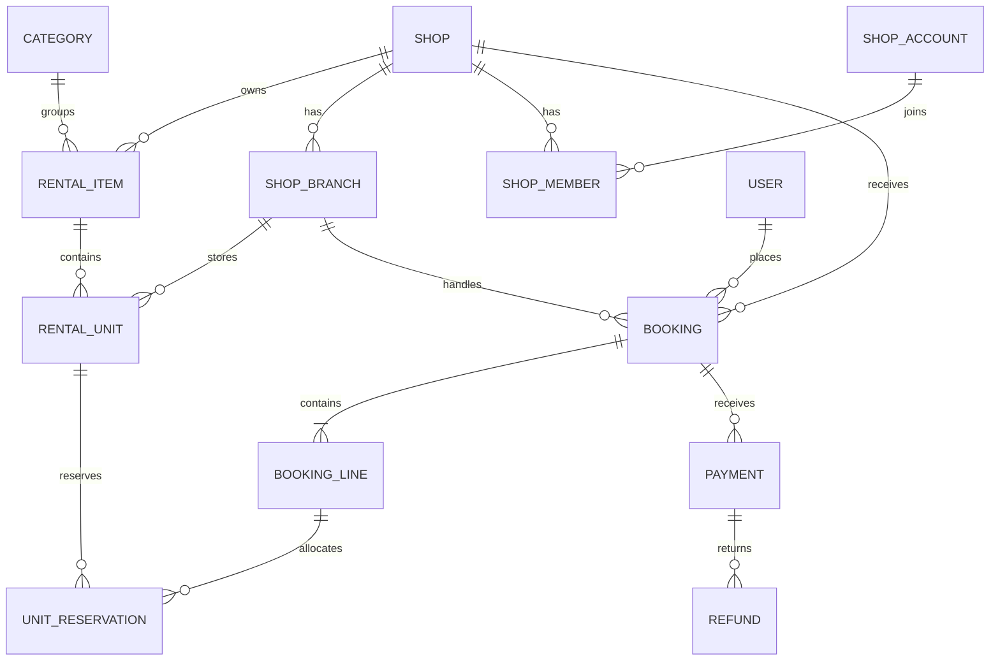

# RentHub — Roadmap Laravel 12 + Vue 3

> Dự án: nền tảng cho thuê đồ dùng nhiều shop.
> Học theo tính năng hoàn chỉnh, từ CRUD đến đặt thuê, thanh toán và vận hành thực tế.
> Đây là lộ trình dự kiến; bảng tiến độ bên dưới mới phản ánh phần đã thực hiện.

## 1. Mục tiêu và cách học

An đã làm full-stack hơn một năm, chủ yếu Laravel/Vue, và có kinh nghiệm xử lý nghiệp vụ. Mục tiêu hiện tại là củng cố nền tảng, tự biết bắt đầu một tính năng, viết và debug code khi không có AI. Kiểm tra chỗ hổng qua bài thực tế; giải thích kỹ PHP, SQL và Laravel tại điểm cần dùng. Lộ trình ba tháng và nhật ký học ở mục 20; không cần học lại mọi thứ từ đầu hoặc chỉ chạy theo số tính năng.

- Mỗi chặng tạo ra một tính năng dùng được xuyên suốt database → backend → giao diện.
- Giải thích PHP/OOP, HTTP, SQL tại chỗ khi tính năng cần đến.
- Trợ lý chuẩn bị migration/schema để bạn review; bạn tập trung code logic. Có thể nhờ tạo dữ liệu mẫu hoặc phần lặp lại.
- Viết controller trực tiếp ở chặng đầu; tách Action/Service khi logic và transaction xuất hiện.
- Kiểm tra tay luồng mới trước, bổ sung test cho hành vi và rủi ro quan trọng trong cùng chặng.
- Giữ PHPUnit hiện có. Pest là lựa chọn cú pháp, không phải điều kiện để đi tiếp.
- Không tạo interface, repository hoặc microservice khi chưa có nhu cầu cụ thể.
- Mỗi tính năng có tiêu chí hoàn thành; chia thành các mục tiêu nhỏ vừa một lượt học, review và ôn lại trước khi chuyển tiếp.

Không dự án nào sử dụng mọi API của Laravel. Đích đến là làm chủ các phần cốt lõi, tự lựa chọn công cụ và vận hành được ứng dụng có giao dịch, phân quyền và tác vụ nền.

## 2. Sản phẩm đang xây

**RentHub** cho phép khách thuê đồ của các shop: máy ảnh, máy chơi game, lều trại, dụng cụ và thiết bị sự kiện.

Luồng chính:

1. Chủ shop đăng đồ, ảnh, giá thuê theo ngày và mức cọc.
2. Khách tìm đồ, chọn khoảng ngày và nhận báo giá.
3. Hệ thống giữ một món đồ cụ thể trong thời gian chờ thanh toán.
4. Khách thanh toán, shop xác nhận và bàn giao.
5. Khách trả đồ; shop kiểm tra tình trạng, tính phí phát sinh và hoàn cọc.
6. Hai bên xem lịch sử; khách đánh giá đơn đã hoàn tất.

### Vai trò

| Vai trò              | Phạm vi                                               |
| -------------------- | ----------------------------------------------------- |
| Khách chưa đăng nhập | Tìm kiếm, xem đồ, xem shop và lịch còn trống          |
| Khách hàng           | Đặt thuê, thanh toán, xem đơn của mình, đánh giá      |
| Chủ shop             | Quản lý đồ, nhân viên, đơn và doanh thu của shop mình |
| Nhân viên            | Xử lý công việc được cấp quyền trong shop             |
| Quản trị nền tảng    | Duyệt shop, kiểm duyệt nội dung, hỗ trợ tranh chấp    |

Tách tài khoản khách hàng và tài khoản quản lý shop. `users` chỉ chứa khách hàng; `shops` lưu thông tin cửa hàng và liên hệ chủ shop, không có khóa ngoại owner_id đến users. Đến chặng xác thực, dùng `shop_accounts` riêng cho người đăng nhập quản lý và `shop_members` để cấp quyền theo shop. Thông tin liên hệ chủ shop không thay thế thông tin xác thực.

### Phạm vi tăng dần

- **MVP:** một shop với chi nhánh nhận/trả, danh mục, đồ cho thuê, ảnh, lịch trống, đặt thuê và bàn giao thủ công.
- **Bản giao dịch:** giữ chỗ có hạn, thanh toán sandbox, hủy đơn, hoàn tiền và thông báo.
- **Bản nền tảng:** nhiều shop, nhân viên, kiểm duyệt và báo cáo.
- **Bản vận hành:** realtime, tối ưu truy vấn, CI/CD, giám sát và phục hồi dữ liệu.

Chưa làm ví rút tiền, đấu giá, AI gợi ý hoặc microservice trong MVP.

## 3. Source và môi trường hiện tại

| Hạng mục                   | Hiện trạng                                                                                                |
| -------------------------- | --------------------------------------------------------------------------------------------------------- |
| Backend                    | Laravel 12, PHP trong Docker, Composer                                                                    |
| Database                   | Có MySQL 8.4 trong Docker (`laravel_practice`); `.env` local hiện vẫn chọn SQLite                         |
| Docker service             | `app` và `db`                                                                                             |
| Backend URL                | `http://localhost:8000`                                                                                   |
| Ping                       | `GET /` trả JSON `message: pong` và `time` trong `routes/web.php`                                         |
| Sanctum                    | Đã cài package, có config và migration; chưa xây đăng nhập                                                |
| Frontend                   | Chưa tạo Vue app riêng                                                                                    |
| Migration nghiệp vụ        | Có migration `shops`, `shop_branches`, `rental_items`; chưa xác minh lại trạng thái migrate trên DB local |
| Model/Controller nghiệp vụ | Có Shop/ShopBranch/RentalItem; ShopController hỗ trợ danh sách, chi tiết, tạo, sửa, xóa mềm; RentalItem chưa có API |
| Test                       | PHPUnit, 19 test; chạy lại 23/11/2026 trên bản copy sạch (PHP 8.2, SQLite bộ nhớ): 19 passed, 132 assertions; `pint --test` còn 8 file lỗi style |

```text
laravel-practice/
├── .docker/Dockerfile
├── docker-compose.yml
├── app/
├── bootstrap/app.php
├── database/migrations/
├── routes/web.php
├── resources/views/welcome.blade.php
├── tests/
├── docs/roadmap.md
├── docs/advice.md             # Lời khuyên tự học và việc làm B0–B8, D1–D6
├── docs/skill.md              # Chuẩn làm đúng Laravel / SQL / DevOps và cách tự kiểm
├── docs/review-fix-23-11.md   # Lỗi đã biết của source ngày 23/11/2026
├── composer.json
└── frontend/                  # Tạo ở chặng 2
```

Laravel hiện nằm ngay gốc repo. Service trong Compose là `app`; tên container do Docker tạo thường là `laravel-practice-app-1`. `docker compose exec` dùng tên service, còn `docker exec` dùng tên/ID container.

### Dựng source lần đầu

Chạy từ thư mục gốc repo bằng PowerShell:

```powershell
if (!(Test-Path .env)) { Copy-Item .env.example .env }
docker compose build
docker compose up -d --wait db
docker compose run --rm --no-deps app composer install
# Chỉ sinh key khi APP_KEY chưa có; không đổi key của môi trường đang dùng.
docker compose run --rm --no-deps app php artisan key:generate
docker compose run --rm --no-deps app php artisan migrate
docker compose up -d app
```

`.env.example` đã cấu hình MySQL khớp `docker-compose.yml`. Laravel dùng `DB_HOST=db`, `DB_PORT=3306`; DBeaver/TablePlus trên máy dùng host `127.0.0.1`, cổng `3307`, tài khoản theo Compose. Không commit `.env`. Sau khi làm D2, `.env.example` sẽ để trống mật khẩu: phải điền giá trị vào `.env` **trước** lần `up` đầu tiên, vì MySQL chỉ đọc mật khẩu lúc khởi tạo volume.

**Nếu đã có `.env` cũ dùng `DB_CONNECTION=sqlite`** (ví dụ trên máy khác): muốn dùng MySQL theo roadmap, cập nhật toàn bộ nhóm `DB_CONNECTION`, `DB_HOST`, `DB_PORT`, `DB_DATABASE`, `DB_USERNAME`, `DB_PASSWORD` theo `.env.example`, rồi chạy `php artisan config:clear` và `php artisan migrate` trong container. Chỉ bật container MySQL không tự chuyển database của Laravel; dữ liệu SQLite cũ cũng không tự được chuyển sang MySQL. Giữ nguyên APP_KEY và các cấu hình local khác.

Không chạy `composer create-project` trong repo có sẵn. Trang chào và ping không cần npm/Vite. Giữ nguyên khai báo yêu cầu PHP hiện tại; việc nâng/chỉnh dependency không thuộc lần chuyển dự án này.

### Lệnh thường dùng

```bash
docker compose up -d
docker compose ps
docker compose exec app bash
docker compose exec app php artisan route:list
docker compose exec app php artisan migrate:status
docker compose exec app php artisan migrate
docker compose exec app php artisan test
docker compose exec app vendor/bin/pint --test
docker compose logs -f app
docker compose down
```

Đã vào shell container thì dùng trực tiếp `php artisan ...` và `composer ...`. Trong WSL, ổ Windows nằm dưới `/mnt/<ổ>/`; ví dụ `C:\dev\laravel-practice` là `/mnt/c/dev/laravel-practice`. Không dùng `down -v` hoặc `migrate:fresh` với database có dữ liệu cần giữ.

### Quy ước route và CSRF

Hiện ping là `GET /` trong `web.php`. Từ 23/11/2026, route shop nằm trong `routes/api.php` (`Route::apiResource('shops', ...)`, URL `/api/shops`), thuộc nhóm `api`: không session, không CSRF. Trước đó chúng nằm trong `web.php` với `prefix('api')`; prefix chỉ đổi URL, không đổi middleware, nên POST từ client thật bị 419.

**Với các endpoint POST/PUT/PATCH/DELETE ở chặng 1, chọn và kiểm chứng một cơ chế:**

- Tiếp tục dùng `web.php`: request ghi dữ liệu phải mang session cookie và CSRF token hợp lệ; dùng form Blade có `@csrf` hoặc client gửi token tương ứng.
- Khi tách JSON API: tạo `routes/api.php` và đăng ký `api: __DIR__.'/../routes/api.php'` trong `bootstrap/app.php`; chuyển route nghiệp vụ sang đó. Prefix `/api` do cấu hình API thêm, không bọc thêm prefix lần nữa.

Việc chọn cơ chế route/CSRF cho luồng ghi dữ liệu vẫn cần được thực hành và kiểm chứng ngoài test. Không tắt CSRF toàn ứng dụng để né lỗi 419. Chỉ đăng ký file route có tồn tại và tránh khai báo một endpoint ở cả hai file.

Đến chặng Sanctum SPA, thiết lập đầy đủ stateful API, cookie/session, CORS và `/sanctum/csrf-cookie`. Cài package Sanctum riêng lẻ chưa tạo ra luồng đăng nhập hoạt động.

## 4. Quy tắc nghiệp vụ thống nhất

### Đồ đăng bán và món đồ vật lý

`shops` là thương hiệu/cửa hàng; `shop_branches` là từng địa điểm giữ đồ và giao nhận. Địa chỉ, số điện thoại chi nhánh và tọa độ nằm ở chi nhánh. Shop có một địa điểm thì vẫn tạo một chi nhánh đầu tiên trong luồng tạo shop, không tự tạo địa chỉ giả trong migration. Tạo shop và chi nhánh đầu tiên trong cùng transaction khi làm API đăng ký shop.

`rental_items` là mẫu đồ/listing chung của shop, ví dụ “Sony A6400”. `rental_units` là từng chiếc có mã riêng, ví dụ `CAM-001`, `CAM-002`, thuộc listing và một chi nhánh cụ thể. Không gắn listing cố định vào một chi nhánh vì nhiều chi nhánh có thể cùng cho thuê mẫu đồ đó.

Chặng 1 chỉ xây listing; chặng 3 mới thêm các chiếc cụ thể. Tồn khả dụng được xác định theo lịch của từng chiếc, không chỉ nhìn một cột số lượng tồn.

### Thời gian và báo giá

- MVP thuê theo ngày, dùng khoảng **[start_date, end_date)**: có ngày bắt đầu, không gồm ngày kết thúc.
- Từ 10/11 đến 12/11 tính 2 ngày; `end_date` phải lớn hơn `start_date`.
- Hai khoảng trùng nhau khi `existing.start_date < requested.end_date` và `existing.end_date > requested.start_date`.
- Một chiếc trả ngày 12/11 có thể được đặt tiếp từ ngày 12/11. Khi thêm thời gian kiểm tra/vệ sinh, phải cập nhật quy tắc này và test.
- Ngày thuê theo múi giờ shop; MVP dùng `Asia/Ho_Chi_Minh`. Timestamp sự kiện được lưu theo UTC và hiển thị có chuyển múi giờ.
- Giá và tiền cọc dùng **số nguyên VND**, không dùng float. Các phép tính có kiểm tra số âm và giới hạn hợp lý.
- Lưu snapshot tên đồ, giá/ngày, số ngày, tiền cọc và giảm giá trong đơn; đổi giá listing không làm đổi đơn cũ.

### Đơn, giữ chỗ và thanh toán

```text
pending_payment → confirmed → picked_up → returned → completed
pending_payment → expired hoặc cancelled
confirmed → cancelled (theo chính sách hủy)
```

- MVP mỗi đơn thuộc một shop và một chi nhánh nhận/trả; giỏ nhiều shop hoặc nhiều chi nhánh phải tách đơn. Mỗi chiếc được phân bổ phải thuộc đúng shop và chi nhánh của đơn. Nhận và trả cùng chi nhánh; trả khác nơi cần thêm nghiệp vụ điều chuyển ở giai đoạn sau.
- Đơn `pending_payment` chỉ giữ lịch đến `hold_expires_at`; `confirmed` và `picked_up` tiếp tục chiếm lịch.
- MVP có thể xác nhận thanh toán thủ công. Đến chặng 6 mới tích hợp sandbox.
- Trạng thái thanh toán/hoàn tiền nằm riêng với trạng thái thuê. Trả đồ không đồng nghĩa đã hoàn cọc.
- Máy đang bảo trì hoặc ngừng hoạt động không được giữ chỗ mới.
- Không gọi API thanh toán trong khi đang giữ transaction/row lock của kho.
- Hủy đơn và hết hạn phải giải phóng lịch đúng một lần.

## 5. Mô hình dữ liệu đích

Đây là bản đồ thiết kế, **không tạo hết migration ngay đầu dự án**.

| Nhóm           | Bảng dự kiến                                                       | Mục đích                                                  |
| -------------- | ------------------------------------------------------------------ | --------------------------------------------------------- |
| Danh mục       | `categories`, `rental_items`, `item_images`                        | Listing, phân loại, ảnh và thứ tự ảnh                     |
| Kho vật lý     | `rental_units`, `maintenance_periods`                              | Từng chiếc, tình trạng, lịch bảo trì                      |
| Tài khoản/shop | `users`, `shops`, `shop_branches`, `shop_accounts`, `shop_members` | Khách hàng tách tài khoản quản lý shop và quyền theo shop |
| Đặt thuê       | `bookings`, `booking_lines`, `unit_reservations`                   | Đơn, snapshot báo giá, phân bổ từng chiếc và khoảng thuê  |
| Thanh toán     | `payments`, `payment_events`, `refunds`                            | Giao dịch, webhook đã nhận, hoàn tiền                     |
| Giao nhận      | `handover_records`, `damage_reports`                               | Checklist, ảnh bằng chứng, phí và người xác nhận          |
| Cộng đồng      | `favorites`, `reviews`, `conversations`, `messages`                | Yêu thích, đánh giá, chat                                 |
| Vận hành       | `notifications`, `audit_logs`                                      | Thông báo và lịch sử thao tác                             |

Quan hệ chính:



Index theo đường truy vấn thực tế: listing theo shop/trạng thái/danh mục, đơn theo shop/trạng thái/ngày, reservation theo unit/khoảng ngày. Unique cho mã chiếc trong shop, mã đơn và định danh giao dịch nhà cung cấp. Index thông thường không tự ngăn hai khoảng ngày giao nhau; phần đó cần transaction và locking.

## 6. Chặng 1 — CRUD shop, chi nhánh và đồ cho thuê

**Đầu ra:** quản lý shop trước, rồi quản lý listing trong từng shop bằng HTTP, có phân trang và validation.

Migration chạy theo thứ tự `shops` → `shop_branches` → `rental_items`. Bảng `shops` gồm `id`, `shop_name`, `owner_name`, `owner_phone` (varchar 20), `owner_email` nullable, `description` nullable, `is_active` mặc định true và timestamps. Không liên kết chủ shop đến khách hàng trong users. Một shop có nhiều đồ cho thuê; owner_email là liên hệ, không bắt buộc unique và chưa phải tài khoản đăng nhập.

Bảng `shop_branches` gồm `id`, `shop_id`, `branch_name`, `address` (varchar 500), `phone` nullable, `latitude`/`longitude` (decimal 10,7) nullable, `is_active` và timestamps. Tọa độ phải cùng có hoặc cùng trống; validation giới hạn latitude [-90,90], longitude [-180,180]. Shop còn chi nhánh không được xóa cứng.

`rental_items.shop_id` bắt buộc, tham chiếu `shops.id`. Không xóa shop khi còn listing; khóa ngoại dùng restrict, tránh xóa dây chuyền dữ liệu nghiệp vụ.

Schema `rental_items`:

| Cột                    | Kiểu                        | Ý nghĩa               |
| ---------------------- | --------------------------- | --------------------- |
| `id`                   | bigint PK                   | ID                    |
| `shop_id`              | foreign ID, bắt buộc        | Shop sở hữu listing   |
| `item_name`            | varchar(255)                | Tên đồ                |
| `description`          | text nullable               | Mô tả                 |
| `rental_price_per_day` | unsigned bigint             | Giá thuê/ngày, VND    |
| `deposit_amount`       | unsigned bigint, mặc định 0 | Tiền cọc, VND         |
| `is_active`            | boolean, mặc định true      | Có cho thuê hay không |
| timestamps             | timestamp                   | Ngày tạo/cập nhật     |

### Việc làm

1. Review migration do trợ lý chuẩn bị, chạy migrate; tạo model `Shop`, `RentalItem`, quan hệ Shop/ShopBranch/RentalItem, fillable và casts.
2. Viết `ShopController` CRUD trước, rồi CRUD `ShopBranch` theo shop và `RentalItemController` với index/store/show/update/destroy theo shop. Model Shop và ShopBranch đã có quan hệ branches()/shop(); tạo chi nhánh qua $shop->branches()->create(...).
3. Chốt cơ chế route/CSRF ở mục 3 trước khi thử endpoint ghi dữ liệu.
4. Tạo `StoreRentalItemRequest`, `UpdateRentalItemRequest`; dùng `validated()`.
5. Tạo `RentalItemResource` để ổn định response; danh sách có phân trang, giới hạn `per_page`.
6. Tìm theo tên, lọc `is_active`; chỉ cho sort theo danh sách cột được phép.
7. Factory/seeder tạo dữ liệu giả; không để controller tự sinh dữ liệu mẫu.

| Endpoint                                               | Hành vi                                                     |
| ------------------------------------------------------ | ----------------------------------------------------------- |
| `GET /api/shops`                                       | Danh sách shop phân trang                                   |
| `POST /api/shops`                                      | Tạo shop, trả 201                                           |
| `GET /api/shops/{shop}`                                | Chi tiết shop                                               |
| `PATCH /api/shops/{shop}`                              | Cập nhật shop                                               |
| `DELETE /api/shops/{shop}`                             | Xóa shop rỗng; shop còn chi nhánh/listing trả lỗi nghiệp vụ |
| `GET /api/shops/{shop}/branches`                       | Danh sách chi nhánh                                         |
| `POST /api/shops/{shop}/branches`                      | Thêm chi nhánh                                              |
| `GET/PATCH/DELETE /api/shops/{shop}/branches/{branch}` | Xem/sửa/xóa chi nhánh thuộc shop                            |
| `GET /api/shops/{shop}/rental-items`                   | Danh sách đồ trong shop                                     |
| `POST /api/shops/{shop}/rental-items`                  | Thêm đồ vào shop, trả 201                                   |
| `GET /api/shops/{shop}/rental-items/{rentalItem}`      | Chi tiết đồ trong shop hoặc 404                             |
| `PATCH /api/shops/{shop}/rental-items/{rentalItem}`    | Sửa đồ trong shop                                           |
| `DELETE /api/shops/{shop}/rental-items/{rentalItem}`   | Xóa đồ trong shop, trả 204                                  |

Lấy shop từ route và tạo listing qua quan hệ; không nhận `shop_id` tùy ý từ payload. Dùng scoped binding hoặc query qua shop để chặn URL ghép shop A với đồ của shop B. Chưa có auth thì CRUD shop và thông tin liên hệ chỉ thực hành local. Khi triển khai đăng nhập quản lý, kiểm tra tài khoản shop và quyền thành viên; không coi shop_id hoặc owner_email do client gửi là bằng chứng sở hữu.

Dùng route model binding. Update cho phép bỏ qua trường không sửa; nếu có truyền thì phải hợp lệ. `rental_price_per_day` bắt buộc và lớn hơn 0; tiền cọc không âm; `is_active` là boolean. Xóa cứng listing chỉ dùng ở chặng đầu; trước khi có đơn phải đổi sang lưu trữ/ẩn để giữ lịch sử.

**Hoàn thành khi:** thêm/xem/sửa/xóa chạy được; input sai trả 422 khi request nhận JSON; ID không tồn tại trả 404; dữ liệu lưu MySQL thật; có feature test cho CRUD và validation. Các endpoint ghi dữ liệu chưa có phân quyền chỉ chạy local cho đến chặng 4.

## 7. Chặng 2 — Vue và danh mục có ảnh

**Đầu ra:** khách duyệt listing; có màn hình quản lý đồ dùng được.

- Tạo `frontend/` bằng Vue 3 + TypeScript, Vue Router; Vite chạy trên máy, không dùng Vite gốc Laravel cho SPA này.
- Màn hình danh sách dạng card ảnh, chi tiết, form thêm/sửa; trạng thái loading/rỗng/lỗi/422 và phân trang.
- Tách client HTTP và kiểu dữ liệu; component không rải URL API khắp nơi.
- Thêm `categories`, `category_id`, `item_images`, ảnh bìa, thứ tự ảnh.
- Upload qua Laravel Storage; kiểm tra MIME, dung lượng và quyền ghi/xóa; không tin tên file client.
- Local disk trước, object storage sau; quản lý xóa ảnh cũ và file bị bỏ dở.
- Dùng eager loading, kiểm tra N+1, giới hạn dữ liệu và trường JSON trả ra.
- Kết nối frontend/backend có CORS đúng origin. Nếu dùng web routes, xử lý session/CSRF đầy đủ.

**Hoàn thành khi:** thao tác CRUD từ UI được; ảnh tải lên/hiển thị/xóa đúng; filter và phân trang đồng bộ; test API upload bằng fake storage và kiểm tra loại file sai.

## 8. Chặng 3 — Kho vật lý và lịch còn trống

**Đầu ra:** chọn ngày và biết còn chiếc nào cho thuê.

- Thêm `rental_units`: mã chiếc, rental_item_id, shop_branch_id, tình trạng hoạt động/bảo trì. Kiểm tra listing và chi nhánh cùng shop; hai khóa ngoại độc lập chưa tự đảm bảo điều đó. Đến chặng này chọn composite constraint hoặc ràng buộc tương đương để giữ tính nhất quán.
- Thêm lịch bảo trì; không sửa một cột available thủ công để biểu diễn mọi thời điểm.
- Viết query tìm các chiếc không giao khoảng thuê và không bị bảo trì.
- Endpoint `GET /api/rental-items/{rentalItem}/availability?branch_id=...&start_date=...&end_date=...`.
- Viết báo giá dùng số nguyên và khoảng ngày đã thống nhất; chưa giữ lịch tại bước báo giá.
- Xem SQL, query plan, index; dùng eager loading đúng mức.

**Hoàn thành khi:** kiểm tra được các khoảng chạm biên, trùng một phần, bao trùm, không còn chiếc, bảo trì; báo giá 2 ngày đúng như tính tay. Đây là lúc học sâu SQL và quan hệ Eloquent, thay vì chỉ gọi ORM theo mẫu.

## 9. Chặng 4 — Tài khoản, một shop và phân quyền

**Đầu ra:** khách có tài khoản; chủ shop quản lý đồ và nhân viên đúng quyền.

- Đăng ký, đăng nhập, đăng xuất, người dùng hiện tại; hash mật khẩu, rate limit đăng nhập.
- Chọn Sanctum SPA cookie cho frontend first-party; hoàn thiện CSRF/session/CORS. Token dùng cho client phù hợp, không mặc định lưu token dài hạn trong localStorage.
- Xác minh email, đặt lại mật khẩu; Mail/Notification và mail giả lập khi test.
- `shops`, thông tin liên hệ chủ shop và `rental_items.shop_id` đã có từ chặng 1. Bổ sung `shop_accounts` cho thông tin đăng nhập riêng và `shop_members` (shop_account_id, shop_id, vai trò chủ/nhân viên); không tạo lại bảng shop, không dùng users làm tài khoản quản lý.
- Cấu hình provider/guard phù hợp cho khách hàng và tài khoản shop; kiểm tra đúng loại danh tính ở từng nhóm route. Policy cho xem/sửa/xóa, thêm nhân viên; lấy danh tính từ request đã xác thực.
- Vue có trạng thái đăng nhập, Pinia khi cần chia sẻ state, router guard; backend vẫn là nơi quyết định quyền.
- Nhóm quản trị dùng endpoint riêng; listing công khai chỉ trả dữ liệu được phép.

**Hoàn thành khi:** khách không sửa được listing; nhân viên không tự nâng quyền; user không đọc/sửa tài nguyên shop khác bằng cách đổi ID; test 401/403 và luồng xác thực.

## 10. Chặng 5 — Đặt thuê và chống trùng lịch

**Đầu ra:** tạo đơn có snapshot báo giá và phân bổ từng chiếc an toàn.

- Thêm `bookings`, `booking_lines`, `unit_reservations`, `hold_expires_at`.
- Tách `CreateBooking`, `CancelBooking`, `ConfirmBooking` thành Action khi logic vượt khỏi HTTP.
- Dùng enum cho trạng thái và quy tắc chuyển trạng thái tập trung.
- Trong transaction, khóa các dòng `rental_units` theo thứ tự ổn định bằng `lockForUpdate`, kiểm tra lại lịch rồi mới ghi reservation.
- Mọi luồng đặt/hủy/bảo trì cùng tuân thủ giao thức khóa; chỉ khóa kết quả query reservation rỗng là chưa đủ.
- Giữ chỗ có hạn; scheduler giải phóng đơn hết hạn theo batch, thao tác có thể chạy lại an toàn.
- Chặn double submit bằng khóa idempotency có unique constraint và quy định payload tương ứng.
- Có thể xác nhận cọc thủ công qua thao tác có quyền trước khi tích hợp payment gateway.

**Hoàn thành khi:** hai request đồng thời tranh một chiếc chỉ một request thành công; hết hạn/hủy giải phóng lịch; giá đổi sau đặt không ảnh hưởng đơn; thất bại giữa luồng rollback đủ. Kiểm tra concurrency trên MySQL thật với kết nối độc lập, không suy ra từ SQLite.

## 11. Chặng 6 — Thanh toán sandbox và hoàn tiền

**Đầu ra:** cọc và tiền thuê có lịch sử giao dịch, webhook xử lý trùng an toàn.

- Chọn một gateway có sandbox khi bắt đầu chặng này; xác minh tài liệu và chữ ký theo nhà cung cấp.
- `PaymentGateway` interface chỉ xuất hiện khi cần adapter thật/fake hoặc nhiều gateway.
- Dùng HTTP Client, timeout, retry có điều kiện; không retry giao dịch tài chính mù quáng.
- `payments`, `payment_events`, `refunds`; unique provider event/transaction ID.
- Webhook xác thực chữ ký, số tiền, loại tiền và đối chiếu đơn; redirect trên trình duyệt không là bằng chứng đã thanh toán.
- Payment, refund có trạng thái riêng; ghi audit và xử lý callback sai thứ tự.
- Tình huống thanh toán về sau khi giữ chỗ hết hạn phải có chính sách hoàn tiền/đối soát, không tự chiếm lại chiếc đã được đặt.
- Endpoint webhook bên ngoài có ngoại lệ CSRF đúng phạm vi và xác thực chữ ký thay thế.

**Hoàn thành khi:** webhook gửi nhiều lần chỉ ghi nhận một lần; tiền không khớp không xác nhận đơn; thất bại/timeout có cách đối soát; test bằng HTTP fake và payload mẫu sandbox.

## 12. Chặng 7 — Bàn giao, trả đồ và tranh chấp

**Đầu ra:** hoàn tất vòng đời thuê, biết vì sao tiền cọc được hoàn hoặc bị khấu trừ.

- Checklist giao/nhận, ảnh tình trạng, người thực hiện, thời điểm và ghi chú.
- Phí trả trễ theo chính sách được lưu snapshot; báo hư hỏng có bằng chứng.
- Chủ shop xác nhận phí, khách có luồng phản hồi; không tự trừ tiền tùy ý từ input client.
- Tách trả đồ, chốt phí, yêu cầu hoàn cọc và hoàn cọc thành các hành động rõ ràng.
- Bảo vệ file nhạy cảm; dùng authorized download/temporary URL khi cần.
- Audit thao tác nghiệp vụ, không ghi token/thông tin thanh toán nhạy cảm vào log.

**Hoàn thành khi:** chuyển trạng thái sai bị chặn; nhân viên sai shop không xem bằng chứng; trả/hoàn tiền lặp không tính hai lần; test tiền và quyền truy cập.

## 13. Chặng 8 — Event, queue và tác vụ định kỳ

**Đầu ra:** request nhanh; nhắc lịch và công việc nền có thể retry.

- Event `BookingConfirmed`, `ItemPickedUp`, `ItemReturned`; listener gửi thông báo.
- Dispatch hệ quả sau commit; khi cần đảm bảo không mất sự kiện, đánh giá outbox thay vì cho rằng queue luôn nguyên tử với DB.
- Job xử lý thumbnail, email, export CSV; chia batch và theo dõi tiến độ.
- Database queue trước; Redis/Horizon khi đã chọn Redis queue.
- Backoff, timeout, retry, failed jobs; job idempotent, payload nhỏ và tránh model cũ.
- Scheduler nhắc lịch, hết hạn giữ chỗ, đối soát; chống tác vụ chạy trùng phù hợp môi trường.
- Notification qua database/mail; người dùng chỉ đọc/đánh dấu thông báo của mình.

**Hoàn thành khi:** worker dừng không làm sai đơn; bật lại worker xử lý tiếp; retry không gửi/tính phí lặp ngoài chính sách; có cách xem và xử lý failed job.

## 14. Chặng 9 — Nhiều shop và chức năng cộng đồng

**Đầu ra:** mở cho nhiều shop, dữ liệu và quyền được cô lập.

- Mở onboarding shop, phê duyệt, khóa shop, mời nhân viên; mọi query và Policy xét shop đúng phạm vi.
- Unique code theo shop, route binding scoped khi phù hợp; test đoán ID và truy cập chéo.
- Yêu thích, review từ đơn hoàn tất; giới hạn một review theo quan hệ đơn đã xác định.
- Duyệt/ẩn review, soft delete có chủ đích; không để đánh giá ẩn lộ qua endpoint khác.
- Chỉ dùng polymorphic relation nếu thực sự có nhiều loại đối tượng chung hành vi, ví dụ audit hoặc tệp đính kèm.
- Chat theo đơn; private channel có authorization, Reverb/Echo và sự kiện sau commit.
- Đánh giá realtime để cập nhật UI; DB/API vẫn là nguồn xác nhận cuối cùng về tồn lịch.

**Hoàn thành khi:** một shop account tham gia nhiều shop vẫn đúng quyền từng shop; realtime không rò dữ liệu; review giả bị chặn. Chưa chia database riêng cho mỗi shop khi một DB với shop_id còn đáp ứng tốt.

## 15. Chặng 10 — Tìm kiếm, báo cáo và hiệu năng

**Đầu ra:** dữ liệu lớn hơn vẫn tìm được nhanh và báo cáo có số liệu kiểm chứng.

- Filter theo danh mục, shop, giá, khoảng ngày; debounce, query string, giới hạn tham số.
- Bắt đầu bằng MySQL; chỉ thêm Scout/search engine sau khi xác định nhu cầu full-text và cách đồng bộ.
- Báo cáo doanh thu phân biệt tiền thuê, tiền cọc đang giữ, tiền hoàn và phí; thống nhất ngày ghi nhận.
- Query Builder/raw SQL có binding, aggregate, index; đo bằng EXPLAIN và dữ liệu mẫu đủ lớn.
- Cache catalog/dashboard với TTL và invalidation cụ thể; không dùng cache cũ để quyết định giữ chỗ.
- `chunkById`, lazy collection, streaming cho export; không load toàn bộ đơn vào RAM.
- Rate limit theo endpoint/user; quan sát query count, memory, thời gian đáp ứng.
- Pagination cursor cho danh sách phù hợp; chọn dựa trên UX và cách sort.

**Hoàn thành khi:** có số đo trước/sau, không N+1 ở màn hình chính; báo cáo đối chiếu được với giao dịch; export lớn không timeout request.

## 16. Chặng 11 — Kiến trúc, kiểm thử và bảo mật

Thực hiện xuyên suốt rồi tổng rà ở đây, không chờ đến cuối mới bảo vệ dữ liệu.

- Controller lo HTTP; FormRequest lo input; Policy lo quyền; Action lo use case; Resource lo JSON.
- Model giữ quan hệ, casts và scope phù hợp; không gom mọi nghiệp vụ vào observer.
- Service Container, constructor injection; Service Provider để binding/configure; DTO khi có dữ liệu qua ranh giới rõ ràng.
- Exception nghiệp vụ, JSON lỗi thống nhất; không trả stack trace ở production.
- Unit test cho tính tiền/khoảng ngày; feature test cho API/quyền/transaction; integration test MySQL cho locking, sandbox cho gateway.
- Factory/Seeder, HTTP/Storage/Mail/Notification/Queue fake; không mock hết ORM để test chỉ phản ánh implementation.
- Kiểm tra giới hạn fake: `Queue::fake` không chứng minh worker chạy; SQLite không chứng minh khóa MySQL.
- Pint, Larastan/PHPStan theo mức tăng dần; frontend có type-check và test luồng form/đặt thuê.
- Kiểm soát mass assignment, XSS, SQL injection, upload, IDOR, brute force và webhook giả.
- Localization cho nội dung/thông báo khi cần; config và env tách rõ, không gọi env tùy tiện trong nghiệp vụ.
- Viết Artisan command đối soát hoặc import có dry-run, báo cáo lỗi và khả năng tiếp tục.

**Hoàn thành khi:** sửa công thức/Policy có test bắt lỗi; CI tự chạy kiểm tra; tài liệu giải thích được lựa chọn kiến trúc và giới hạn hiện tại.

## 17. Chặng 12 — Triển khai và vận hành

**Đầu ra:** bản staging chạy được và có quy trình cập nhật/phục hồi.

- Image production đóng gói source/vendor; nginx + PHP-FPM thay `artisan serve`; dùng build context và đường dẫn đúng cấu trúc gốc repo.
- Vue build thành file tĩnh; cấu hình API URL, SPA fallback, HTTPS/cookie/CORS theo domain thực tế.
- Tách web, worker, scheduler; quản lý process và restart worker sau deploy.
- CI chạy Composer install, Pint, static analysis, test; frontend lint/type-check/test/build.
- CI test độc lập bằng SQLite khi phù hợp và MySQL cho test đặc thù; không nối DB dev/production.
- Quản lý secrets; APP_DEBUG=false; quyền storage/cache; không đưa .env vào image/git.
- Migration tương thích bản cũ khi rolling deploy; sao lưu trước thay đổi khó đảo ngược.
- Config/route/view cache, health/readiness, log tập trung, cảnh báo failed job và lỗi thanh toán.
- Sao lưu DB và file, kiểm tra khôi phục; backup chưa thử restore chưa chứng minh phục hồi được.
- Redis/Horizon theo nhu cầu; Octane chỉ sau profiling và đánh giá trạng thái sống lâu của worker.

**Hoàn thành khi:** người khác dựng staging theo README được; deploy không mất đơn/file; phục hồi được bản sao lưu; biết cách rollback ứng dụng và xử lý migration đã chạy.

## 18. Bản đồ kiến thức Laravel

Bảng này là danh sách đầy đủ để biết mình đã học đủ Laravel chưa, và còn thiếu chỗ nào. Bảng được dựng theo mục lục tài liệu Laravel 12: Getting Started, Architecture Concepts, The Basics, Digging Deeper, Security, Database, Eloquent ORM, Testing, Packages. Mỗi trang tài liệu có ít nhất một dòng tương ứng. Trợ lý dựng bảng ngày 23/11/2026 theo hiểu biết của mình, **chưa đối chiếu với trang chính thức**. Bài đầu tiên: mở sidebar `laravel.com/docs/12.x`, đối chiếu từng trang với bảng, thiếu thì thêm dòng. Chuẩn làm đúng của từng nhóm nằm ở [skill.md](skill.md); số mục ghi ở tiêu đề mỗi nhóm.

**Mức cần đạt** (dùng thang ở mục 20):

- **Lõi:** dùng hằng ngày trong dự án Laravel. Đích: "Tự làm", sau đó "Áp dụng độc lập".
- **Mở rộng:** dùng khi có nhu cầu cụ thể. Đích: "Tự làm", qua ít nhất một bài trong RentHub.
- **Biết:** hiểu nó giải quyết vấn đề gì, khi nào nên và không nên dùng; đọc trang tài liệu, có thể thử nhanh ngoài repo. Đạt khi giải thích được bằng 3–5 câu, kể cả vì sao RentHub chưa dùng.

**Phạm vi theo thời gian:** trước 22/02/2027, phạm vi bắt buộc ghi ở mục 20. Bảng này cho biết phần còn lại để đi tiếp theo mục 21. Khi bắt đầu một chặng, lọc các dòng của chặng đó để đưa vào việc làm.

**Cột "Học ở":** "Chặng N" là chặng sản phẩm ở mục 6–17; B0–B8 và D1–D6 là các bước trong [advice.md](advice.md).

**Cột "Hiện tại":** `–` là chưa đánh giá; `HD` là hiểu có hướng dẫn; `TL` là tự làm; `ĐL` là áp dụng độc lập. Chỉ đổi khi đã có bằng chứng như cột "Đạt khi", ghi kèm ngày (ví dụ `TL 15/12`), và thêm một dòng nhật ký ở mục 20.

### 18.1 PHP và kiến trúc (skill.md mục 2)

| Chủ đề | Mức | Học ở | Đạt khi | Hiện tại |
| --- | --- | --- | --- | --- |
| PHP hiện đại: type, null, array, closure, class/trait/interface, enum, readonly, `match`, namespace/PSR-4, exception | Lõi | Chặng 1 (đọc `ShopLogic`), chặng 5 (enum trạng thái) | Giải thích từng dòng `ShopLogic`; viết một enum có luật chuyển kèm unit test | – |
| Composer: require/require-dev, autoload, `composer.lock`, ràng buộc phiên bản | Lõi | B0, B8 | Giải thích vì sao commit lock file; thêm rồi gỡ một package dev mà repo vẫn sạch | – |
| Cài đặt, cấu hình, `.env`, config cache, cấu trúc thư mục | Lõi | B0, chặng 12 | Tạo một file config riêng; giải thích vì sao `env()` gọi ngoài config trả `null` sau `config:cache` | – |
| Vòng đời request | Lõi | Chặng 1 | Viết 10 dòng mô tả đường đi của `POST /api/shops`, chỉ ra chỗ sinh 404/419/422/500 | – |
| Service container, service provider, facade | Lõi | Chặng 1 (`AppServiceProvider`), chặng 6 (cổng thanh toán giả) | Thay một service bằng bản giả trong test; giải thích `register()` khác `boot()` | – |
| Contract, real-time facade | Biết | – | Giải thích khác nhau giữa type-hint contract và type-hint class cụ thể | – |

### 18.2 HTTP (skill.md mục 3)

| Chủ đề | Mức | Học ở | Đạt khi | Hiện tại |
| --- | --- | --- | --- | --- |
| Routing: `apiResource`, route lồng + `scoped()`, binding, `withTrashed`, group/prefix/name | Lõi | B4, B6, B7 | URL ghép sai shop trả 404; đọc hiểu được `route:list -v` | – |
| Middleware: nhóm web/api, alias, middleware tự viết | Lõi | B4, chặng 4 | Tự viết một middleware có test | – |
| CSRF và session | Lõi | B4, chặng 4 (Sanctum SPA) | Giải thích được 419 và sửa bằng cấu hình đúng, không tắt CSRF | – |
| Controller: resource, một hành động (`__invoke`), return type | Lõi | B3, chặng 5 (hủy đơn) | Controller mỏng, có return type, Pint sạch | – |
| Request và validation: FormRequest, rule cho mảng lồng, `Rule::exists` theo shop, `prepareForValidation`, `after`, Rule class | Lõi | B5, B7, chặng 5 (khoảng ngày) | Tự viết một Rule class; mỗi rule có test 422 | – |
| Response, API Resource, `paginate` | Lõi | B2, chặng 2 | Cùng shape ở list/detail/create/update; có test cấu trúc JSON | – |
| `simplePaginate`, `cursorPaginate`, `streamDownload` | Mở rộng | Chặng 10 (export) | Giải thích khi nào chọn loại phân trang nào; export CSV lớn không tràn RAM | – |
| Xử lý lỗi, exception riêng, logging, `Context` | Lõi | B5, chặng 11 | Lỗi nghiệp vụ được render ở một chỗ; tìm nguyên nhân lỗi 500 chỉ từ log | – |
| URL generation, signed URL | Mở rộng | Chặng 7 (file riêng tư) | Link có chữ ký và hạn dùng; sửa URL thì bị từ chối | – |
| View và Blade | Mở rộng | Chặng 8 (mail Markdown) | Template mail render đúng dữ liệu | – |
| Frontend: Vite, starter kit, Inertia/Livewire | Biết | Chặng 2 (Vue SPA riêng) | Giải thích vì sao RentHub chọn SPA riêng thay vì Inertia/Livewire | – |

### 18.3 Eloquent và database (skill.md mục 4–5)

| Chủ đề | Mức | Học ở | Đạt khi | Hiện tại |
| --- | --- | --- | --- | --- |
| Query Builder, raw SQL có binding, `toRawSql`, `EXPLAIN` | Lõi | Chặng 1, chặng 10 | Đoán đúng SQL của một scope trước khi in ra; đọc được kết quả `EXPLAIN` | – |
| Migration: khóa ngoại, index, `down()`, thay đổi nhiều bước, `--pretend` | Lõi | B8, chặng 3 | Thêm cột NOT NULL vào bảng có dữ liệu theo nhiều bước mà không mất dữ liệu | – |
| Factory và Seeder | Lõi | B8 | Test dùng factory/state; seeder chạy lại không tạo trùng | – |
| Model: fillable, casts, accessor/mutator `Attribute`, soft delete, timestamps | Lõi | Chặng 1–5 | Giải thích vì sao `shop_id` không nằm trong fillable; viết một accessor kiểu mới | – |
| Quan hệ `hasMany`, `belongsTo`, `belongsToMany` + pivot | Lõi | B6, B7, chặng 4 (`shop_members`) | Pivot có cột vai trò; có test truy vấn theo vai trò | – |
| Quan hệ `hasManyThrough`, đa hình (`morphMany`) | Mở rộng | Chặng 2 (ảnh), chặng 3 | Dùng một quan hệ đa hình cho ảnh của shop và của đồ | – |
| Eager loading, `withCount`/`withExists`, `whereHas`, N+1, `preventLazyLoading` | Lõi | B8, chặng 2 | Số truy vấn không đổi khi tăng dữ liệu | – |
| Local scope | Lõi | Chặng 1 | Tự viết scope lọc cho RentalItem | – |
| Global scope | Mở rộng | Chặng 4 | Giải thích đánh đổi; nếu dùng thì có test cho job/command | – |
| Eloquent Collection, LazyCollection, `chunkById`, `lazyById` | Lõi | Chặng 1, chặng 8 | Chỉ ra Builder/Model/Collection trong một đoạn code; xử lý theo lô không bỏ sót dòng | – |
| Custom cast (ví dụ tiền) | Mở rộng | Chặng 5 | Một cast tự viết có unit test | – |
| Serialization (`$hidden`, `$appends`, `toArray`) | Biết | – | Giải thích vì sao API dùng Resource thay vì serialize model | – |
| Model event, observer | Lõi | Chặng 7 (audit) | Observer chạy sau commit; test kiểm tra hệ quả | – |
| Transaction, `lockForUpdate`, unique index, deadlock | Lõi | Chặng 1 (đã có test rollback), chặng 5 | Hai kết nối MySQL tranh một chiếc đồ, chỉ một bên thành công | – |
| Redis | Mở rộng | Chặng 10 | Chuyển cache/queue sang Redis, có số đo trước và sau | – |
| MongoDB và DB khác | Biết | – | Giải thích khi nào không nên dùng MySQL | – |

### 18.4 Bảo mật (skill.md mục 6)

| Chủ đề | Mức | Học ở | Đạt khi | Hiện tại |
| --- | --- | --- | --- | --- |
| Authentication: guard, provider, Sanctum SPA cookie và token | Lõi | Chặng 4 | Luồng đăng nhập SPA chạy trên trình duyệt; có test 401 | – |
| Authorization: Gate, Policy, `can`, phân biệt 401/403/404 | Lõi | Chặng 4 | Ma trận test chủ shop / nhân viên / shop khác / chưa đăng nhập | – |
| Rate limiting | Lõi | Chặng 4 | Test gọi vượt giới hạn trả 429 | – |
| Hashing, quy tắc mật khẩu | Lõi | Chặng 4 | Giải thích hash khác mã hóa ở đâu | – |
| Email verification, password reset | Mở rộng | Chặng 4 | Luồng quên mật khẩu cho tài khoản shop có test | – |
| Encryption, `APP_KEY`, cast `encrypted` | Mở rộng | Chặng 6 | Giải thích hậu quả khi đổi `APP_KEY` và cách xoay key | – |
| Upload an toàn, file riêng tư | Lõi | Chặng 2, chặng 7 | Test chặn file sai loại hoặc quá cỡ; file riêng tư không mở được bằng URL công khai | – |
| Webhook có chữ ký, idempotency | Mở rộng | Chặng 6 | Gửi một webhook nhiều lần chỉ được ghi nhận một lần | – |
| Fortify, Passport, Socialite | Biết | – | Giải thích mỗi cái khác Sanctum ở đâu | – |

### 18.5 Xử lý nền và tích hợp (skill.md mục 7)

| Chủ đề | Mức | Học ở | Đạt khi | Hiện tại |
| --- | --- | --- | --- | --- |
| Queue, job, retry, `failed_jobs` | Lõi | Chặng 8 | Worker thật xử lý job; job lỗi vào `failed_jobs` và chạy lại được | – |
| Unique job, chain, batch, job middleware | Mở rộng | Chặng 8, chặng 10 (import) | Một batch import có theo dõi tiến độ | – |
| Event, listener, dispatch sau commit | Lõi | Chặng 8 | Listener qua queue chạy sau commit; test bằng `Event::fake` | – |
| Task scheduling, Artisan command | Lõi | Chặng 5 (hết hạn giữ chỗ), chặng 8 | Command có `--dry-run`, chạy hai lần không tạo trùng; lịch có `withoutOverlapping` | – |
| Mail | Lõi | Chặng 8 | Mail đi qua queue; test bằng `Mail::fake` + `assertQueued` | – |
| Notification (mail + database) | Mở rộng | Chặng 8 | Một thông báo vừa hiện trong app vừa gửi mail | – |
| Cache, atomic lock | Lõi | Chặng 10 | Khóa cache có `shop_id`; sửa dữ liệu xong không đọc phải cache cũ | – |
| File storage | Lõi | Chặng 2, chặng 7 | Test dùng `Storage::fake`; disk riêng tư và công khai dùng đúng chỗ | – |
| HTTP client | Lõi | Chặng 6 | Có timeout/retry; test bằng `Http::fake` + `preventStrayRequests` | – |
| Broadcasting, Reverb | Mở rộng | Chặng 9 | Kênh riêng tư từ chối user không thuộc shop | – |
| Localization | Mở rộng | Chặng 11 | Thông báo validation tiếng Việt; mã lỗi không đổi theo ngôn ngữ | – |
| Helpers, `Str`, `Arr`, `Number` | Lõi | Xuyên suốt | Phân biệt được `blank`/`filled` với `empty` | – |
| Search (Scout) | Mở rộng | Chặng 10 | Giải thích khi nào `LIKE` không đủ; thử một driver | – |
| Processes, Concurrency, Pennant, Prompts | Biết | – | Mỗi cái một câu: dùng để làm gì | – |
| Package development | Biết | – | Giải thích service provider của package được tự đăng ký thế nào | – |

### 18.6 Test (skill.md mục 8)

| Chủ đề | Mức | Học ở | Đạt khi | Hiện tại |
| --- | --- | --- | --- | --- |
| Feature test HTTP, database test, `RefreshDatabase` | Lõi | Xuyên suốt từ B1 | Mỗi endpoint đủ ma trận ca ở skill.md 8.2 | – |
| Fake và mock: Mail, Queue, Event, Http, Storage, thời gian | Lõi | Chặng 2, 5, 6, 8 | Test không gọi mạng thật, không phụ thuộc giờ chạy | – |
| Unit test logic thuần | Lõi | Chặng 5 (enum, báo giá) | Chạy được mà không cần DB | – |
| Console test | Mở rộng | Chặng 8 | Test command bằng `artisan()` và mã thoát | – |
| Test trên MySQL thật | Lõi | Chặng 5, D4 | Có job CI riêng với service MySQL | – |
| Phá có chủ đích để kiểm độ chặt của test | Lõi | Hằng tháng (advice.md mục 7) | Mọi dòng trong bảng skill.md 8.4 đều đỏ khi phá | – |
| Browser test (Dusk), chạy test song song, Pest | Biết | – | Giải thích khi nào đáng thêm | – |

### 18.7 Triển khai, công cụ và hệ sinh thái (skill.md mục 9)

| Chủ đề | Mức | Học ở | Đạt khi | Hiện tại |
| --- | --- | --- | --- | --- |
| Deployment: nginx + php-fpm, `optimize`, `queue:restart`, maintenance, `storage:link` | Lõi | Chặng 12, D5–D6 | Deploy staging bằng một lệnh; lỗi giữa chừng thì dừng đúng chỗ | – |
| CI | Lõi | D4 | Commit làm test đỏ thì CI đỏ | – |
| Pint, Tinker | Lõi | B3, xuyên suốt | Pint sạch; dùng Tinker thử Builder mà không sửa dữ liệu thật | – |
| Larastan, Pail, Telescope hoặc Debugbar | Mở rộng | Chặng 11 | Larastan mức cơ bản chạy trong CI; tìm ra một N+1 bằng Telescope/Debugbar | – |
| Horizon, Pulse, Octane | Biết | Chặng 10–12 | Giải thích vấn đề mỗi công cụ giải quyết và điều kiện để dùng | – |
| Sail, Homestead, Valet, Herd, Envoy, Mix | Biết | – | Giải thích vì sao repo tự viết cấu hình Docker | – |
| Cashier, Folio, Precognition, Boost | Biết | – | Một câu cho mỗi cái | – |
| Nâng cấp phiên bản: release notes, upgrade guide | Mở rộng | Sau 22/02/2027 | Repo đang ở Laravel 12, tài liệu chính thức đã có 13.x: đọc upgrade guide, thử nâng trên nhánh riêng, test xanh | – |

### 18.8 Docker (skill.md mục 9.1, sườn ở 9.6)

Docker không thuộc tài liệu Laravel nên có bảng riêng. Bảng dựng theo các phần cơ bản của tài liệu Docker (image và container, Dockerfile, Compose, volume, network) và theo nhu cầu của RentHub. Bảng này cũng chưa đối chiếu với trang chính thức.

| Chủ đề | Mức | Học ở | Đạt khi | Hiện tại |
| --- | --- | --- | --- | --- |
| Image, container, layer, vòng đời container | Lõi | B0, D1 | Giải thích vì sao sửa code không cần build lại, còn sửa Dockerfile thì cần | – |
| Dockerfile: `FROM`, `RUN`, `COPY`, `WORKDIR`, `ARG`/`ENV`, `CMD`/`ENTRYPOINT`, `EXPOSE`; thứ tự lệnh và cache | Lõi | B0, D1 | Giải thích từng dòng `.docker/Dockerfile`; đổi thứ tự lệnh rồi so thời gian build lại | – |
| Build context và `.dockerignore` | Lõi | D2 | Image không chứa `.env`, `.git` (kiểm tra bằng `docker run --rm <image> ls -a`) | – |
| Compose: service, `build`, `image`, `depends_on` + `healthcheck`, `restart` | Lõi | B0, D1 | Giải thích từng dòng `docker-compose.yml`; `db` healthy trước khi `app` chạy | – |
| Mạng: gọi nhau bằng tên service, cổng trong container khác cổng publish ra host | Lõi | B0 | Giải thích `db:3306` trong container khác `127.0.0.1:3307` trên máy ở đâu | – |
| Volume: bind mount, named volume, vòng đời dữ liệu | Lõi | B0, D2 | Nói đúng mất gì khi xóa container, khi `down`, khi `down -v` | – |
| Biến môi trường: `environment`, `env_file`, `${VAR}` từ `.env`, `$$` | Lõi | D2 | `docker compose config` ra đúng giá trị; file đã commit không còn secret | – |
| Lệnh hằng ngày: `up`, `down`, `ps`, `logs`, `exec`, `run --rm`, `build --no-cache`, `config` | Lõi | B0, D1 | Tự tìm ra lỗi kết nối DB chỉ từ `ps` và `logs` | – |
| Debug trong container: vào shell, kiểm tra mạng (`getent hosts db`), quyền file, biến môi trường | Lõi | D1, D3 | Cố ý đặt sai `DB_HOST` và tìm ra nguyên nhân trong 10 phút | – |
| Dọn dẹp an toàn: `system df`, `image prune`, `system prune` không kèm `--volumes` | Lõi | D1 | Giải phóng dung lượng mà không mất volume DB | – |
| Docker trên Windows: WSL2, tốc độ bind mount, xuống dòng LF cho script | Mở rộng | B0 | Giải thích lỗi `\r` khi chạy script `.sh` và vai trò của `.gitattributes` | – |
| Quyền file và user: `www-data`, uid, `storage/` và `bootstrap/cache`, chạy non-root | Mở rộng | D5–D6 | Container production chạy non-root mà Laravel vẫn ghi được log và cache | – |
| Image production: multi-stage, `composer install --no-dev`, opcache, image nhỏ | Mở rộng | D6 | Image không có dev dependency; kích thước giảm, có số đo | – |
| Tách process: nginx + php-fpm / worker / scheduler thành service riêng | Mở rộng | D6, chặng 12 | `queue:work` và `schedule:work` chạy ở container riêng, restart độc lập được | – |
| Compose theo môi trường: file base + file override, profiles | Mở rộng | D5–D6 | Một file base dùng chung; override cho dev và prod không lặp nội dung | – |
| Registry: tag, push, pull, ghim phiên bản image | Mở rộng | D4–D6 | CI build và push image; server chỉ pull | – |
| Bảo mật image: non-root, không để secret trong layer, quét lỗ hổng | Mở rộng | D6 | `docker history` không lộ secret; đọc được một báo cáo quét | – |
| Docker Swarm, Kubernetes | Biết | Sau D6 | Giải thích vì sao Compose còn đủ cho RentHub | – |

Blade vẫn được học qua mail template; sản phẩm chính dùng Vue SPA. Package chỉ thêm khi có bài toán thật, không cài tất cả cho đủ danh sách. Mỗi tháng (mục 21), đếm số dòng Lõi chưa đạt `TL` của các chặng đã xong: đó là chỗ hổng cần ưu tiên.

## 19. Tiến độ và việc tiếp theo

- [x] Có cấu hình Laravel + Docker + MySQL; cần kiểm tra lại runtime trước buổi thực hành môi trường.
- [x] Có ping trong web routes.
- [x] Chọn nghiệp vụ RentHub và cập nhật tài liệu.
- [x] Có migration `shops`, `shop_branches`, `rental_items` với khóa ngoại.
- [x] API danh sách shop: tìm tên, lọc trạng thái, sắp xếp và phân trang.
- [x] API tạo/sửa shop và thêm/sửa nhiều chi nhánh trong transaction; chi nhánh không gửi lên được giữ lại.
- [x] API xóa mềm shop; có FormRequest, Resource và feature test cho các luồng hiện có.
- [ ] Xác minh migration và schema trên database local; không suy ra từ test SQLite bộ nhớ.
- [ ] Bổ sung xem chi tiết shop và quản lý/xóa chi nhánh theo quy tắc đã thống nhất.
- [ ] RentalItem CRUD theo shop.
- [ ] Chốt route/CSRF cho endpoint ghi dữ liệu.
- [ ] Feature test cho `GET /api/shop/{shop}` (200, 404, đã xóa mềm, không có chi nhánh).
- [ ] `ShopResource` khai báo rõ field + `whenLoaded('branches')`; `store`/`update` trả kèm branches.
- [ ] Controller có return type, bỏ PHPDoc lặp type hint; sửa PHPDoc `syncBranches`.
- [ ] Chốt 3 điểm lệch code/roadmap: id chi nhánh lạ trả 404 hay 422; update bắt buộc đủ trường hay cho bỏ qua; xóa shop còn chi nhánh.
- [ ] Factory/Seeder nghiệp vụ, Request/Resource và feature test cho các API còn thiếu.
- [ ] Tạo Vue app và màn hình catalog.
- [ ] Các chặng đặt thuê, thanh toán và mở nhiều shop.

**Tự học không cần trợ lý:** làm theo các bước B0–B8 trong [advice.md](advice.md) (bắt đầu từ B0 dựng Docker, rồi B1 test `show`). Tra chuẩn và cách tự kiểm ở [skill.md](skill.md). Lỗi đã biết của source ghi ở [review-fix-23-11.md](review-fix-23-11.md). Bản đồ kiến thức ở mục 18; lộ trình sau 22/02/2027 ở mục 21.

**Việc ngay tiếp theo:** B0 (tự dựng Docker và giải thích Dockerfile/Compose), kèm bài Builder/scope còn chờ (diễn giải `Shop::forList($params)->paginate(15)`); sau đó B1. Các lỗi trong `review-fix-23-11.md` sửa dần theo B1–B5. Không tạo lại các model/controller đã có; An tập trung vào logic và kiểm chứng HTTP.

### Checklist trước khi coi một tính năng là xong

- Chạy được happy path, dữ liệu rỗng, input sai, tài nguyên không tồn tại.
- Quyền và phạm vi shop được kiểm tra phía backend.
- Giá/ngày/trạng thái có quy tắc và test cho biên quan trọng.
- Ghi nhiều bảng có transaction; tác vụ ngoài hệ thống được xử lý sau commit phù hợp.
- Không N+1 rõ ràng, không trả dữ liệu nhạy cảm hoặc list không giới hạn.
- Test và Pint qua; ghi ngắn điều đã hiểu, điều còn chưa rõ; commit theo tính năng.

### Khi bị kẹt

Đọc response HTTP → route:list → log Laravel → truy vấn/DB → test tái hiện. Đặt breakpoint hoặc dùng dump trong local; gỡ trước khi commit. Hỏi theo tình huống cụ thể: input, kết quả mong đợi, kết quả thực tế và lỗi.

### Ghi chú schema khách hàng

Các trường phone, avatar_path và suspended_at nằm trực tiếp trong migration users gốc; không còn migration add_profile_fields riêng. Migration users gốc đã được áp dụng trên SQLite local trước thay đổi này, nên migrate thông thường không tự thêm ba cột vào bảng cũ. Khi dựng database mới, schema đầy đủ được tạo ngay; nếu giữ database cũ thì cần migration nâng cấp riêng. Không tự reset database đang có dữ liệu.

## 20. Kế hoạch học ba tháng và nhật ký của An

### Mục tiêu và lịch khả thi

- Khoảng học: **22/11/2026–22/02/2027**. Đây là kế hoạch điều chỉnh theo kết quả, không phải cam kết thành chuyên gia sau đúng ba tháng.
- Đã có hơn một năm Laravel/Vue; ưu tiên củng cố PHP/Laravel, SQL, Vue/TypeScript và debugging qua RentHub. Học viên tự viết logic, tự giải thích được quyết định và sửa được lỗi.
- **Ưu tiên An chốt ngày 23/11/2026:** Laravel và Docker. Vue/TypeScript, phần UI của chặng 3 bên dưới và "một UI dùng được" trong mục tiêu bắt buộc tạm gác cho đến khi An mở lại; khi đó mới bổ sung chuẩn Vue vào `skill.md`.
- Phạm vi chat này là học Laravel và ôn kiến thức liên quan. An xác nhận mỗi lần tìm đến là đã sẵn sàng học; không đưa đồ án khác vào buổi học hoặc dùng lịch đồ án, công việc, tăng ca để tự giảm nhịp hay trì hoãn nội dung.
- Tiến theo mức hiểu và kết quả thực hành trong từng buổi; giới hạn thời gian chỉ áp dụng khi An chủ động nêu. Không áp lịch học nhẹ trước giữa tháng 12 hay định mức giờ/tuần từ suy đoán trước đó. Chưa có lịch nhắc tự động.
- Học Docker ngay; học Linux và CI/CD trong chặng deploy. Kubernetes, realtime, thanh toán sandbox và báo cáo nâng cao là phần mở rộng sau khi nền tảng vững.

### Các chặng thực hành

| Chặng trong ba tháng          | Trọng tâm                                                                                                                                                                                         | Bằng chứng cần có                                                                                                                                                                                                                     |
| ----------------------------- | ------------------------------------------------------------------------------------------------------------------------------------------------------------------------------------------------- | ------------------------------------------------------------------------------------------------------------------------------------------------------------------------------------------------------------------------------------- |
| 1 — Nền tảng và môi trường    | Ôn chỗ hổng PHP qua ShopLogic: `$this`, `::`, array, null, closure, type, PHPDoc; HTTP → route → request → controller → Eloquent. Docker: image/container, Compose app/db, port, volume, env, log | Tự giải thích Builder khác Model/Collection; dự đoán một truy vấn; đọc được Dockerfile/Compose và tìm log lỗi kết nối DB. Không yêu cầu hoàn thành toàn bộ phần này ngay buổi đầu                                                     |
| 2 — CRUD, SQL và test         | Hoàn thiện CRUD RentalItem theo shop, validation, Resource, binding, transaction; SQL khóa ngoại/index và Factory/Seeder; test hành vi                                                            | Tự triển khai một endpoint; xử lý input sai/ID sai/ID thuộc shop khác; kiểm thử rollback; xác minh dữ liệu MySQL local. Kiểm tra thực tế CSRF/API middleware                                                                          |
| 3 — Auth và UI                | Auth Sanctum, phân biệt authentication/authorization, Policy và phạm vi shop; Vue/TypeScript nối một màn hình danh mục, form, lỗi và phân trang; eager loading                                    | Luồng đăng nhập hoạt động; phân quyền được kiểm thử; màn hình gọi API và xử lý lỗi; phát hiện và sửa một truy vấn N+1                                                                                                                 |
| 4 — Nghiệp vụ và vận hành     | Một luồng đặt thuê tối thiểu: chiếc đồ vật lý, khoảng ngày, báo giá, transaction và chống trùng trên MySQL; queue/scheduler ở mức cần dùng. Docker triển khai, Linux cơ bản, CI                   | Test biên ngày/giá và rollback; thử cạnh tranh trên MySQL bằng kết nối độc lập nếu triển khai đặt thuê; CI chạy test; bản staging có log và hướng dẫn chạy. Ưu tiên deploy luồng đã có trước khi mở rộng đặt thuê nếu thiếu thời gian |
| 5 — Đánh giá trước 22/02/2027 | Ôn, hoàn thiện và đánh giá độc lập                                                                                                                                                                | Nhận một yêu cầu nhỏ mới, tự chia việc → API → UI → test → deploy; tái hiện và sửa một lỗi được cài vào; giải thích tradeoff, chưa xem lời giải mẫu trước khi thử                                                                     |

Lộ trình nghiệp vụ đầy đủ ở mục 6–17 vẫn là định hướng dài hạn; không bắt buộc nhồi toàn bộ các chặng đó vào ba tháng. Mục tiêu bắt buộc là CRUD theo shop, auth/phân quyền, SQL/Eloquent, debug/test, một UI dùng được và deploy. Đặt thuê nâng cao và thanh toán chỉ mở khi các mục cốt lõi đã vững.

### Nhịp một buổi học

1. Nhắc mục tiêu và kiểm tra một kiến thức liên quan từ bài trước (5–10 phút).
2. Giải thích một khái niệm qua code hiện có, gồm input/output và vì sao dùng nó (10–15 phút).
3. An tự viết hoặc sửa một phần nhỏ; trợ lý gợi ý tăng dần khi vướng (20–40 phút).
4. Kiểm tra bằng request, SQL/log hoặc test thích hợp; review lỗi và cách đặt tên/tổ chức (10–15 phút).
5. An diễn giải lại và chốt bài tiếp theo; ghi ngắn tiến độ (5 phút).

Buổi ngắn có thể chỉ làm một bước. Khi An hỏi trực tiếp về cú pháp hoặc lỗi, trả lời rõ trước; không biến mọi câu hỏi thành bài kiểm tra.

### Thang đánh giá một kỹ năng

| Mức               | Bằng chứng                                                                     |
| ----------------- | ------------------------------------------------------------------------------ |
| Chưa đánh giá     | Có thể đã gặp trong source nhưng chưa kiểm tra mức hiểu                        |
| Hiểu có hướng dẫn | Giải thích đúng một ví dụ và làm được khi có gợi ý                             |
| Tự làm            | Hoàn thành bài tương tự, tự kiểm tra và sửa lỗi; có thể tra tài liệu cú pháp   |
| Áp dụng độc lập   | Làm được tình huống mới, giải thích tradeoff, debug và viết kiểm chứng phù hợp |

Không nâng mức chỉ vì nói “đã hiểu”, copy được ví dụ hoặc repo có code chạy. Có thể tra tài liệu trong bài độc lập; cần tự quyết định cách làm thay vì phụ thuộc lời giải AI.

### Điểm xuất phát và nhật ký

**Source đã có:** Shop list/create/update/soft delete, đồng bộ chi nhánh, Request/Resource, quan hệ và test; RentalItem có model/migration. Bộ test 19 test từng đạt 132 assertions trong hội thoại, chưa chạy lại sau các thay đổi tài liệu/PHPDoc. Runtime MySQL hiện chưa được xác minh lại.

**Kiến thức vừa trao đổi:** PHPDoc `/** */`, `@param`, `@return`, type hint, `array<string, mixed>`, khi nào comment có ích và cách nối local scope. Đã sửa một lỗi mở comment bằng `//**`; An tiếp tục tự bổ sung PHPDoc. Cần kiểm tra khả năng giải thích/áp dụng, chưa đánh dấu đã thành thạo.

**Điểm review kế tiếp:** `syncBranches()` nhận danh sách các mảng chi nhánh; kiểm tra lại PHPDoc `array<string, mixed>` hiện tại bằng cách yêu cầu An xác định kiểu key của mảng ngoài, thay vì tự sửa hộ trước khi học.

| Ngày       | Nội dung                                                               | Bằng chứng và giới hạn                                                                              | Bài tiếp theo                                                                                                                                       |
| ---------- | ---------------------------------------------------------------------- | --------------------------------------------------------------------------------------------------- | --------------------------------------------------------------------------------------------------------------------------------------------------- |
| 22/11/2026 | Chốt mục tiêu ba tháng, ghi cách học; cập nhật hiện trạng roadmap      | Đã đọc source và lưu hướng dẫn. Chưa có bài đánh giá độc lập                                        | Tự diễn giải `Shop::forList($params)->paginate(15)`; dự đoán điều gì thay đổi khi thay `paginate()` bằng `get()`, rồi đọc hai service trong Compose |
| 22/11/2026 | An làm rõ: mỗi lần vào chat là đã sẵn sàng học Laravel và ôn kiến thức | Đã cập nhật AGENTS.md và bỏ lịch giảm nhịp dựa trên đồ án/tăng ca; chưa phát sinh bài thực hành mới | Tiếp tục bài Builder/scope đang chờ trả lời, điều chỉnh theo mức hiểu trong buổi                                                                    |
| 22/11/2026 | An đã bổ sung `@param` cho controller và muốn code tính năng tiếp theo | Đã đọc controller/route: chưa có `show`; chưa đánh giá độc lập Builder/scope hoặc chạy lại test | An tự thêm `GET /api/shop/{shop}` và `show(Shop $shop)`, trả ShopResource kèm branches; review trước khi thêm bài khác |
| 22/11/2026 | Review lần đầu hàm `show()` do An viết | Có chữ ký `show(Shop $shop): ShopResource`; đang truyền model vào `findOrFail()` rồi lấy collection chi nhánh để bọc ShopResource. Route chưa bật `show`, đã xác nhận bằng route:list; chưa kiểm thử HTTP hành vi | An sửa dùng model đã binding, load branches rồi trả ShopResource của shop; bật route show và thử các ca 200/404/chi nhánh rỗng |
| 22/11/2026 | Review controller + ShopLogic sau khi An sửa `show()` | `show()` đã dùng binding + `load('branches')`, route show đã bật (route:list). `php -l` qua, chạy lại 19 test/132 assertions đạt; `show` chưa có test. Vướng: Resource dùng `parent::toArray` nên shape response lệch (store/update thiếu branches, show có `deleted_at`, index thì không); route ghi dữ liệu nằm trong nhóm `web` (CSRF); PHPDoc lặp type hint, thiếu return type | An viết feature test cho `show` (200/404/đã xóa mềm/không có chi nhánh), rồi khai báo field rõ ràng trong ShopResource + `whenLoaded('branches')` |
| 23/11/2026 | Check toàn bộ source và docs; viết lại `advice.md`, thêm `skill.md` và mục 21 | Chạy trên bản copy sạch của HEAD (PHP 8.2, SQLite bộ nhớ): `php -l` qua, 19 test/132 assertions đạt; `pint --test` fail 8 file; curl POST không CSRF token trả 419. Máy chưa có `vendor/`, `.env`; MySQL chưa xác minh; mật khẩu DB đang ghi cứng trong `docker-compose.yml`. Đây là kết quả của trợ lý, chưa phải bài An tự làm | B0: An tự dựng Docker và chạy được `php artisan test` trong container; sau đó B1 (test `show`) |
| 23/11/2026 | Theo yêu cầu An: viết lại `skill.md` (bỏ lời giải, chỉ giữ chuẩn và cách tự kiểm); ghi lỗi source vào `review-fix-23-11.md`; mở rộng mục 18 thành bản đồ kiến thức Laravel đầy đủ | Chỉ đổi tài liệu, không sửa code. Từng lỗi đã được xác nhận lại bằng cách đọc source; chưa chạy lại test/Pint (máy không có PHP trên PATH). Mục lục Laravel 12 trong mục 18 do trợ lý dựng, chưa đối chiếu với trang chính thức | Như dòng trên; thêm bài đối chiếu mục 18 với sidebar tài liệu Laravel 12 |
| 23/11/2026 | An chốt ưu tiên: Laravel và Docker; Vue/TypeScript tạm gác | Thêm bảng Docker 18.8, mở rộng skill.md 9.1; sửa hướng dẫn B0 ở mục 3 (đoạn `.env` SQLite thành điều kiện, đường dẫn WSL cũ). Chỉ đổi tài liệu, chưa chạy lại gì | B0 tự làm chỉ với tài liệu; ghi lại mỗi chỗ kẹt hoặc tài liệu khó hiểu để sửa tiếp |
| 23/11/2026 | An yêu cầu trợ lý sửa review-fix mục 2–4; bỏ qua mục 1 | Trợ lý viết: `routes/api.php` + `/api/shops`, `ShopResource` khai báo field, `ShopBranchResource`, `load('branches')` ở store/update, `ShopResponseTest`. Đã chạy (PHP 8.4, SQLite bộ nhớ): 22 passed/224 assertions; curl POST không token trả 422; phá `load` thì test đỏ. Đây là code của trợ lý, An chưa tự làm lại | An giải thích được vì sao `branches()->get()` không gán quan hệ còn `load()` thì có; B1 (test `show` 4 ca) vẫn để An tự viết |
| 23/11/2026 | An chuyển `load('branches')` vào `saveFromRequest()`; sau đó yêu cầu xóa toàn bộ thư mục `tests/` | 22 test qua ngay trước khi xóa. Đã xóa `tests/` (kể cả `TestCase.php`); các file test cũ khôi phục được từ git, `ShopResponseTest` thì không. Docs (advice B1–B8, skill mục 8, review-fix "Xong khi") vẫn tham chiếu test | Chốt lại có viết test hay không, rồi sửa docs theo |

Khi nối lại buổi học, đọc dòng nhật ký mới nhất và kiểm tra code hiện tại. Chỉ lưu thay đổi mục tiêu, kết quả thực hành và điều còn vướng; không dùng nhật ký thay cho kiểm chứng mới.

## 21. Lộ trình tự đi sau 22/02/2027 (không cần trợ lý)

Mục này để An tự quyết việc tiếp theo khi không có ai hướng dẫn. Các mốc dưới đây là thứ tự ưu tiên, không phải lịch cam kết; điều chỉnh theo kết quả thực hành.

### Nguyên tắc chọn việc tiếp theo

1. Chỉ sang giai đoạn sau khi giai đoạn trước qua **tiêu chí chuyển giai đoạn** bên dưới, có bằng chứng (test, log, deploy), không chỉ vì đã đọc xong.
2. Mỗi lần chỉ mở một mặt trận mới (một tính năng, hoặc một công cụ vận hành), không mở nhiều cùng lúc.
3. Trước khi thêm công nghệ mới (Redis, search engine, Kubernetes...) phải viết ra vấn đề cụ thể nó giải quyết và số đo cho thấy cách hiện tại không đủ.
4. Mỗi quyết định kiến trúc ghi 4 dòng vào roadmap: quyết định, lý do, hệ quả, test chứng minh.
5. Chọn bài tiếp theo từ bản đồ mục 18: trước hết là dòng Lõi chưa đạt `TL`, sau đó là dòng Mở rộng của chặng đang làm, cuối cùng là các dòng Biết.

### Các giai đoạn tiếp theo

| Giai đoạn | Trọng tâm | Tiêu chí chuyển giai đoạn |
| --- | --- | --- |
| **A. Củng cố lõi** | Hoàn tất CRUD shop/chi nhánh/RentalItem, Factory/Seeder, Auth và Policy theo shop, Pint và CI bắt buộc xanh, bắt đầu phân tích tĩnh (Larastan, tăng mức dần), eager loading không N+1 | Mọi endpoint có test 401/403/404/422; CI xanh; người khác đọc README dựng được môi trường |
| **B. Đặt thuê** | `rental_units`, lịch bảo trì, truy vấn chiếc còn trống, báo giá, `bookings` + `unit_reservations` với khóa dòng, giữ chỗ có hạn, scheduler hết hạn (roadmap mục 8, 10) | Hai request đồng thời tranh một chiếc chỉ một thành công, kiểm chứng trên MySQL bằng hai kết nối; test biên khoảng ngày `[start, end)` |
| **C. Vận hành thật** | Image production nginx + php-fpm, tách web / worker / scheduler, staging, log tập trung và cảnh báo lỗi, backup và **diễn tập restore**, kế hoạch rollback (roadmap mục 17; advice.md D5–D6) | Deploy được lên staging bằng một lệnh; khôi phục được từ backup; rollback thử thành công |
| **D. Thanh toán và thông báo** | Cổng sandbox, `payments`/`payment_events`, webhook xác thực chữ ký và xử lý trùng, hoàn cọc, event/queue/notification (mục 11–13) | Webhook gửi nhiều lần chỉ ghi nhận một lần; tiền không khớp thì không xác nhận đơn |
| **E. Mở rộng** | Nhiều shop và kiểm duyệt, tìm kiếm và báo cáo, tối ưu bằng số đo, realtime, Kubernetes khi đã có nhu cầu vận hành thật (mục 14–15) | Có số đo trước/sau; không rò dữ liệu giữa shop |

Frontend (Vue 3 + TypeScript) tạm gác theo ưu tiên ngày 23/11/2026 (mục 20). Khi mở lại: mỗi tính năng API xong thì làm màn hình tương ứng, tách client HTTP và kiểu dữ liệu, xử lý loading/rỗng/lỗi/422 (xem `skills/vue-frontend` ở `C:\dev\skill`).

### Nhịp hằng tháng (khoảng 2 giờ)

1. Chạy `php artisan test` và `pint --test`; ghi ngày, môi trường, kết quả.
2. Làm một bài tự đánh giá trong advice.md mục 7 (làm lại từ trống, phá có chủ đích, giải thích bằng văn, đo).
3. Xem lại danh sách tồn đọng ở mục 19; xóa mục đã xong, thêm mục mới.
4. Đọc lại một skill liên quan trong `C:\dev\skill` và ghi một điều mình sẽ làm khác đi.
5. Cập nhật cột "Hiện tại" ở mục 18 (và mức kỹ năng ở mục 20) chỉ khi có bằng chứng tự làm lại được; đếm số dòng Lõi chưa đạt `TL`.

### Khi kẹt lâu

- Quá 20 phút không tiến triển thì viết ra input, kết quả mong đợi, kết quả thực tế, những gì đã thử; thường chính việc viết này tìm ra lỗi.
- Quá 2 giờ thì thu nhỏ bài toán (một test, một request, một bảng), hoặc chuyển sang bước nhỏ khác và quay lại sau.
- Không đoán trong môi trường production: tái hiện ở local trước, có test, rồi mới sửa.

### Tài liệu bám

- [advice.md](advice.md): việc làm B0–B8, D1–D6, debug, tự đánh giá.
- [skill.md](skill.md): chuẩn làm đúng Laravel / SQL / DevOps, cách tự kiểm và checklist; không chứa lời giải.
- [review-fix-23-11.md](review-fix-23-11.md): lỗi đã biết của source ngày 23/11/2026.
- Mục 18: bản đồ toàn bộ kiến thức Laravel và mức đã đạt.
- `C:\dev\skill`: thư viện skill và handbook; `research/` chứa tên thật hệ thống nội bộ nên không chép sang repo.
